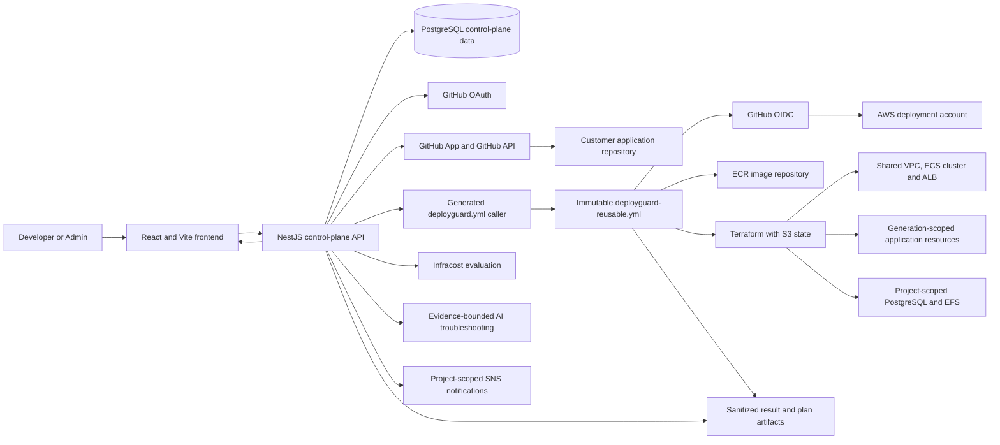
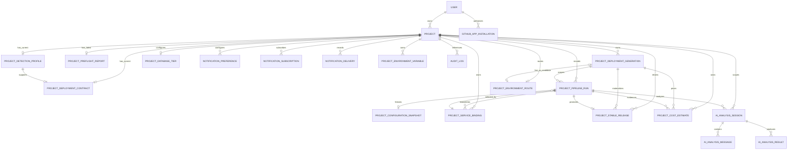
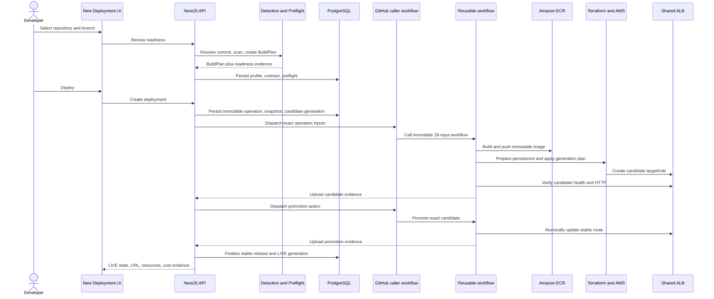
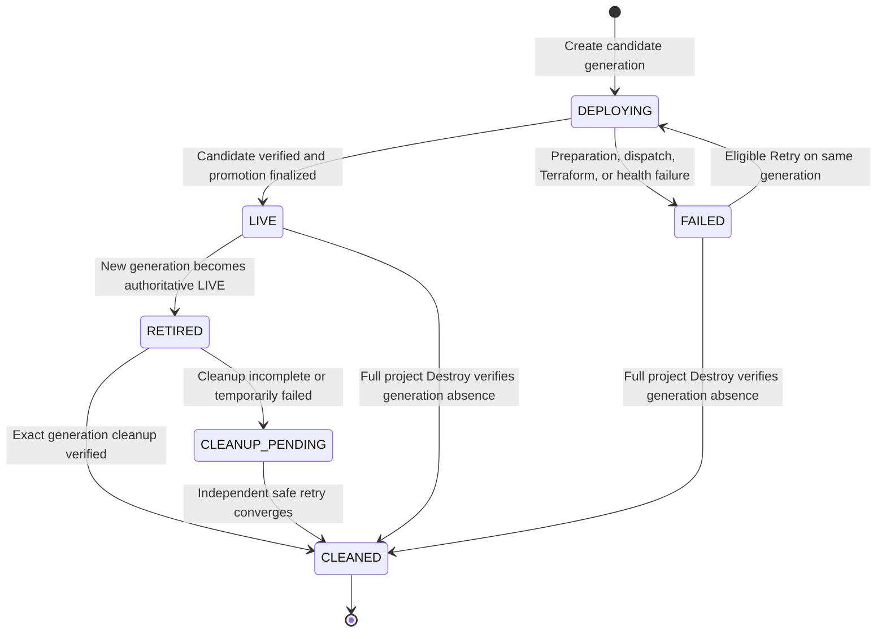
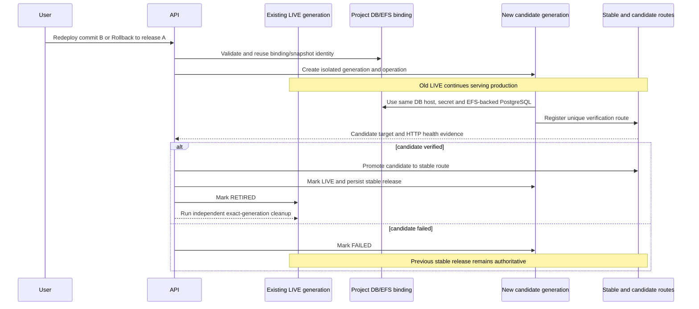
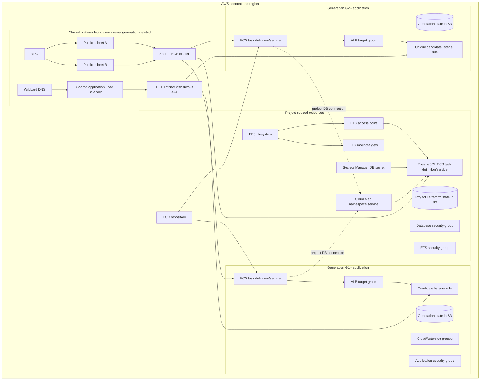
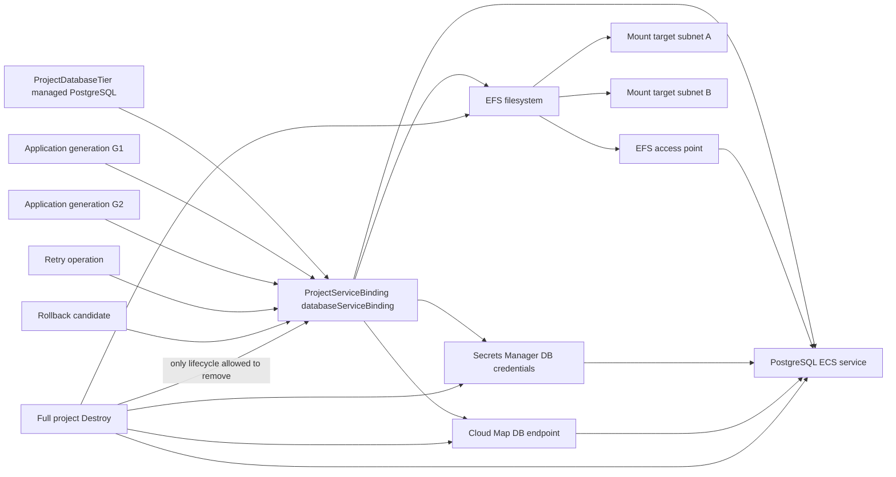
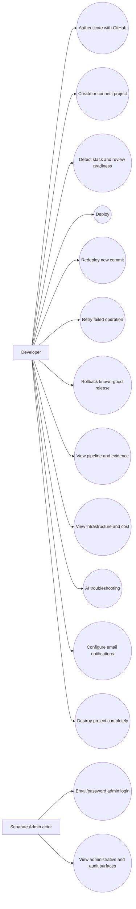

# DeployGuard Final Project Report

**Report date:** 14 August 2026  
**Inspected platform revision:** active tracked source in `Deploy-Guard-dev` (including the current working tree)  
**Control-plane runtime:** Node.js 22  
**Active reusable-workflow pin:** `59b1446c20efd095ebce3ba1e9a23dd9991165f7`

## Evidence and status conventions

This report describes the executable source, active configuration, database migrations, generated Terraform, and GitHub workflow currently used by DeployGuard. ZIP files, extracted duplicates, design proposals, and retired execution paths were excluded. Historical modules are mentioned only when their presence could otherwise cause confusion.

The following terms are used deliberately:

- **Implemented** — present and reachable in the current application or reusable workflow.
- **Locally/test-verified** — covered by current verification scripts, builds, contract checks, or deterministic local tests.
- **Live-verified** — observed in completed GitHub Actions/AWS-backed runs, not inferred from source alone.
- **External/certification limitation** — dependent on provider configuration, a fresh external run, or evidence that is not presently retained locally.

The local PostgreSQL database inspected for this report contains no current project rows. That is consistent with completed project-extinction exercises, but means the report uses GitHub run history and previously captured operation evidence for live verification. It does not claim that a customer application is running at the report date.

## 1. Project overview and problem statement

DeployGuard is a compact platform-as-a-service control plane for turning supported GitHub repositories into repeatable AWS deployments. It addresses several problems that are easy to underestimate in a deployment product:

- application repositories express frameworks, commands, ports, environment variables, and persistence needs differently;
- a deployment must use an immutable repository revision and an exact, reviewable BuildPlan;
- a failed candidate must not replace a healthy production release;
- retries and rollbacks must preserve operation lineage rather than mutate history;
- application generations must not collide through ALB rules, Terraform state, AWS names, secrets, or stale database records;
- project-scoped PostgreSQL/EFS persistence must survive application release changes;
- Destroy must prove exact-scope cleanup without deleting shared platform infrastructure;
- status, cost, and troubleshooting views must be based on persisted evidence rather than optimistic UI state.

The current solution is a React control-plane UI, a NestJS API backed by PostgreSQL, a GitHub App for repository integration, a generated customer-repository caller workflow, and one immutable reusable workflow that performs the AWS deployment lifecycle through GitHub OIDC.

## 2. Objectives and scope

The active product aims to provide:

1. GitHub authentication and repository/branch selection.
2. deterministic JavaScript or Python repository analysis;
3. an authoritative BuildPlan and readiness gate;
4. immutable Deploy, Redeploy, Retry, and Rollback operations;
5. candidate-first, health-verified production promotion;
6. generation-isolated application infrastructure;
7. project-scoped, DeployGuard-managed PostgreSQL and EFS;
8. exact-scope Terraform state and AWS ownership validation;
9. evidence-backed pipeline, infrastructure, cost, and troubleshooting views;
10. project-scoped email notifications through SNS;
11. a separate database-authenticated administrator surface; and
12. verified project extinction on Destroy while preserving shared foundations.

The platform deliberately does **not** attempt to be a universal build system, a Kubernetes platform, a customer-supplied database broker, or a general-purpose AWS cleanup tool. The supported detector/runtime contract currently targets mainstream JavaScript and Python web applications.

## 3. Functional and non-functional requirements

### Functional requirements

- Analyze a selected repository, branch, and resolved commit without reusing a stale branch contract.
- Persist a BuildPlan containing detector evidence, application root, commands, runtime, port, health path, environment ownership, and generated-container strategy.
- Block dispatch when readiness, GitHub workflow compatibility, AWS capabilities, immutable runtime configuration, or required managed persistence is invalid.
- Create an immutable operation and candidate generation before dispatch.
- Build and push a commit/operation-specific container image.
- provision only exact project- and generation-owned resources;
- verify candidate ECS, target health, image identity, and HTTP health before promotion;
- atomically update the stable ALB route and then persist the authoritative stable release;
- keep the old LIVE generation serving during a failed Redeploy or Rollback;
- retry with a new operation ID and immutable lineage;
- reuse project-scoped database/EFS bindings across application generations;
- clean retired application generations independently;
- on Destroy, remove every verified project-owned AWS/state/runtime artifact and then delete the project graph from PostgreSQL;
- ingest pipeline, cost, runtime, and failure evidence for the UI.

### Non-functional requirements

- **Isolation:** ownership is scoped by `projectId`, canonical environment, and—where application resources are concerned—`generationId`.
- **Immutability:** commits, BuildPlans, configuration snapshots, workflow references, operation IDs, and release evidence are fixed per operation.
- **Availability:** candidate failure does not replace the authoritative stable route.
- **Idempotency:** preparation, adoption, retry, cleanup, and Destroy treat already-absent exact-owned resources as converged while failing closed on ambiguous ownership.
- **Least privilege:** GitHub Actions uses OIDC and a capability contract; shared VPC, subnets, ECS cluster, and ALB are supplied foundations, not generation deletion targets.
- **Evidence safety:** displayed logs and AI inputs are sanitized, bounded, and scoped to an exact operation.
- **Secret safety:** secret values are encrypted or referenced; they are not placed in BuildPlans, caller inputs, result artifacts, or sanitized evidence.
- **Reproducibility:** Terraform state keys, container identities, configuration fingerprints, and reusable-workflow pins are deterministic.
- **Operability:** product startup, migrations, builds, readiness checks, and focused verification scripts are exposed as repository commands.

## 4. Current technology stack

| Layer | Current implementation |
|---|---|
| Runtime | Node.js `>=22 <23` across root, backend, frontend, local startup, and CI declarations |
| Frontend | React 18, React Router 7, Vite 8, JavaScript/JSX |
| Backend | NestJS 11, TypeScript, Express adapter, `@nestjs/config` 4 |
| Persistence | PostgreSQL, TypeORM 0.3, ordered TypeORM migrations |
| Repository integration | GitHub OAuth for users; GitHub App installation tokens for repository writes/API access |
| Delivery | generated caller workflow plus immutable reusable GitHub Actions workflow |
| AWS authorization | GitHub OIDC role assumption and `deployguard.workflow-aws/v2` capability admission |
| Infrastructure | generated Terraform, remote S3 state, AWS provider |
| Runtime | Docker images in ECR, ECS Fargate services, shared ALB routing |
| Managed database | PostgreSQL 16 on ECS Fargate with Secrets Manager, Cloud Map, and encrypted EFS |
| Cost | Infracost against authoritative candidate Terraform plan JSON, persisted as `ProjectCostEstimate` |
| AI | Gemini-backed evidence-bounded troubleshooting with deterministic safe fallback |
| Notifications | project-scoped SNS topic and email subscription/delivery records |
| Local product | Docker Compose PostgreSQL, Nest backend on port 5000, Vite production preview on port 5173 |

Redis/BullMQ source and older worker-era modules remain in the repository for historical compatibility, but they are not part of the supported current startup or active GitHub Actions deployment path.

## 5. Complete active system architecture

The control plane owns analysis, contracts, admission, persistence of lifecycle state, dispatch, reconciliation, evidence ingestion, and presentation. GitHub Actions owns mutable deployment execution. AWS contains a deliberately shared network/routing foundation, project-scoped persistence, and generation-scoped application resources.



The active NestJS graph imports `AuthModule`, `UsersModule`, `AdminModule`, `AuditLogModule`, `ProjectsModule`, `TerraformExportModule`, `AiTroubleshootingModule`, and the health controller. `ProjectsModule` composes the GitHub, analysis, configuration, lifecycle, current-state, database reconciliation, cost-evidence, deletion, notification, and read-only AWS evidence services.

## 6. Frontend architecture and main user flows

The React application separates the public/authentication surfaces, the developer workspace, and the administrator console.

- `/` provides the signed-out landing experience and GitHub login entry.
- `/auth/github` starts developer authentication.
- `/admin/login` is a separate email/password entry; Admin is not shown in the signed-in GitHub developer sidebar.
- `/projects` lists the authenticated developer's projects.
- `/deploy` implements repository selection, branch selection, analysis, readiness review, managed database preparation, and Deploy submission.
- `/projects/:id` shows authoritative runtime state and the latest operation separately.
- `/pipeline` shows immutable attempt history, stages, evidence, retry, and rollback actions.
- `/infrastructure` shows verified AWS inventory, stable application endpoint, Terraform portability, and cost evidence.
- `/settings` manages environment configuration, managed database state, notifications, and Destroy.
- `/troubleshooting` analyzes an eligible failed operation only.
- `/monitoring` has a frontend presentation route, but live metric APIs are not part of the active backend module graph; this is a current limitation, not a fully certified feature.

Branch or repository changes invalidate the previous readiness state immediately. Review Readiness performs analysis for the current `{repositoryFullName, branch, commitSha}` identity; stale asynchronous responses are ignored.

## 7. Backend modules and responsibilities

| Active boundary | Responsibility |
|---|---|
| `AuthModule` | GitHub OAuth sessions, separate admin authentication, guards |
| `UsersModule` | user persistence and roles |
| `AdminModule` | separate administrative summaries and controls |
| `AuditLogModule` | security- and lifecycle-relevant activity records |
| `ProjectsModule` | project CRUD, repository analysis, readiness, GitHub App, deployment lifecycle, generations, stable releases, managed DB reconciliation, cost evidence, notifications, deletion |
| `InfrastructureModule` | current managed `databaseServiceBinding` configuration boundary; legacy infrastructure execution is not authoritative |
| `TerraformExportModule` | short-lived sanitized Terraform source export, excluding state, plans, credentials, and real tfvars |
| `AiTroubleshootingModule` | provider status, evidence-bounded failure analysis, follow-up sessions |
| `HealthController` | API and database readiness |

The central active lifecycle services are `GithubActionsDeploymentService`, `DeploymentGenerationService`, `GithubActionsOperationContract`, `GithubActionsWorkflowCompatibilityService`, `GithubActionsCapabilityService`, `ManagedDatabaseReconciliationService`, `ProjectCurrentStateService`, `GithubActionsCostEvidenceService`, and `ProjectDeletionService`.

Older `OrchestrationModule`, `StateManagementModule`, `StorageModule`, `FinopsModule`, `ObservabilityModule`, and BullMQ worker sources are not imported into the active application graph. Their tables may remain readable for historical migrations, but they do not supersede GitHub Actions or the current project services.

## 8. Database/domain model

The authoritative operational model is project-centred. Some lineage fields such as `retryOfOperationId` and `candidateWorkflowRunId` are stored in JSON metadata rather than relational foreign keys; Mermaid cannot express those JSON constraints, so dashed conceptual links are described below the diagram.



Important constraints include unique generation ordinals per project/environment, one LIVE and one DEPLOYING generation per project/environment, a unique candidate listener priority, a stable project/environment route, explicit UUID generation for deployment generations, one current detection/contract boundary, and one authoritative stable release per project/environment.

`ProjectPipelineRun` is the immutable attempt record. It stores commit, branch, generation, status/stage, workflow run IDs, configuration snapshot identity, database binding identity, and metadata such as action, retry lineage, candidate run, promotion run, immutable runtime configuration, and sanitized result evidence.

The schema is migration-owned rather than synchronized automatically in production. The current lifecycle is consolidated by the recent ordered migrations: `AuthoritativeBuildPlan`, `DeploymentGenerations`, `RepairGenerationScopedStableReleaseIndex`, `GenerationResidueIsolation`, `ProjectExtinctionCascade`, `ValidateProjectExtinctionOwnership`, `PersistentDestroyLifecycle`, `NoConflictGenerationArchitecture`, `RemoveAbsoluteDestroyLifecycle`, and `GenerationCandidateRoutingPriority`. These migrations preserve historical IDs while adding current constraints, cascade behavior, explicit UUID/default consistency, project-scoped persistence, generation isolation, and collision-free candidate routing. Clean-schema verification is part of the backend regression surface.

## 9. GitHub App and GitHub Actions architecture

DeployGuard uses two cooperating workflows:

1. **Customer caller workflow:** `GithubAppService` creates or updates `.github/workflows/deployguard.yml` in the selected application repository. It accepts a bounded `workflow_dispatch` contract, uses `contents: read` and `id-token: write`, and calls the platform workflow at an immutable 40-character SHA.
2. **Platform reusable workflow:** `.github/workflows/deployguard-reusable.yml`, contract `deployguard.workflow-call/v2`, receives exactly 28 canonical inputs and performs the delivery operation.

The 28 inputs are `deployment_action`, `deployment_operation_id`, `project_id`, `environment_name`, `repository_full_name`, `repository_branch`, `detection_profile_version`, `deployment_contract_version`, `build_plan_base64`, `image_tag`, `environment_references_base64`, `infrastructure_namespace`, `aws_region`, `aws_role_arn`, `vpc_id`, `public_subnet_ids`, `commit_sha`, `application_root`, `app_port`, `health_check_path`, `terraform_state_bucket`, `container_profile`, `output_directory`, `generated_dockerfile_base64`, `build_time_public_config_base64`, `rollback_source_operation_id`, `rollback_image_uri`, and `rollback_task_definition_arn`.

The active reference is:

```text
Hassan-Sajjad72/Deploy-Guard-dev/.github/workflows/deployguard-reusable.yml@59b1446c20efd095ebce3ba1e9a23dd9991165f7
```

The backend validates the remote exact-pin workflow and contract before dispatch. Dispatch correlation uses an immutable operation ID and accepts GitHub's run identity without selecting an unrelated run. Candidate, promotion, maintenance cleanup, and Destroy are distinct persisted actions/runs even though they share the same reusable workflow.

## 10. BuildPlan and immutable deployment contract

`BuildPlan` version 1 and detector profile `mainstream-detectors-v3` are the authority for application runtime behavior. Repository identity includes full name, selected branch, and resolved commit SHA. A contract lacking the current BuildPlan is invalidated with the explicit migration message: **“Repository analysis changed. Run Detect Stack again before deploying.”**

The plan records:

- detector ID, framework, deployment mode, confidence, and evidence;
- application/install roots and manifest paths;
- package manager and lockfile evidence;
- runtime family/version and digest-aware base image choices;
- install, build, start, and health commands;
- output directory, port, health path, and binding behavior;
- operating-system package requirements;
- generated Dockerfile strategy and template version;
- public build-time variables, runtime variables, and secret variables;
- configuration ownership and required-input rules;
- warnings and blockers.

Supported detector families include Vite React, Create React App/React, Vue/Nuxt, Angular, SvelteKit, Astro, Remix, Next.js, Express, NestJS, Fastify, Flask, FastAPI, Django, and Streamlit. Repository scanning can select a deployable nested application root. It does not force customer applications to Node 22: customer runtime versions come from the authoritative BuildPlan.

Before dispatch, the backend freezes an immutable runtime configuration and configuration snapshot. Retry inherits the failed operation's commit and compatible snapshot; Rollback inherits the selected known-good release evidence. Promotion rejects candidate evidence whose generation, snapshot, binding, image, task definition, or route identity does not match the operation.

## 11. Deploy, Redeploy, Retry, Rollback and Destroy lifecycle

### Deploy and Redeploy

A normal Deploy creates a new immutable operation and candidate application generation. If a LIVE generation already exists, it remains authoritative and serves traffic. The candidate receives its own Terraform state and collision-free ALB verification priority, but reuses valid project persistence. Only after candidate health and exact image evidence pass does a separate promotion action update the stable listener rule. Backend result ingestion then persists the new stable release, marks the new generation LIVE, retires the old generation, and schedules independent cleanup.

### Retry

Retry creates a new operation ID and records `retryOfOperationId`. It preserves the failed operation's action, commit, generation, configuration snapshot, database binding, and immutable runtime context. Retry of an operation belonging to a retired or deleted generation is rejected. A failed Destroy retry remains Destroy; it does not enter normal application build/release behavior.

### Rollback

Rollback selects a known-good stable release from the current project/environment lineage. It creates a new candidate generation, uses the target release's immutable image/task-definition and configuration/database-binding identities, and does not rebuild or alter persistence. The existing LIVE release remains authoritative until the rollback candidate passes health verification and promotion. A failed rollback leaves the previous LIVE release unchanged. Cross-project, cross-environment, or invalid retired-lineage targets are rejected.

### Destroy

Destroy receives an immutable deletion context. The workflow initializes exact Terraform states, skips resources already managed in state, imports only exact-owned missing state when required, destroys all recorded application generations, destroys project-scoped persistence, deletes exact project-owned ECR/runtime artifacts, removes every version/delete-marker/lock artifact for the relevant state keys, and verifies absence. Shared VPC, subnets, ECS cluster, ALB, and listener are explicitly outside the deletion scope.

Only a matching `deployguard.destroy-result/v2` result with `project_delete_ready` and all exact-scope booleans true allows `ProjectDeletionService` to remove SNS resources, remove the managed customer caller when it is not shared, delete project-related audit records, and delete the project row. Database foreign-key cascades remove the owned graph. Until then, the failed Destroy and project remain available for safe retry.



## 12. Generation isolation and LIVE/RETIRED/CLEANUP_PENDING behavior

Each application generation has an immutable UUID, ordinal, state key, candidate route identity, ownership tags, manifest, and lifecycle status. Project persistence is deliberately outside the application generation and therefore is not replaced merely because a commit changes.



There can be one authoritative LIVE generation and one DEPLOYING candidate for a project/environment. A failed candidate is marked FAILED and the route's `candidateGenerationId` is cleared using the persisted operation identity. A failed new candidate never overwrites the live release projection.

Retired cleanup is non-blocking: it runs as an internal maintenance operation after promotion. Failure yields `CLEANUP_PENDING`, which may be safely retried without blocking a later Redeploy. The cleanup contract forbids shared platform deletion and project-persistence deletion.



## 13. AWS architecture

DeployGuard uses a shared foundation plus two ownership scopes.



Shared-foundation identifiers—VPC, public subnets, ECS cluster, ALB, listener, routing domain, and Terraform bucket—come from validated platform configuration. Generation resources carry `ManagedBy`, project, environment, and generation ownership metadata. Project persistence carries project/environment scope and must not be selected by generation cleanup.

## 14. Managed PostgreSQL architecture

When analysis proves PostgreSQL is required, readiness enables the DeployGuard-managed database tier. The external database option is rejected by the active service. The backend persists the project database tier and reconciles an authoritative project-scoped `databaseServiceBinding`; the workflow materializes the persistence stack before the application generation.

The stack includes:

- PostgreSQL 16 running as a dedicated ECS Fargate service/task definition;
- generated password and connection URL in Secrets Manager;
- database and EFS security groups;
- Cloud Map private namespace and database service discovery;
- encrypted EFS, mount targets in the shared subnets, and an access point;
- task/execution IAM roles scoped to the database runtime;
- a project-scoped CloudWatch log group;
- project-persistence Terraform state independent of application generations.

DeployGuard owns and injects `DB_HOST`, `DB_PORT`, `DB_NAME`, `DB_USER`, and `DB_PASSWORD`. User-supplied aliases cannot override the managed values. The application BuildPlan remains responsible for declaring that those values are needed, while the binding and immutable runtime snapshot provide their authoritative identities.

## 15. EFS persistence lifecycle and `databaseServiceBinding`

EFS stores the PostgreSQL data directory, not the application release. A successful binding records verified filesystem, access-point, service-discovery, database service, secret, and fingerprint evidence. Its `generationId` is null/project-scoped in the active architecture, preventing an old application generation from owning the database.



Deploy, Redeploy, eligible Retry, and Rollback validate and reuse the same project persistence. A commit change alone cannot recreate or rebind it. Missing data for a genuinely established persistent generation fails closed and requires a verified recovery source or explicit reset flow; stale secrets or historical failed attempts alone do not prove that persistent data ever existed.

Full project Destroy removes persistence only after exact ownership validation. Partial cleanup remains retryable; successful application-generation cleanup never removes EFS or database resources.

## 16. Terraform state architecture

There are two active state namespaces:

- project persistence: `projects/<projectId>/<environment>/project/terraform.tfstate`;
- application generation: `projects/<projectId>/<environment>/<generationId>/terraform.tfstate`.

Terraform initializes against an encrypted S3 backend. Preparation first asks whether each adoptable Terraform address is already present in initialized state. Already-managed addresses are skipped. Only an exact-owned remote object absent from state may be imported; foreign generation/project resources are rejected. No valid managed object is removed from state merely to re-import it.

Plans are checked for forbidden CREATE/IMPORT/REPLACE actions where an operation requires deletion-only behavior, and ownership evidence is read from Terraform state and AWS tags. Destroy removes current objects, legacy exact-project keys, lock objects, all S3 object versions, and delete markers. Absence verification is required; deletion of the current object alone is insufficient.

The generated EFS creation token is a deterministic generation/project-scope-safe short value within AWS's 64-character limit, while full IDs remain in Terraform variables, state paths, tags, and ownership metadata.

## 17. Docker, ECR, build, and security scanning

Repository analysis either validates an existing Dockerfile against the BuildPlan or selects a versioned generated Dockerfile template. JavaScript and Python templates use BuildPlan-derived install/build/start commands, runtime versions, port, health path, application root, and output directory. Build-time inputs are restricted to explicitly public framework-prefixed values; secrets are runtime references.

The reusable workflow checks out the immutable commit, materializes the immutable container contract, builds the image, pushes it to a project-scoped ECR repository, and verifies the resulting digest/URI. Task definitions and stable releases retain exact image evidence, so promotion and rollback cannot silently select a moving image.

Current security controls include repository deployability scanning, BuildPlan/preflight blockers, Dockerfile parity checks, secret-boundary checks, OIDC, least-privilege admission, exact ownership tags, sanitized artifacts, and immutable image evidence.

**Current limitation:** the active reusable workflow does not run Trivy or another container vulnerability scanner, and the ECR repository is currently created with scan-on-push disabled. Security scan entities and a Trivy-oriented historical worker path exist in source but are not reachable from the active GitHub Actions architecture. Therefore container vulnerability scanning is not certified as an active feature.

## 18. Infracost/FinOps flow

The candidate workflow uploads the authoritative plan inputs at exact artifact paths:

- `terraform/deployguard-cost-plan.json` for generation resources;
- `project-terraform/deployguard-project-cost-plan.json` for project persistence.

After promotion, `GithubActionsCostEvidenceService` reads artifacts from `metadata.candidateWorkflowRunId`, not from the promotion run. The backend invokes Infracost for both available plans, normalizes resource breakdowns, sums the monthly estimate, and persists a `ProjectCostEstimate` linked to project, generation, and operation. Current-state projects the evidence as `estimated`, and the Infrastructure UI displays the total and resource breakdown. Existing deployments are deliberately not backfilled.

**Live verification:** the React Pomodoro operation `31b0da8e-39e4-4c69-844c-b0388ef5e504` used candidate run `31720283326` and promotion run `31720566990`; candidate artifacts were ingested and persisted as an estimated **USD 36.04/month** with a three-item resource breakdown. This proves the corrected generation-only cost path. Smart Retail's earlier missing cost evidence predated the candidate-run ingestion fix; no backfill is claimed.

Cost remains an estimate, not billing truth. Accuracy depends on the installed/configured Infracost binary/API access and on resources represented in the exact Terraform plan.

## 19. AI troubleshooting flow and evidence-safety rules

The troubleshooting controller accepts an exact failed pipeline-run identity. Eligibility requires that the operation belongs to the selected project, is failed, has a GitHub workflow-run identity, and has non-empty sanitized evidence. Operations without sufficient evidence must not appear as valid analysis targets.

The evidence service scopes every record by `projectId` and `pipelineRunId`; it includes sanitized error/log fragments and immutable operation metadata. The preprocessor strips ANSI/control characters and known environment values, deduplicates, bounds evidence by source and total size, and assigns reference IDs. The Gemini system prompt requires evidence citations, forbids invented AWS/GitHub facts, and returns a validated JSON schema. Follow-ups stay within the session's stored evidence. Rate limits apply to analysis and follow-up calls.

Provider availability is checked lazily at the status endpoint, with a bounded timeout and a short cache, so startup does not call the external AI provider. A configured-provider failure can fall back to deterministic evidence-only guidance; an unconfigured provider fails clearly rather than pretending a live model answer exists.

Pre-built questions cover the first error, safe retry, configuration vs application causes, evidence gaps, and likely remediation.

**Verification status:** evidence isolation, sanitization, schema validation, timeouts, caching, eligibility, and deterministic fallback are locally/test-verified. No retained current database session proves a fresh real Gemini response at the report date, so live external-provider operation remains a certification limitation.

## 20. Authentication, RBAC, audit, and security controls

- Developers authenticate with GitHub OAuth and use GitHub App installations for repository authorization.
- GitHub App installation tokens are short-lived and repository-scoped; the app, not a stored user PAT, creates the managed caller.
- Workflow AWS access uses GitHub OIDC and an exact role/capability contract.
- Administrators use a separate database email/password login. A migration separates legacy GitHub administrators, and the developer sidebar does not expose Admin.
- Roles are `admin`, `developer`, and `readonly`; project ownership and guards restrict mutations.
- Global authentication middleware, Helmet, configured CORS, DTO validation, and rate limiting protect API boundaries.
- environment values are encrypted at rest; secret values are represented by references in immutable snapshots and are materialized through AWS Secrets Manager.
- sensitive logs and AI evidence are sanitized and bounded.
- lifecycle/configuration/notification/admin events are recorded in audit logs while the project exists.
- workflow capability admission enumerates required ECS, ELBv2, ECR, CloudWatch Logs, S3 state, IAM PassRole, Secrets Manager, EFS, Cloud Map, and required EC2/Route53 reads. Shared VPC/ALB/cluster deletion remains outside generation authority.

Project extinction deliberately removes project-related audit history once exact AWS deletion has been verified; this matches the current product contract but differs from compliance systems that retain immutable audit tombstones.

## 21. Failure handling, zero-downtime behavior, and recovery

The two-phase delivery design separates candidate preparation from production promotion.

- An original LIVE generation remains authoritative while a Redeploy or Rollback candidate builds, provisions, and passes health checks.
- Candidate route priorities are generation-specific, preventing residue from a previous candidate from colliding with a later Redeploy.
- If candidate preparation, Terraform, dispatch, or health verification fails, the exact candidate becomes FAILED and the stable route is unchanged.
- If promotion changes routing but authoritative finalization fails, compensation restores the previous stable target group—or removes the route for a first release—and records bounded reconciliation evidence.
- Stable release finalization verifies configuration snapshot, database binding, generation, operation, image, task definition, and routing identities before committing LIVE.
- deterministic invalid-contract failures are terminalized/bounded instead of being thrown every reconciliation sweep indefinitely.
- Retry creates history rather than rewriting the failed operation.
- retired cleanup is independent and may remain `CLEANUP_PENDING` without corrupting the active release.
- Destroy is deletion-only and idempotent: exact already-absent resources count as success; real failures remain retryable; ambiguous/foreign ownership fails closed.
- current-state separates authoritative runtime health/release from the latest operation. A failed Deploy, Redeploy, Rollback, or Destroy can be shown alongside a healthy LIVE release instead of marking the application itself dead.

## 22. Monitoring and observability

The active product provides operational observability through:

- GitHub Actions workflow/job/step status and timestamps;
- persisted operation stages, outcomes, safe failure evidence, and run links;
- current-state reconciliation freshness and source;
- read-only AWS evidence for ECS desired/running/pending counts, ALB target health, ECR image identity, region, and Terraform-state identity;
- health/readiness endpoints for the control plane and database;
- structured NestJS logs and audit records;
- notification delivery history;
- stable URL and production HTTP verification evidence.

The frontend's pipeline and infrastructure pages use the GitHub Actions/current-state evidence model, not the retired worker projection. The Monitoring route is conditionally presented for LIVE projects, and current-state can mark Prometheus available when configured. However, `ObservabilityModule` is not imported by the active `AppModule`; a complete live metrics/log-query backend is therefore not certified. This is the primary observability gap.

## 23. Important API/backend flows

### Repository to readiness

`NewProject.jsx` → repository/branch APIs → GitHub App repository reader → deployability scanner → mainstream detector resolver → stack detection → BuildPlan contract → preflight/configuration ownership → optional managed database configuration → readiness response.

### Deploy or Redeploy

UI action → project deployment controller → readiness and capability gates → active/live route lookup → configuration snapshot and database-binding reconciliation → candidate generation → immutable operation persistence → managed caller creation/validation → GitHub dispatch → bounded run discovery → result reconciliation → promotion dispatch → stable release finalization → cost evidence capture → retired cleanup.

### Retry

Pipeline/Overview generic retry action → existing retry endpoint → eligibility check → new `ProjectPipelineRun` with `retryOfOperationId` → inherited immutable context and action → dispatch. The original attempt remains terminal.

### Rollback

Pipeline release selection → rollback endpoint → known-good same-project/environment release validation → new candidate generation and operation → persisted target snapshot/binding/image/task-definition evidence → candidate verification → promotion/compensation → stable release finalization.

### Current state

Project endpoint → `ProjectCurrentStateService` → current profile/preflight plus latest non-maintenance GitHub operation → authoritative LIVE generation and stable release → optional read-only AWS evidence → cost evidence → `stateAuthority`, `latestAttempt`, `stableRelease`, infrastructure, health, and UI action projection.

### Destroy and extinction

Settings Destroy → immutable Destroy operation → reusable deletion workflow → verified `deployguard.destroy-result/v2` ingestion → `ProjectDeletionService.assertReady` → SNS cleanup → managed caller cleanup when unshared → project/audit deletion transaction → cascading PostgreSQL deletion → future project requests return not found.

## 24. Testing strategy

The repository uses focused executable verification scripts rather than a single unit-test framework. The active backend command surface includes checks for:

- stack detection, mainstream detectors, repository certification, BuildPlan, branch contracts, and deployability preflight;
- authentication, operator/admin segregation, automation controls, configuration ownership, reserved environment boundaries, and manifest secret safety;
- generated JavaScript/Python runtime smoke tests and Docker templates;
- workflow contract, dispatch, immutable release, AWS capability, state lock, Terraform reconciliation, and exact Destroy behavior;
- current-state, runtime configuration, retry/Destroy semantics, two-phase promotion, live-project Redeploy, reachable Rollback, candidate failure, stable-release ingestion, generation UUIDs, generation lifecycle, recovery baseline, and managed database reconciliation;
- Infracost evidence and AI troubleshooting;
- migrations against a clean PostgreSQL schema.

Frontend verification scripts cover application surfaces, operator segregation, current-state presentation, deploy journey, managed environment, unified lifecycle, pipeline recovery, infrastructure presentation, Destroy wording, overview lifecycle, retry UI, and time/freshness behavior.

Production compilation is validated separately with backend and frontend builds. `npm run product:verify` checks the integrated local surface: frontend reachability, CORS, API/database readiness, GitHub OAuth entry, anonymous access rejection, and retired public credential endpoints. Live GitHub/AWS canaries supplement rather than replace deterministic local tests.

Tests are strongest around contracts and lifecycle invariants. They do not substitute for periodic external certification of IAM policies, GitHub API behavior, AWS quotas, DNS, provider outages, Infracost pricing/API availability, SNS email confirmation, or Gemini responses.

## 25. Live-verified scenarios and results

The following recent GitHub run evidence was inspected directly:

| Scenario | Live evidence | Result |
|---|---|---|
| React fresh/update candidates | `31696800968`, `31698816334`, `31699340702`, `31720283326` | Build/ECR, persistence preparation, generation Terraform, candidate ALB/ECS health, and result upload succeeded |
| React promotions | `31697023735`, `31699067585`, `31699548916`, `31720566990` | exact verified candidate promotion and result upload succeeded |
| React rollback | candidate `31702099781`, promotion `31702236722` | reused known-good image path without build; candidate health and promotion succeeded |
| React retired cleanup | `31720639357` and earlier cleanup runs | independent exact-generation cleanup succeeded |
| React project Destroy | `31724410625` | all recorded generations, project persistence, runtime artifacts, state artifacts, and exact deletion verification succeeded |
| Smart Retail managed DB fresh Deploy | candidate `31717610945`, promotion `31718285513` | project persistence preparation, application candidate health, and promotion succeeded |
| Smart Retail Redeploy with DB reuse | candidate `31727533147`, promotion `31727980929` | Redeploy succeeded using the authoritative existing project binding/EFS rather than recreating persistence |
| Smart Retail retired cleanup | `31728052082`, `31728566153` | cleanup ran independently after LIVE promotion |
| Smart Retail project Destroy | `31729059057` | exact project/generation/persistence deletion sequence and deletion verification succeeded |
| React Infracost | operation `31b0da8e-39e4-4c69-844c-b0388ef5e504` | candidate artifact ingestion persisted USD 36.04/month and three breakdown entries |

The sequence of multiple React candidate and promotion pairs at commits `33d434cbc6c9`, `0f9d6ba01cad`, and `a4648e38770b` proves repeated release generation and stable cutover. Failed runs also occurred during development; the current architecture and regression suite specifically verify that such candidate failures do not replace an existing healthy stable release. Because the final local database has been extinguished, attempt-level failed-isolation records are no longer present for a fresh query; this item is live-observed historically and locally regression-verified rather than re-certified from current rows.

Smart Retail's managed database evidence previously recorded an authoritative binding, EFS filesystem `fs-075931b9fb6ce7e73`, and access point `fsap-0187e7e93554e2800`. The successful later Redeploy reused the project binding across a new application generation. The final successful Destroy means those identifiers must now be treated as historical deletion evidence, not active resources.

## 26. Current limitations and remaining work

1. **Active container vulnerability scanning:** the current workflow does not execute Trivy and ECR scan-on-push is disabled. Add a fail-closed, artifact-producing scan stage if production certification requires it.
2. **Full monitoring backend:** the frontend and current-state abstractions exist, but the legacy observability module is not active. Integrate an evidence-authoritative metrics/log service before advertising full monitoring.
3. **AI live-provider certification:** local evidence-safety tests pass, but no current retained project proves a fresh Gemini response. Run a controlled failed operation with sanitized evidence and certify the configured provider.
4. **Infracost breadth:** one current React path is live-proven. The generic two-plan implementation supports managed persistence, but a post-fix managed-PostgreSQL cost run should be retained as certification evidence. Existing releases are intentionally not backfilled.
5. **SNS confirmation:** implementation is project-scoped and handles pending/confirmed status, delivery records, and exact-owned topic deletion. A real email requires recipient confirmation and should be re-certified per deployment account/region.
6. **External reliability:** GitHub availability/rate limits, AWS service quotas, OIDC propagation, DNS propagation, email delivery, Infracost pricing, and AI provider availability remain external dependencies.
7. **Supported stacks:** deterministic JavaScript/Python mainstream detectors are implemented; arbitrary languages, unusual monorepos, private package registries, WebSockets, background worker topologies, and non-HTTP workloads require explicit new contracts rather than inference.
8. **Local startup scope:** PostgreSQL, backend, and frontend are the supported integrated local product. Redis/BullMQ is not an active requirement or startup component.
9. **Destructive audit retention:** full project Destroy intentionally removes project audit history and caller metadata. Environments with regulatory retention requirements would need an explicitly external, non-authoritative compliance archive.
10. **Current live inventory:** the inspected control-plane database is empty after extinction tests. A new end-to-end canary is required to certify the exact current environment as actively serving, although recent GitHub/AWS sequences demonstrate the workflow behavior.

## 27. Deployment, run, and setup overview

### Control-plane prerequisites

- Node.js 22;
- Docker/Compose for local PostgreSQL;
- configured PostgreSQL connection and encryption/session secrets;
- GitHub OAuth and GitHub App credentials/installation;
- immutable `DEPLOYGUARD_REUSABLE_WORKFLOW` reference;
- GitHub Actions AWS role and region;
- shared VPC and at least two public subnets;
- shared ECS cluster;
- shared ALB, HTTP listener with default 404, and wildcard DNS/routing domain;
- S3 Terraform-state bucket;
- optional configured Infracost, Gemini, SNS, and Prometheus values.

### Supported local workflow

```bash
npm run install:all
npm run product:start
npm run product:verify
```

`product:start` checks Node 22, starts/verifies PostgreSQL, runs migrations, builds both applications, starts the Nest backend, and serves the frontend production build. `product:verify` validates the integrated surface. Focused backend and frontend verification scripts should be run when their corresponding contract changes.

### Operator flow

1. Sign in with GitHub and install/authorize the GitHub App.
2. Select a repository and branch.
3. Review readiness; resolve only genuine BuildPlan/configuration blockers.
4. Enable the automatically selected managed PostgreSQL tier when required.
5. Deploy once and follow candidate/promotion evidence in Pipeline.
6. Use Infrastructure for exact AWS inventory, endpoint, Terraform export, and cost evidence.
7. Use Retry only for an eligible failed immutable operation; use Rollback only for a known-good release.
8. Configure and confirm project email notifications in Settings if required.
9. Use Destroy only when complete project extinction is intended. Retry a failed Destroy until exact cleanup verification succeeds; never infer success from Terraform alone.

## 28. Final architecture summary

DeployGuard's current architecture is an evidence-driven GitHub Actions PaaS rather than an in-process deployment worker. The NestJS control plane decides *what* may be deployed and persists immutable intent; the pinned reusable workflow performs *how* the candidate is built and applied; AWS evidence and signed operation identity decide whether it may become LIVE.

The architecture's central separation is:

- shared foundation: reusable networking, cluster, ALB, listener, and routing;
- project persistence: managed PostgreSQL, EFS, Secrets Manager, Cloud Map, ECR, and project state;
- application generation: ECS service/task definition, target group/rule, log groups, IAM, security group, and generation state;
- immutable operation/release evidence: BuildPlan, configuration snapshot, binding, commit, workflow runs, candidate result, promotion result, stable release, and cost.

That separation enables repeated Deploy/Redeploy, same-context Retry, known-good Rollback, candidate failure isolation, independent retired cleanup, and exact project Destroy without shared-platform deletion or cross-generation residue.



## Verified Project Status

| Capability | Final status | Basis |
|---|---|---|
| Fresh Deploy | **Live-verified** | successful React and Smart Retail candidate + promotion runs |
| Redeploy/new commit | **Live-verified** | multiple isolated React generations and Smart Retail Redeploy |
| Failed Redeploy isolation | **Implemented and regression-verified; historically live-observed** | current-state/runtime separation, candidate terminalization, compensation, prior failed runs; current extinct DB prevents fresh row-level replay |
| Retry | **Implemented and locally/test-verified; live retry history observed** | immutable new operation, retry lineage, same failed generation/context |
| Rollback | **Live-verified** | React rollback candidate `31702099781` and promotion `31702236722` |
| Generation isolation | **Live-verified** | repeated candidate/promotion/cleanup generations with independent state and route priorities |
| Retired cleanup | **Live-verified** | React and Smart Retail cleanup workflow runs |
| Destroy/project extinction | **Live-verified** | React `31724410625` and Smart Retail `31729059057` completed exact deletion workflows; local project DB is now empty |
| Managed PostgreSQL/EFS provisioning | **Live-verified** | Smart Retail fresh managed-persistence deployment |
| Managed PostgreSQL/EFS reuse | **Live-verified** | Smart Retail candidate `31727533147` and promotion `31727980929` reused the authoritative binding/EFS |
| Infracost | **Live-verified for a React generation; generic path locally verified** | USD 36.04/month candidate-plan evidence; no legacy backfill and no retained post-fix managed-DB cost proof |
| AI troubleshooting | **Locally/test-verified, not currently live-provider-certified** | evidence scoping/sanitization/schema/fallback tests; no retained fresh Gemini session |
| SNS email notifications | **Implemented and locally/test-verified; external confirmation required** | project-owned topics/subscriptions/delivery records and cleanup logic |
| Security scanning | **Preflight/contract security implemented; container CVE scanning not active** | active workflow has no Trivy step and ECR scan-on-push is disabled |
| Monitoring | **Pipeline/AWS health evidence implemented; full metrics backend incomplete** | GitHub/AWS/current-state views active; ObservabilityModule not active |

**Overall assessment:** DeployGuard's core repository-analysis, immutable GitHub Actions delivery, two-phase promotion, generation isolation, project-scoped managed persistence, recovery, cost ingestion, and verified Destroy lifecycle form a coherent working mini-PaaS. It is suitable for controlled supported-project use, subject to the explicitly listed external certifications and the container-scanning/monitoring gaps above.
