# DeployGuard complete architecture and improvement map

This document describes the repository as it operates now. It separates active production-path code from registered read models and from source that exists but is not composed into the current application.

Snapshot: 2026-08-10  
Control-plane runtime: Node.js 22, React/Vite, NestJS, PostgreSQL  
Deployment engine: GitHub Actions using an immutable reusable-workflow SHA  
Customer runtime: determined by each authoritative `BuildPlan`, not by the control-plane Node version

## Status legend

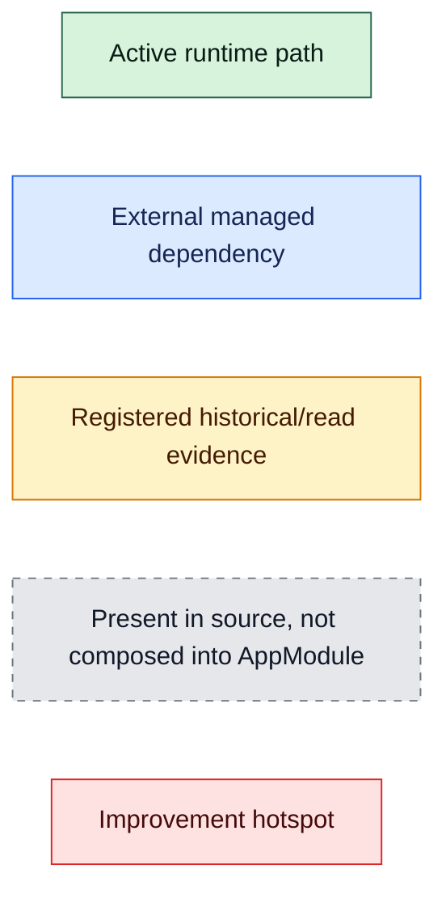

## 1. End-to-end system context

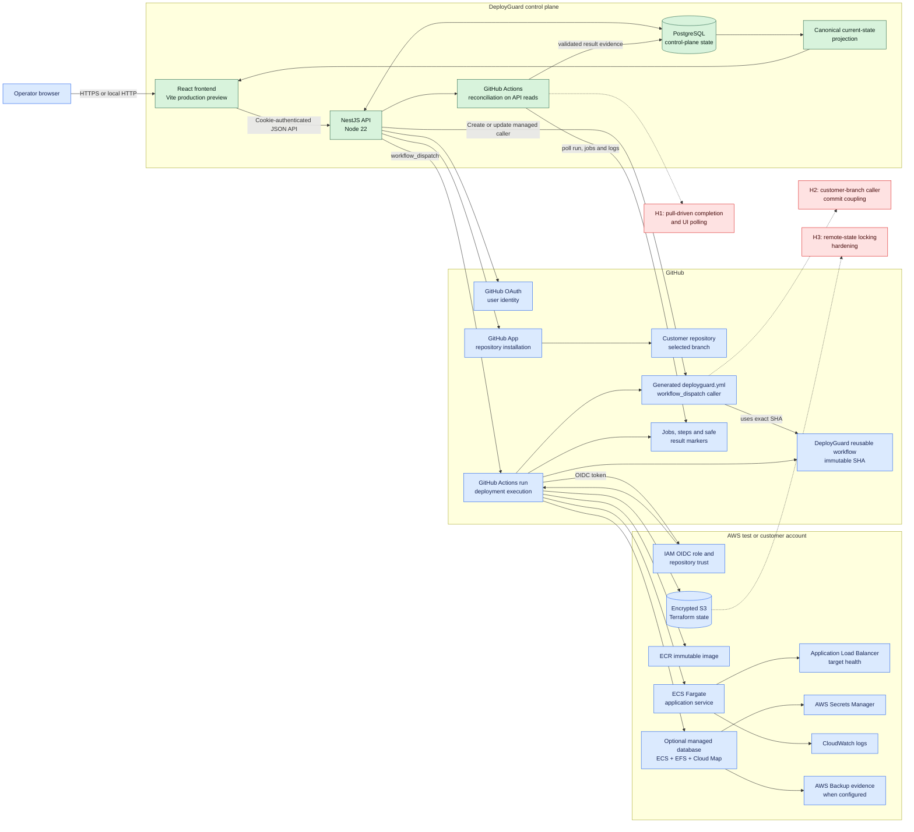

## 2. Local product startup and runtime composition

`npm run product:start` is the supported integrated local launcher.

```mermaid
flowchart TD
    Start[npm run product:start]:::active --> NodeGate{Exactly Node 22?}:::active
    NodeGate -->|No| Stop[Fail before startup]:::active
    NodeGate -->|Yes| Ports{Ports 5000 and 5173 free?}:::active
    Ports -->|No| Conflict[Fail with explicit conflict]:::active
    Ports -->|Yes| Compose[docker compose up -d postgres]:::active
    Compose --> Migration[Run TypeORM migrations]:::active
    Migration --> BackendBuild[Build NestJS backend]:::active
    BackendBuild --> FrontendBuild[Build React frontend]:::active
    FrontendBuild --> API[NestJS dist/src/main<br/>port 5000]:::active
    FrontendBuild --> Web[Vite preview<br/>127.0.0.1:5173]:::active
    API --> Ready[/api/health/ready]:::active
    Web --> WebReady[Frontend root response]:::active
    Ready --> ProductReady[Integrated product ready]:::active
    WebReady --> ProductReady
    Signal[Ctrl-C or SIGTERM]:::external --> Shutdown[Terminate child process groups]:::active
    Shutdown --> StopOwned[Stop only dependencies<br/>started by this launcher]:::active

    NoRedis[No Redis in active compose]:::readmodel
    NoWorker[No local BullMQ pipeline worker<br/>GitHub Actions is the active engine]:::readmodel
    Compose -.-> NoRedis
    API -.-> NoWorker

    H4[H4: add .nvmrc and .node-version<br/>to align interactive shells]:::hotspot
    NodeGate -.-> H4

    classDef active fill:#d8f3dc,stroke:#2d6a4f,color:#081c15
    classDef external fill:#dbeafe,stroke:#2563eb,color:#172554
    classDef readmodel fill:#fef3c7,stroke:#d97706,color:#451a03
    classDef hotspot fill:#fee2e2,stroke:#dc2626,color:#450a0a
```

### Active NestJS module graph

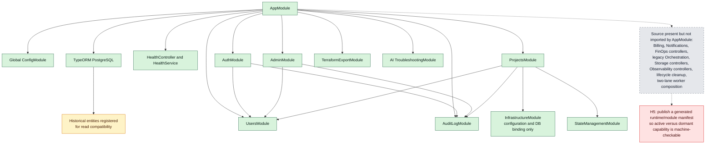

## 3. Frontend product journey

```mermaid
flowchart LR
    Landing[/]:::active --> OAuth[/auth/github]:::active
    OAuth --> Shell[Authenticated AppLayout]:::active
    Shell --> Projects[/projects<br/>workspace summary]:::active
    Shell --> Deploy[/deploy<br/>new deployment]:::active
    Shell --> Admin[/admin<br/>admin only]:::active
    Projects --> Overview[/projects/:id<br/>canonical overview]:::active
    Overview --> Pipeline[/projects/:id/pipeline<br/>attempts and recovery]:::active
    Overview --> Infrastructure[/projects/:id/infrastructure]:::active
    Overview --> Monitoring[/projects/:id/monitoring]:::active

    Legacy[Legacy routes:<br/>detection, preflight, env, settings,<br/>costs, troubleshooting, storage,<br/>orchestration, logs, security]:::inactive
    Legacy -->|redirect| Overview
    Legacy -->|redirect| Pipeline
    Legacy -->|redirect| Infrastructure
    Legacy -->|redirect| Monitoring

    Overview -->|poll every 5 s while active| CurrentState[GET current-state]:::active
    Pipeline -->|poll every 4 s while active| CurrentState
    Monitoring -->|poll every 30 s while live| CurrentState

    H6[H6: one shared event stream or query cache<br/>instead of page-specific polling]:::hotspot
    CurrentState -.-> H6

    classDef active fill:#d8f3dc,stroke:#2d6a4f,color:#081c15
    classDef inactive fill:#e5e7eb,stroke:#6b7280,color:#111827,stroke-dasharray:5 5
    classDef hotspot fill:#fee2e2,stroke:#dc2626,color:#450a0a
```

### Repository analysis and readiness

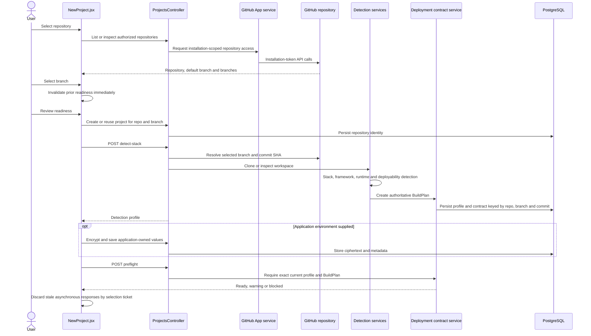

## 4. Normal deployment orchestration

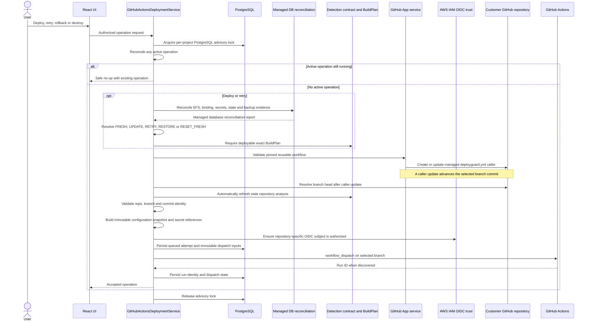

### Recovery and persistence decision

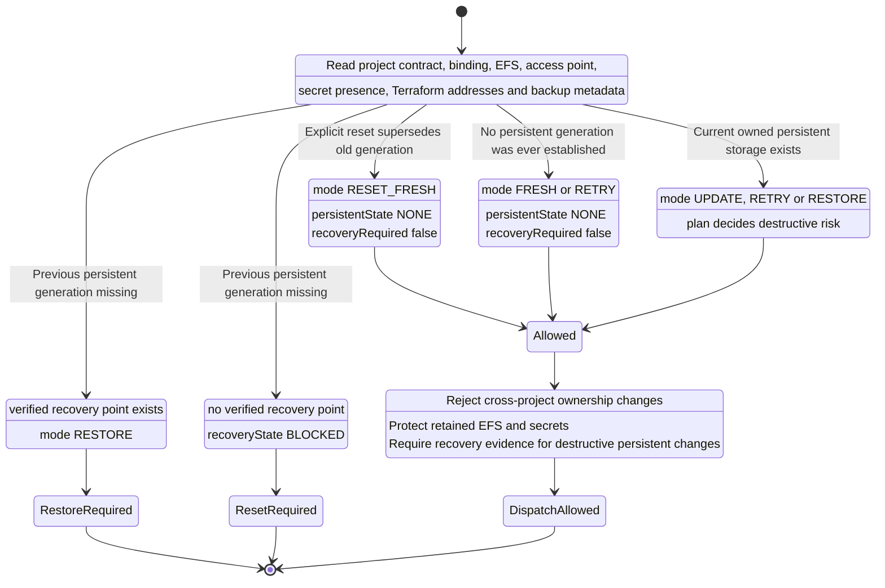

## 5. Reusable workflow internals

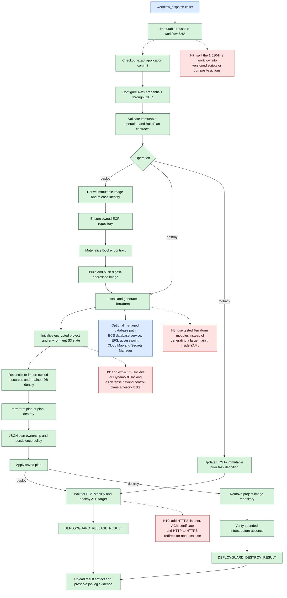

### AWS resource topology per project and environment

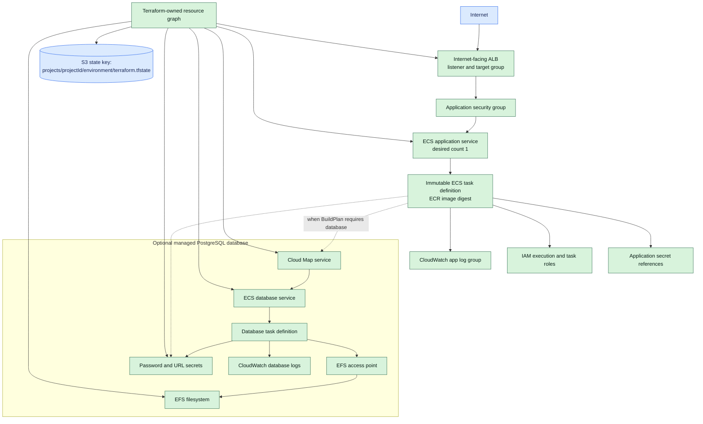

## 6. Result ingestion and canonical current state

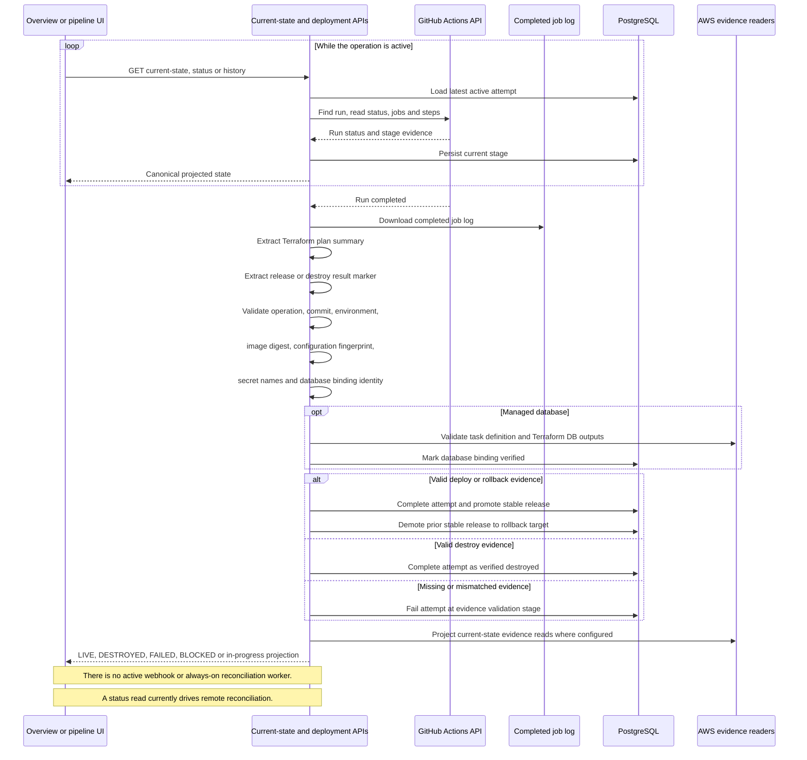

## 7. Control-plane data architecture

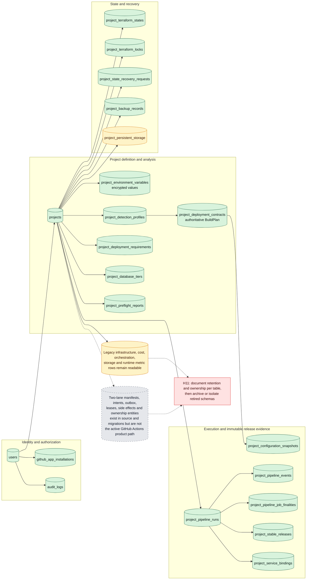

## 8. Security and trust boundaries

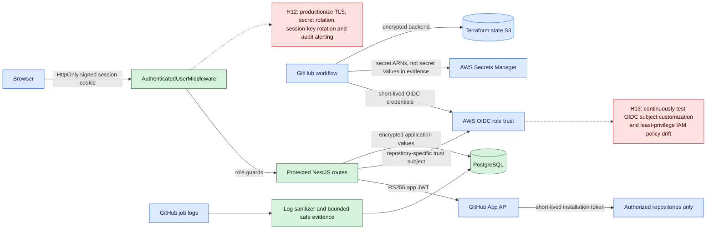

## 9. Improvement roadmap

These are architectural opportunities discovered from the active composition. They are not claims that the successful bounded deployment is broken.

| ID | Priority | Current evidence | Potential improvement | Expected benefit |
|---|---:|---|---|---|
| H1 | P1 | `latest()` and `history()` reconcile GitHub state during API reads; completion can wait for a user poll. | Add an authenticated GitHub `workflow_run` webhook or a small bounded server-side reconciler. Keep read-time reconciliation as fallback. | Deterministic completion, less UI dependence, faster stable-release promotion. |
| H2 | P1 | `ensureWorkflow()` commits the managed caller to the selected customer branch, then detection must refresh because the commit changed. | Install/update the caller once during project connection, expose caller drift separately, and avoid updating it inside every deployment transaction. | Cleaner source identity, fewer surprise commits, simpler retry semantics. |
| H3/H9 | P1 | Terraform uses an encrypted S3 backend, while the backend advisory lock ends after dispatch. The backend command shown does not enable S3 lockfiles or a DynamoDB lock table. | Enable Terraform S3 lockfile support or DynamoDB locking and test lock contention from two independent executors. | Defense against concurrent state mutation outside the control-plane process. |
| H6 | P1 | Overview and pipeline poll every 5 s and 4 s; each poll may call GitHub APIs. | Centralize server reconciliation and publish state through SSE/WebSocket or a shared query cache with backoff and ETags. | Lower GitHub rate usage, fewer duplicate requests, smoother UI. |
| H7 | P1 | `deployguard-reusable.yml` is about 1,510 lines and contains shell, policy, Terraform generation and evidence logic. | Extract pinned scripts/composite actions with unit tests and checksums while preserving the immutable workflow entry contract. | Easier review, safer changes, clearer failures. |
| H8 | P1 | A large Terraform configuration is generated inline by workflow shell. | Move the resource graph into versioned Terraform modules and make the workflow only materialize inputs and run policy. | Native Terraform validation, smaller workflow diffs, reusable plans. |
| H14 | P1 | The live test showed Prometheus monitoring unavailable; monitoring currently relies on deployment-time ECS/ALB evidence. | Add CloudWatch-native CPU, memory, task count, ALB 5xx/latency alarms first; make Prometheus/Grafana optional. | Useful default operations without another monitoring stack. |
| H15 | P1 | Applications without an explicit health endpoint use `/`; ECS container health can remain `UNKNOWN` even when ALB is healthy. | Extend BuildPlan certification with a health endpoint contract and generate an ECS container health check when supported. | Earlier runtime failure detection and consistent ECS/ALB health semantics. |
| H10 | P1 before public production | Current generated ALB path is HTTP. | Add ACM-managed HTTPS, HTTP-to-HTTPS redirect, configurable DNS, secure headers and optional WAF. | Production-grade transport security. |
| H11 | P2 | Many historical and next-generation entities coexist with the smaller active module graph. | Publish a schema ownership catalog and move inactive models behind explicit feature modules or archival migrations. | Lower cognitive load and migration risk. |
| H5 | P2 | Source presence does not mean runtime activation; this is currently learned by reading `AppModule`. | Generate a startup capability manifest and expose it through an admin/readiness endpoint. | Operators can see exactly which engine and modules are active. |
| H4 | P2 | Package engines require Node 22, but no `.nvmrc` or `.node-version` exists and a normal shell selected Node 20. | Add both version-manager files and a shell/CI verification test. | Fewer local runtime mismatches. |
| H12/H13 | P2 | Strong trust boundaries exist, but production hardening is operational rather than visible in one policy plane. | Add scheduled key/secret rotation checks, IAM drift tests, session-key rotation procedure and alerting for sensitive audit events. | Better long-lived security posture. |
| H16 | P2 | Managed persistence safety depends on EFS identity plus recoverable AWS Backup evidence. | Automate backup-plan enrollment, retention verification and periodic restore drills before calling a database tier production-ready. | Proven recoverability rather than metadata-only confidence. |
| H17 | P3 | The active product is optimized around canonical `dev` deployment and one small ECS service. | Add explicit environment promotion, quotas, scaling policy and cost guardrails only when multi-environment use becomes a requirement. | Controlled growth without weakening the current simple path. |

## 10. Suggested implementation order

```mermaid
flowchart LR
    A[1. Push-driven reconciliation<br/>H1 + H6]:::hotspot --> B[2. Remote state locking<br/>H3 + H9]:::hotspot
    B --> C[3. Workflow and Terraform decomposition<br/>H7 + H8]:::hotspot
    C --> D[4. Default observability and health contract<br/>H14 + H15]:::hotspot
    D --> E[5. Caller lifecycle and schema clarity<br/>H2 + H5 + H11]:::hotspot
    E --> F[6. Production security and recovery drills<br/>H10 + H12 + H13 + H16]:::hotspot
    F --> G[7. Multi-environment expansion<br/>H17]:::hotspot

    classDef hotspot fill:#fee2e2,stroke:#dc2626,color:#450a0a
```

The first two steps improve correctness and operational independence without redesigning the deployment contract. Workflow decomposition should follow only after the current immutable workflow has a frozen compatibility test suite, because it is the highest-change surface in the system.

## 11. Source-of-truth map

| Concern | Primary source |
|---|---|
| Local integrated startup | `scripts/local-product.mjs` |
| Active backend composition | `backend/src/app.module.ts` |
| Frontend route composition | `frontend/src/routes/AppRoutes.jsx` |
| New repository deployment journey | `frontend/src/pages/NewProject.jsx` |
| Project HTTP API | `backend/src/projects/projects.controller.ts` |
| Detection and BuildPlan creation | `backend/src/projects/detection/` and `backend/src/projects/deployment-contract.service.ts` |
| State-aware deploy/retry/reset/destroy | `backend/src/projects/github-actions-deployment.service.ts` |
| Recovery state machine | `backend/src/projects/deployment-recovery-decision.ts` |
| Managed database drift classification | `backend/src/projects/managed-database-reconciliation.ts` |
| GitHub App and generated caller | `backend/src/projects/github-app.service.ts` |
| GitHub dispatch and evidence API | `backend/src/projects/pipeline/github-actions.service.ts` |
| Reusable workflow and Terraform policy | `.github/workflows/deployguard-reusable.yml` |
| Canonical current-state projection | `backend/src/projects/current-state/project-current-state.service.ts` |
| Overview and pipeline presentation | `frontend/src/components/projects/ProjectOverviewLifecycle.jsx` and `frontend/src/components/projects/PipelineExecution.jsx` |
