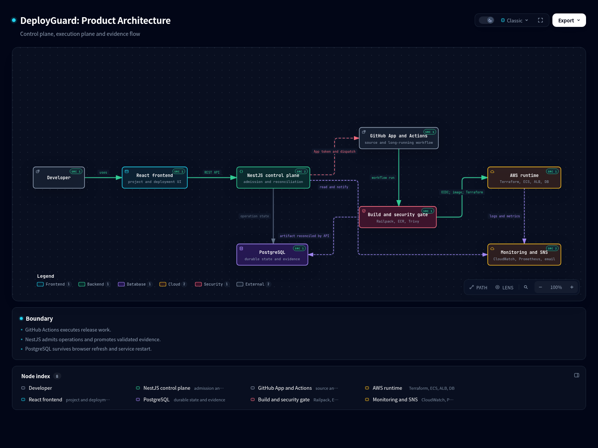
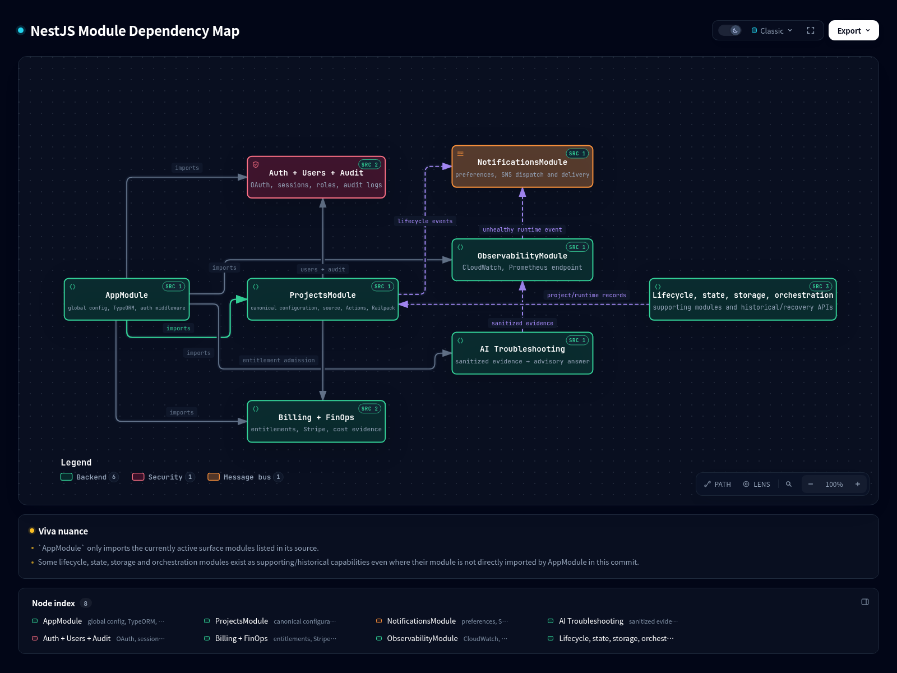
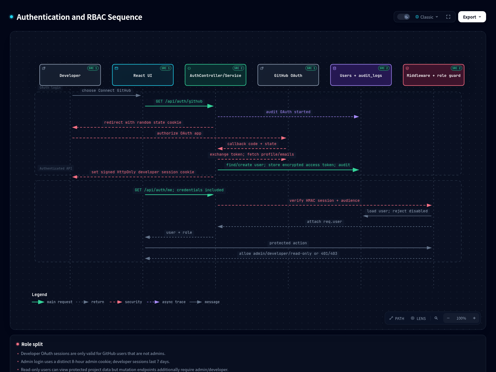
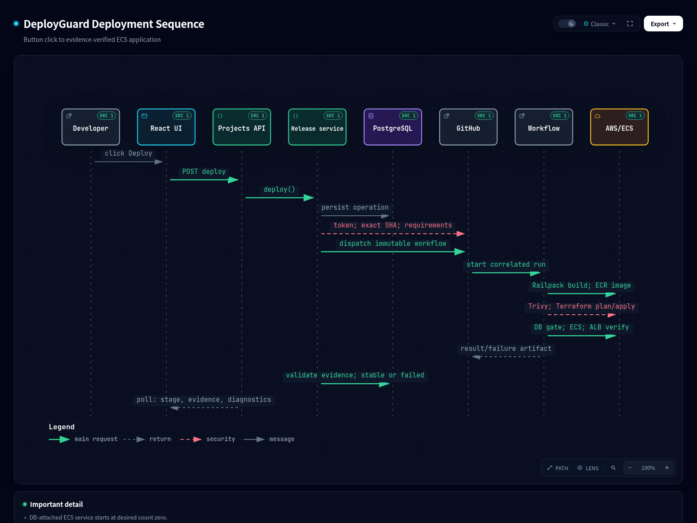
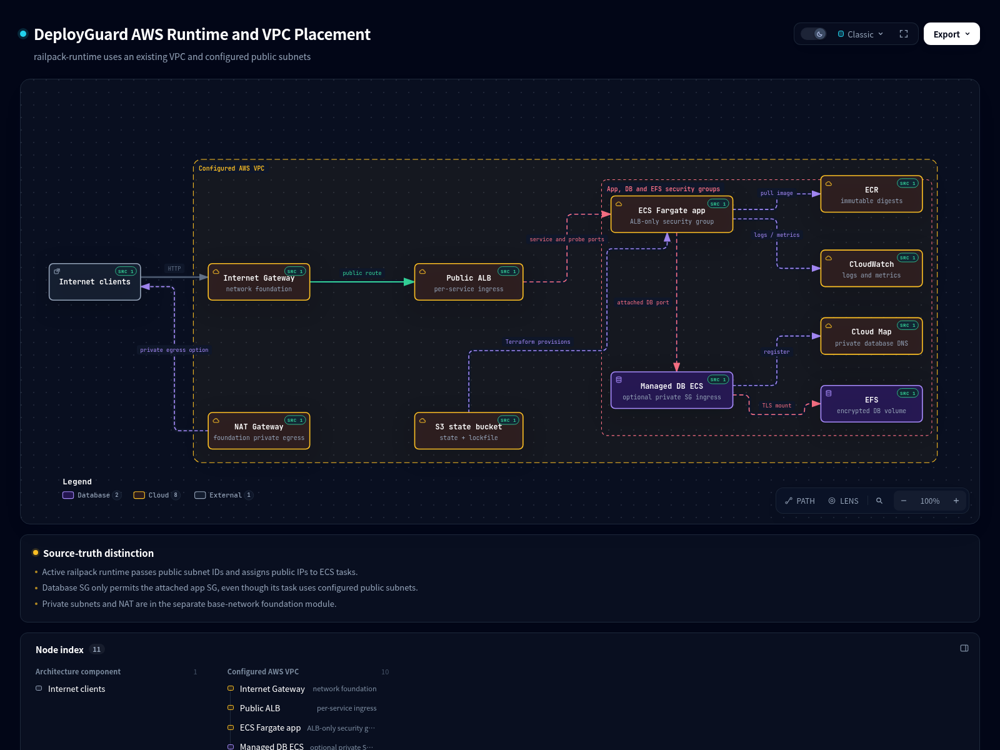
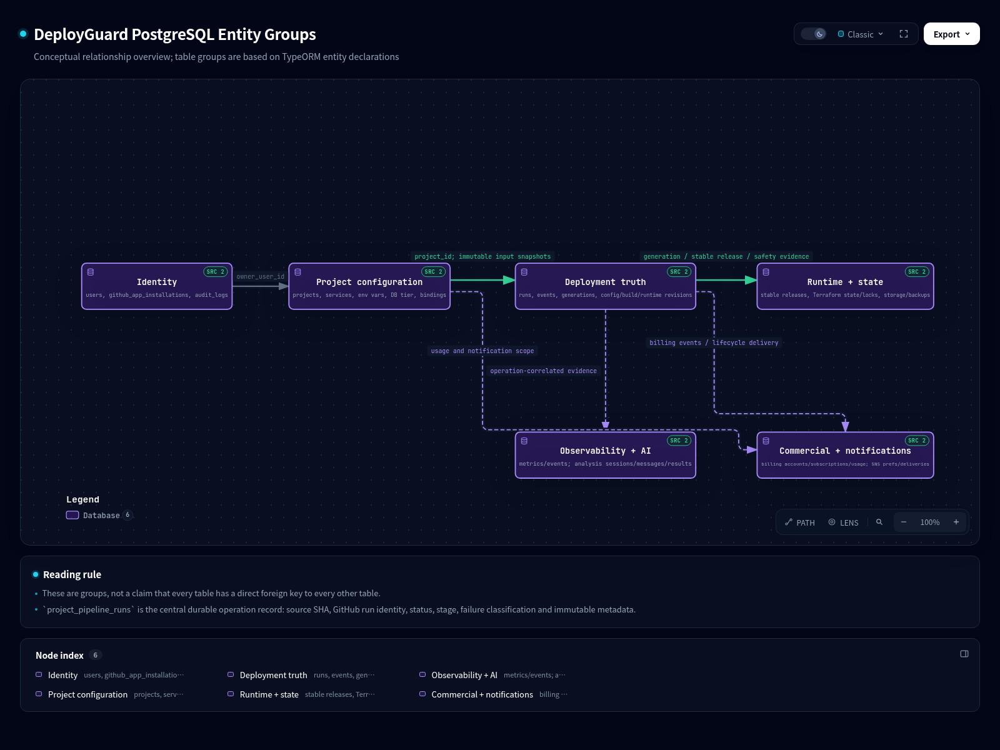
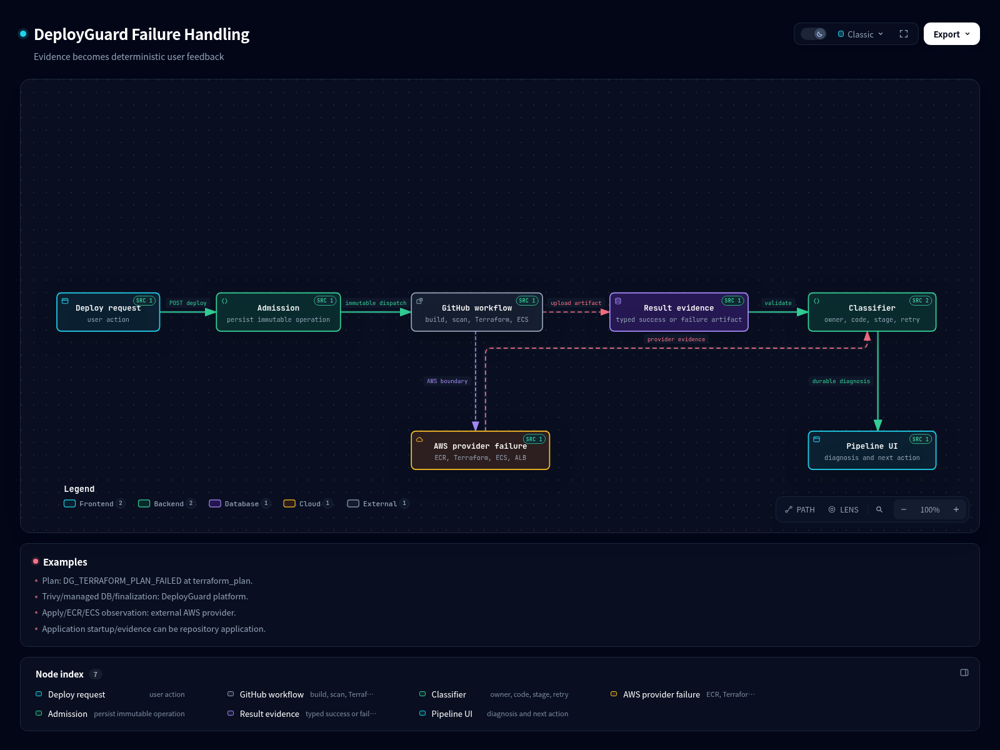

# DeployGuard Viva Master Notes

## A visual guide to the current system

**Source basis:** committed repository `a571c14e9afc45bedf22ec1e4d22e136e8e3005e`. The worktree contained unrelated uncommitted work, so this handbook does not treat those bytes as proof. This is a design and source study, not an AWS certification report.

DeployGuard helps a developer take a GitHub application from repository configuration to a verified AWS runtime. It does not make the browser run cloud commands. The browser asks the backend to begin an operation; the backend records the exact operation and its inputs; GitHub Actions performs the slow build and cloud work; the backend reads the resulting evidence and presents the final state.

---

# 1. What DeployGuard is

**What it is.** A deployment control plane with a React user interface, a NestJS backend, PostgreSQL operational memory, GitHub integration and an AWS runtime.

**Why we use it.** A deployment includes repository access, build, image publication, security, infrastructure, runtime health, cost and rollback history. Putting this in one controlled flow reduces guesswork.

**How it works.** A project stores repository, branch, service directory and environment configuration. A deployment stores the exact source SHA, workflow identity, evidence and terminal classification.

**Input → process → output.** Project configuration and Deploy click → admission and asynchronous workflow → stable release or evidence-backed failed state.

**Simple example.** A developer selects `owner/shop-api`, branch `main`, directory `backend`, then DeployGuard builds that exact commit and shows whether it reached a healthy public ALB endpoint.

**Panel question.** Is DeployGuard a hosting provider?  
**Short answer.** It is a control plane that orchestrates GitHub and AWS services.  
**Cross-question.** Where does the app actually run?  
**Deeper answer.** In ECS Fargate tasks behind an AWS Application Load Balancer, created through Terraform.

# 2. One-page complete system diagram

This is the main story to explain first: Developer → React UI → NestJS control plane → PostgreSQL and GitHub → Application Build/Containerization/Security → AWS runtime → Monitoring and notifications.

# 3. User journey

1. Sign in with GitHub and connect a GitHub App installation.
2. Choose a repository, branch and one or more deployment directories.
3. Add environment values and, if needed, managed database settings.
4. Click Deploy. The UI receives an operation ID quickly instead of waiting for cloud work.
5. Watch status in project overview/pipeline pages.
6. Read infrastructure, cost, logs and monitoring evidence.
7. Retry only when the persisted failure guidance says it is safe; rollback chooses a recorded immutable release; destroy requires confirmation.

**Input → process → output.** Developer decisions → backend admission and workflow execution → an understandable project lifecycle.

**Example.** A read-only user can inspect a completed deployment, but cannot click deploy, change variables, retry or destroy.

**Panel question.** Why is deployment asynchronous?  
**Short answer.** Build, Terraform and ECS health checks take longer than an HTTP request.  
**Cross-question.** How does the UI know what happened later?  
**Deeper answer.** It polls backend current-state/history projections backed by PostgreSQL and GitHub Actions reconciliation.

# 4. Frontend

**What it is.** A React 18 and Vite single-page application.

**Why we use it.** It gives separate, focused screens for configuration, lifecycle status, infrastructure, monitoring, billing and administration.

**How it works.** `AppRoutes.jsx` lazy-loads pages. `AuthContext.jsx` calls `/api/auth/me`, keeps the current user/role in memory, refreshes when the tab returns and sends credentialed API requests through `api/client.js`.

| User need | Main screen | Important visual pieces |
|---|---|---|
| Workspace | `Projects` | Project summaries and active/failure/live state |
| Create | `NewProject` | GitHub repository, branch, directory picker, services, environment input |
| Project overview | `ProjectDetails` | `ProjectOverviewLifecycle`, current state and actions |
| Pipeline | `ProjectPipeline` | stages, history, release/rollback/retry/destroy evidence |
| Infrastructure | `ProjectInfrastructure` | topology, identifiers, cost estimate, export |
| Monitoring | `ProjectMetrics` | metrics and CloudWatch log stream |
| Settings | `ProjectSettings` | service variables, notification settings and configuration |
| Admin | `AdminUsers`, `AdminCloudCleanup` | users, audit and controlled cleanup |

**Input → process → output.** API JSON and session cookie → React state/components → readable operational screens.

**Example.** `ProjectMetrics` uses the application log-stream URL to show server-sent CloudWatch log events without exposing AWS credentials to the browser.

**Panel question.** Does role-based hiding in React provide security?  
**Short answer.** No. It improves UX; NestJS role guards enforce the real permission boundary.  
**Cross-question.** What does the frontend store as authentication state?  
**Deeper answer.** A current user/role object in `AuthContext`; the actual signed session remains in an HttpOnly cookie.

# 5. Backend

**What it is.** A NestJS API with TypeORM and PostgreSQL.

**Why we use it.** It centralizes authorization, immutable admission, durable orchestration, external-provider access, evidence validation and presentation.

**How it works.** `main.ts` applies Helmet, CORS and request validation. `AppModule` configures PostgreSQL and modules. Controllers map HTTP to services; services own business decisions; entities persist operational facts.

| Backend area | Main responsibility | Useful source locations |
|---|---|---|
| Authentication | OAuth, signed sessions, admin session | `auth/*`, `users/*` |
| Projects and deployment | configuration, admission, workflow reconciliation | `projects/railpack-deployment.service.ts` |
| GitHub integration | App tokens, source inspection, workflow dispatch | `projects/github-app.service.ts`, `pipeline/github-actions.service.ts` |
| Monitoring | CloudWatch logs/metrics and Prometheus endpoint | `observability/*` |
| Notifications | preferences, SNS subscriptions/delivery | `notifications/*` |
| Cost and billing | Infracost evidence, Stripe, entitlements | `finops/*`, `billing/*` |
| Small advisory module | evidence-bound troubleshooting | `ai-troubleshooting/*` |

**Input → process → output.** Authenticated HTTP request → controller/service/entity operations → JSON response plus durable audit/state.

**Example.** `ProjectsController.deployGithubActions` delegates to `RailpackDeploymentService.deploy`; it does not run Terraform inside the HTTP controller.

**Panel question.** Why separate controllers and services?  
**Short answer.** Controllers translate HTTP; services hold reusable business and lifecycle logic.  
**Cross-question.** Why use PostgreSQL instead of in-memory state?  
**Deeper answer.** Deployments outlive browser requests and backend restarts, so state, evidence and release identity must survive.

## Backend module map

The diagram shows the primary frontend-to-backend relationship and the important backend modules: authentication, projects/deployment, GitHub integration, infrastructure tooling, AWS observation, notifications, billing and the small advisory troubleshooting module.

# 6. Authentication and RBAC

**What it is.** Developer GitHub OAuth, a separate administrator login and role guards.

**Why we use it.** GitHub identifies developers and authorizes repository access; admin access must not be confused with a developer OAuth account.

**How it works.** OAuth start creates a random state cookie. Callback checks that state, exchanges the code for a GitHub token, fetches profile/email, stores/updates the user and sets a signed HttpOnly developer session. Middleware validates HMAC signature, audience, expiry and disabled status. `requireRole` applies role checks to endpoints.

**Roles.** `developer` may create/change/deploy; `readonly` may view allowed data but not mutate; `admin` uses separate email/password credentials and an eight-hour admin cookie. Developer sessions have a seven-day lifetime. GitHub users cannot be admin users in the entity constraint.

**GitHub App versus OAuth.** OAuth authenticates the person. A GitHub App installation supplies repository-scoped access for listing repositories, resolving source and dispatching workflows.

**Input → process → output.** OAuth code/state or admin credentials → user/session validation → `req.user` and permitted route.

**Example.** A request to deploy without a valid developer/admin role gets 401/403 even if someone manually calls the endpoint.

**Panel question.** Why is the session HttpOnly?  
**Short answer.** Browser JavaScript cannot read it, reducing token exposure to XSS.  
**Cross-question.** What protects OAuth callback redirection?  
**Deeper answer.** The callback requires the returned state to equal the state stored in the short-lived cookie.

# 7. Project creation and deployment-directory configuration

**What it is.** The project wizard captures the deployable repository unit.

**Why we use it.** A repository can have a branch, multiple services and directories. DeployGuard must know exactly which source locations are intended to become services.

**How it works.** The UI asks the backend for GitHub repositories, repository information, branches and repository directories. A project persists repository URL/full name, branch, environment name, owner and service definitions. Each service has name, repository-relative directory, ordering and an optional bounded build-target override. Environment variables are scoped to a service and include secret/scope/ownership metadata.

**Input → process → output.** Selected repository, branch, directory, services and variables → DTO validation and ownership rules → durable project configuration.

**Example.** A monorepo can have `apps/web` and `apps/api` as separate services rather than treating its root as one uncertain application.

**Panel question.** Why select a deployment directory?  
**Short answer.** It tells application build logic which repository subdirectory is the service.  
**Cross-question.** Can environment variables be freely overwritten?  
**Deeper answer.** No. Service scope, secret status and platform-owned/managed-database aliases are validated to prevent unsafe conflicts.

# 8. Complete deployment lifecycle

**What it is.** The path from a Deploy click to a verified runtime.

**Why we use it.** It provides exact source, repeatable evidence and a clear boundary between backend control and cloud execution.

**How it works in DeployGuard.**

1. UI calls `POST /api/projects/:projectId/deploy`.
2. `ProjectsController` calls `RailpackDeploymentService.deploy`.
3. `admitLifecycleOperation` creates a `project_pipeline_runs` operation and immutable configuration/generation records.
4. GitHub App credential resolves an exact 40-character commit SHA.
5. Backend resolves build target, port and deployment requirements at that SHA, checks managed database reconciliation, caller, OIDC and AWS capability.
6. It materializes runtime secret references and dispatches the reusable GitHub Actions workflow with immutable inputs.
7. The workflow builds and validates the application, publishes image digests, scans security, plans/applies Terraform and verifies runtime.
8. The workflow uploads a success/failure artifact. Backend reconciliation validates it and records stable release or deterministic failure.
9. UI reads current state/history from the backend.

**Input → process → output.** Project + role → admitted immutable operation + asynchronous execution → `live`, failed/blocked, or destruction-related state with evidence.

**Example.** For an attached database, Terraform creates the application ECS service at desired count zero; only after database readiness does the workflow call ECS UpdateService for that one application service.

**Panel question.** Why store the commit SHA before dispatch?  
**Short answer.** It makes the deployment reproducible and prevents a moving branch from changing the source during a release.  
**Cross-question.** Who announces final success?  
**Deeper answer.** The backend, after it validates the workflow artifact and persists a stable release, not simply when workflow dispatch succeeds.

# 9. Application build and containerization

**What it is.** The workflow turns selected application source into Docker-compatible container images.

**Why we use it.** A container image carries the application and its runtime dependencies into ECS consistently.

**How it works.** The workflow checks out the exact application commit, installs a pinned application-build tool, builds each configured service, locally validates that the image starts and is reachable from a separate network peer, then publishes it to ECR.

**Image identity.** The final identity is `repository@sha256:<digest>`, not merely a human tag. The workflow verifies local image ID before pushing and asks ECR for the immutable digest after push.

**Input → process → output.** Exact SHA and service directories → build plus local reachability check → per-service ECR immutable image digest.

**Example.** If an app binds only to localhost instead of `0.0.0.0` and platform `PORT`, local validation produces an application binding failure before AWS runtime deployment.

**Panel question.** Why keep digest identity?  
**Short answer.** A digest is content-addressed and cannot be silently changed like a tag.  
**Cross-question.** Does build run in the NestJS backend?  
**Deeper answer.** No. The reusable workflow runs long-lived build tooling; backend records and reconciles it.

# 10. Security

**What it is.** Trivy image vulnerability scanning within the deployment workflow.

**Why we use it.** It catches known vulnerable packages in the actual image that would run, not only a source folder guess.

**How it works.** Trivy scans each exact immutable ECR image. Findings contain service, image, vulnerability ID, severity, package, installed/fixed versions and origin. Enforced policy blocks fixable critical application-dependency findings. The workflow writes a structured security result and bounded evidence hash.

**Input → process → output.** Immutable image digest → Trivy finding aggregation/policy → passed, advisory, blocked or scan-error evidence.

**Example.** A fixable critical Node dependency in the image can create `DG_TRIVY_POLICY_BLOCKED` when enforcement is enabled.

**Panel question.** What does DeployGuard scan?  
**Short answer.** The exact immutable service images produced for this deployment.  
**Cross-question.** What evidence is retained?  
**Deeper answer.** Counts, bounded findings, policy status and an SHA-256 evidence hash are carried into deployment evidence.

# 11. Automated cost estimation

**What it is.** Infracost-based cost evidence based on Terraform plan artifacts.

**Why we use it.** It gives a monthly cost estimate before/alongside infrastructure change evidence.

**How it works.** Workflow creates immutable Terraform cost-plan artifacts. When a supported deploy/rollback completes and Infracost is configured, `GithubActionsCostEvidenceService` retrieves the artifacts, runs the official CLI, normalizes resource costs and stores estimates/breakdowns. Threshold crossing can notify the project owner.

**Input → process → output.** Terraform plan JSON + Infracost API key → Infracost breakdown → `project_cost_estimates` and Infrastructure-screen cost view.

**Example.** Compute, ALB, storage and log resource costs become a monthly total plus resource rows.

**Panel question.** Does cost estimation deploy anything?  
**Short answer.** No. It reads immutable plan evidence and is not Terraform apply.  
**Cross-question.** When can automatic cost calculation be unavailable?  
**Deeper answer.** When the API key or required workflow plan artifact is absent; it is recorded as cost-evidence failure rather than invented data.

# 12. Terraform

**What it is.** The infrastructure engine for resource creation, state and destruction.

**Why we use it.** AWS resource topology must be reproducible and safely tracked outside transient backend memory.

**How it works.** The workflow copies the exact committed `infrastructure/railpack-runtime` contract into its temporary workspace and runs `terraform init`, `validate`, `plan`, then `apply`. Its S3 backend key is `projects/<project>/<environment>/runtime/terraform.tfstate`, encrypted with `use_lockfile=true`.

**Current modules.** The active runtime defines ECS, ALB, security groups, CloudWatch log groups, optional managed DB ECS service, EFS, Cloud Map and Secrets Manager. The separate `backend/terraform/base-network` foundation contains reusable network concepts including public/private subnets and NAT choice.

**Input → process → output.** Immutable release configuration and AWS inputs → Terraform plan/apply → exact AWS resource outputs and state.

**Example.** A Terraform plan failure is explicitly emitted as `DG_TERRAFORM_PLAN_FAILED` at stage `terraform_plan`; it is not presented as apply failure.

**Panel question.** Why use S3 native lockfiles?  
**Short answer.** It locks remote Terraform state using the state backend, without a separate locking service.  
**Cross-question.** Does Terraform own runtime release choice forever?  
**Deeper answer.** It owns resource existence; application service `desired_count` and active `task_definition` ignore external changes so ECS release updates are not reverted by later topology apply.

# 13. AWS infrastructure

**What it is.** The AWS runtime created/used by the active Terraform contract.

**Why we use it.** It provides public ingress, serverless containers, immutable registry, persistence, discovery, logging and state storage.

**How it works.** Per-service ALB/target group/listener routes HTTP to ECS Fargate tasks. Application security groups accept service and transport-probe ports only from their ALB group. An optional database ECS service has a group that accepts its DB port only from its attached application security group, uses EFS and registers private DNS in Cloud Map.

**Important implementation truth.** The active `railpack-runtime` receives `public_subnet_ids` and sets `assign_public_ip = true` for application and optional database tasks. Do not claim private-subnet ECS placement for this current runtime. Public/private/NAT concepts exist in the separate foundation network module.

| Service | Role in current design |
|---|---|
| VPC/Availability Zones | Supplied platform network boundary; foundation network supports subnet/AZ layout |
| Internet Gateway | Foundation public internet path |
| ALB | Public HTTP listener and target health path per service |
| ECS Fargate | Application and optional DB containers |
| ECR | Immutable image repository/digest source |
| EFS | Encrypted optional managed DB persistence |
| Cloud Map | Private database service name |
| CloudWatch | Container logs and ECS/ALB metrics |
| S3 | Terraform remote state + native lockfile |
| SNS | Email lifecycle delivery provider |

**Input → process → output.** Terraform variables and image digests → AWS resources/network rules → public URL, service/task identity and verified observations.

**Example.** An app can reach `database.<project>.internal` only when it is the configured database-attached service.

**Panel question.** Is the managed database RDS?  
**Short answer.** No. In this runtime it is an optional PostgreSQL, MySQL or MongoDB ECS service with EFS persistence.  
**Cross-question.** Why is database traffic still private in a public-subnet task layout?  
**Deeper answer.** The database security group allows its DB port only from the attached app security group, not public CIDRs.

# 14. Monitoring

**What it is.** Read-only runtime observation using CloudWatch plus Prometheus/Grafana presentation.

**Why we use it.** Deployment success should be supported by observable logs, resource metrics and target health after release.

**How it works.** `LiveRuntimeResolverService` identifies the authoritative live generation/service. `CloudWatchLogsService` fetches/sanitizes log events and can stream them as server-sent events. `CloudWatchMetricsService` reads ECS CPU/memory and ALB latency/healthy/unhealthy hosts, then derives runtime availability. `AwsPrometheusExportService` presents latest values at `/api/monitoring/metrics`; Prometheus scrapes it and Grafana uses Prometheus.

**Input → process → output.** Stable release identity → CloudWatch queries/sanitization/cache → frontend metrics/logs and Prometheus gauges.

**Example.** Unhealthy targets trigger a runtime-health notification attempt and are shown as unavailable runtime evidence.

**Panel question.** Does the frontend talk directly to CloudWatch?  
**Short answer.** No. Backend resolves the live identity and makes read-only AWS SDK calls.  
**Cross-question.** What values are observed?  
**Deeper answer.** ECS CPU/memory; ALB target response time and healthy/unhealthy host count; calculated availability; sanitized container logs.

# 15. Notifications

**What it is.** Project-level lifecycle email notifications through Amazon SNS.

**Why we use it.** Developers should learn about completed, failed, unhealthy and cost-threshold events without continuously watching a screen.

**How it works.** Users configure preferences and an email subscription. SNS confirmation is required. `NotificationDispatcherService` classifies lifecycle events, deduplicates with a key, persists delivery history and retries publication a bounded number of times.

**Input → process → output.** Event plus preference/subscription → classification/deduplication/SNS publish → delivery record and email when configured/confirmed.

**Example.** A cost estimate exceeding its warning threshold can create a `cost_threshold_exceeded` delivery.

**Panel question.** Why store notification deliveries in PostgreSQL?  
**Short answer.** To display attempt/status history and stop duplicate sends.  
**Cross-question.** Is a subscription immediately usable?  
**Deeper answer.** No. SNS email subscription must be confirmed; otherwise delivery is recorded as skipped-unconfirmed.

# 16. Database and data architecture

**What it is.** PostgreSQL stores durable control-plane facts, not application business data.

**Why we use it.** It holds the history needed to explain and safely continue/stop a deployment.

**How it works.** TypeORM entities are grouped below. `project_pipeline_runs` is central: project, triggerer, repository/branch/SHA, GitHub workflow identity, status/current stage, timestamps, ECR identity, failure owner/provider/code/service and immutable metadata.

| Visual group | Main tables | Meaning |
|---|---|---|
| Users and Audit | `users`, `github_app_installations`, `audit_logs` | identities, roles, connection metadata and action history |
| Projects and Configuration | `projects`, services, environment variables, database tier, bindings | what should be deployed |
| Pipeline Operations | pipeline runs/events, generations, snapshots, build/runtime revisions | exact operation input and progress |
| Releases | stable releases, deployments, rollback records | what is or was safe to run |
| Infrastructure State | Terraform state/locks/validation/recovery, storage/backups | safety and recovery evidence |
| Monitoring | observability events, stage/runtime metrics, log stream sessions | observed release behavior |
| Cost | estimates, resource breakdowns, settings | plan-derived financial evidence |
| Notifications | preferences, subscriptions, deliveries | user delivery policy/history |
| Billing | accounts, subscriptions, checkout, invoices, payments, usage, webhooks | commercial entitlement and records |

**Input → process → output.** Auth/configuration/workflow evidence → transactions/entity updates → current-state/history/UI/API responses.

**Example.** A stable release ties an exact source SHA, generation, service revision and verification outcome together for rollback selection.

**Panel question.** Why not store only the latest status?  
**Short answer.** Operations need evidence/history for audit, retry, rollback and diagnosis.  
**Cross-question.** Is PostgreSQL the Terraform remote state?  
**Deeper answer.** No. Terraform state is S3; PostgreSQL stores DeployGuard’s control-plane state and safety observations.

# 17. Destroy and rollback

**What it is.** Controlled ways to return to a previous verified release or remove project infrastructure.

**Why we use it.** A failure should not cause an improvised rebuild; destruction must avoid deleting unrelated cloud resources or healthy persistent data.

**How it works.** Rollback selects the immediate immutable `ROLLBACK_TARGET`, validates historical runtime configuration and dispatches an ECS release update without source rebuild. Destroy requires a confirmation phrase, dispatches Terraform destroy, verifies exact project/generation cleanup, then `ProjectDeletionService.finalize` removes local project data. Runtime secrets/ECR repositories/state objects are checked against DeployGuard ownership before deletion.

**Input → process → output.** Confirmed destroy or selected release target → immutable workflow/verification → restored stable release or verified project deletion.

**Example.** If AWS deletion succeeds but local finalization fails, retry completes local cleanup without sending Terraform destroy again.

**Panel question.** Why no source rebuild for rollback?  
**Short answer.** Rollback must use the known immutable previous runtime identity.  
**Cross-question.** Does Reset Fresh delete a healthy database?  
**Deeper answer.** No. Managed-database reconciliation and recovery rules decide whether reset is allowed; healthy persistent data is not silently removed.

# 18. Billing

**What it is.** Stripe-backed subscription, invoice and usage/entitlement module.

**Why we use it.** The product needs durable plan and usage decisions separate from deployment mechanics.

**How it works.** Billing endpoints provide summary, Checkout, customer portal and invoice access. Stripe webhook processing records normalized subscription/payment/invoice events. `EntitlementService` and `ProjectUsageService` provide product admission/usage information.

**Input → process → output.** Selected plan/Stripe event/project usage → normalized billing state and entitlement → billing UI and deployment admission input.

**Example.** A developer opens Stripe Checkout from the Billing page; a signed webhook later updates stored subscription state.

**Panel question.** Does Stripe run infrastructure?  
**Short answer.** No. Stripe affects commercial entitlement, not Terraform or ECS execution.  
**Cross-question.** Why store webhooks?  
**Deeper answer.** To process provider events durably/idempotently and preserve billing history.

# 19. AI troubleshooting, kept small

**What it is.** A small advisory analysis module for a selected failed operation or live-runtime issue.

**Why we use it.** It can turn already collected, sanitized evidence into an easier explanation and next steps.

**How it works.** It collects operation-correlated evidence, preprocesses/sanitizes/bounds it, sends only that context to configured Gemini with a JSON schema, then validates returned evidence references, responsibility, root cause and retry recommendation against deterministic facts. Sessions/messages/results are stored.

**Input → process → output.** Selected pipeline run/service evidence → preprocess/LLM/schema validation → advisory explanation, limitations and cited references.

**Example.** A startup failure can be summarized with cited sanitized runtime log evidence.

**Panel question.** Can AI deploy or destroy anything?  
**Short answer.** No. It is advisory and has no infrastructure mutation path.  
**Cross-question.** How is hallucination limited?  
**Deeper answer.** It receives bounded evidence and schema validation rejects unsupported references or answers contradicting authoritative classification.

# 20. Failure handling

**What it is.** A deterministic evidence-to-user-feedback pipeline.

**Why we use it.** A generic “deployment failed” message is not enough to decide whether to fix source, wait for AWS, correct platform configuration or retry.

**How it works.** Workflow emits a typed release result or failure artifact. Backend validates it, uses the failure catalog/diagnostic service to assign owner, provider, code, stage and retry decision, stores that with the operation, then UI and SNS read the durable projection.

| Failure type | Detection | Typical output |
|---|---|---|
| Application build/startup | local application validation/workflow marker | repository application failure; source fix needed |
| Security | Trivy result/policy | security counts and policy block/scan failure |
| Terraform plan | explicit workflow plan boundary | `DG_TERRAFORM_PLAN_FAILED`, `terraform_plan` |
| Terraform apply/ECR/AWS | workflow/AWS verification evidence | external AWS provider classification |
| ECS/ALB/runtime | ECS events, stopped tasks, container exit, target health/public verification | service-specific code/stage/evidence |
| GitHub | dispatch/reconciliation provider error | external GitHub provider classification |

**Input → process → output.** Failure artifact/provider error → deterministic classifier + PostgreSQL → UI diagnosis, retry guidance and optional notification.

**Example.** `DG_TERRAFORM_APPLY_FAILED` is AWS/Terraform boundary evidence; it is not automatically blamed on application code.

**Panel question.** What failure owners exist?  
**Short answer.** Repository application, DeployGuard platform, external provider and unverified.  
**Cross-question.** Can the UI invent a root cause?  
**Deeper answer.** No. It should present stored evidence and deterministic classification; ambiguous evidence remains unverified.

# 21. Important design decisions

1. **GitHub Actions performs long-running execution.** Build, image scan, Terraform and ECS waits are isolated and asynchronous; the API is not a long-running shell host.
2. **PostgreSQL is durable orchestration memory.** It records inputs, operations, evidence, audit and release history across restarts.
3. **Exact SHA and digest identities are immutable.** A branch/tag can move; a source SHA/ECR digest identifies a specific release.
4. **Terraform owns topology, ECS owns rolling runtime mechanisms.** Terraform creates/deletes services; direct runtime updates are protected by `ignore_changes` for desired count/task definition.
5. **S3 native locking protects Terraform state.** It serializes remote-state mutation using the backend’s lockfile mechanism.
6. **AI remains advisory.** It improves explanation but cannot change infrastructure or overrule failure evidence.
7. **Database readiness is service-specific.** The attached app waits; unrelated services do not become collateral damage.

**Panel question.** What is the most important ownership split?  
**Short answer.** Terraform owns infrastructure existence; DeployGuard owns admission/evidence/release decision; ECS performs runtime deployment primitives.  
**Cross-question.** Why protect task definition from Terraform drift?  
**Deeper answer.** Otherwise a later topology apply could accidentally revert the active immutable release revision.

# 22. Fifty likely viva questions with short answers

1. **What problem does DeployGuard solve?** It turns GitHub source into a controlled, evidence-backed AWS deployment.
2. **What is the frontend stack?** React 18 with Vite and React Router.
3. **What is the backend stack?** NestJS, TypeORM and PostgreSQL.
4. **Where does an app run?** AWS ECS Fargate behind an ALB.
5. **What begins a deployment?** `POST /api/projects/:id/deploy` through `ProjectsController`.
6. **Which service owns the deployment lifecycle?** `RailpackDeploymentService`.
7. **Why is an operation stored first?** To give the workflow a durable correlation identity and survive restart.
8. **Why use an exact commit SHA?** It freezes the application source being deployed.
9. **Why use GitHub Actions?** It runs slow, tool-heavy build/cloud work asynchronously.
10. **What builds the application?** The pinned Application Build/Containerization step in the reusable workflow.
11. **What is the image identity?** ECR `image@sha256:digest`.
12. **Why not trust an image tag?** Tags can move; digest contents cannot.
13. **What does Trivy scan?** Exact immutable service images.
14. **What can block security deployment?** Enforced fixable critical application-dependency findings.
15. **What does Infracost calculate from?** Immutable Terraform plan artifacts.
16. **Does Infracost apply infrastructure?** No.
17. **What does Terraform own?** AWS topology, remote state and final destroy.
18. **What does ECS own?** Starting/scaling/replacing task revisions for services.
19. **Why use S3 state?** Durable remote Terraform state shared by workflow runs.
20. **How is state locked?** Terraform S3 native lockfile with `use_lockfile=true`.
21. **What is the Terraform plan failure code?** `DG_TERRAFORM_PLAN_FAILED` at `terraform_plan`.
22. **How is apply failure different?** It is a separate Terraform/AWS boundary failure.
23. **What does ALB do?** Accepts public HTTP and forwards to healthy ECS IP targets.
24. **What is the transport probe?** A sidecar that proves the application is reachable on its declared port.
25. **Does current ECS runtime use private subnets?** No claim should be made: active runtime uses supplied public subnet IDs and public IP assignment.
26. **Where is private-subnet/NAT support?** In the separate foundation network module.
27. **What stores DB data?** Optional encrypted EFS through an access point.
28. **How does the app discover managed DB?** Cloud Map private DNS such as `database.<project>.internal`.
29. **How is a DB-attached service started?** Terraform creates desired count zero; after DB readiness workflow calls ECS UpdateService.
30. **Does DB failure block unrelated apps?** No.
31. **What is GitHub OAuth for?** Human developer identity and GitHub profile/token acquisition.
32. **What is GitHub App for?** Repository access and workflow dispatch through installation credentials.
33. **What protects OAuth callback?** Random state cookie comparison.
34. **Where is the developer session stored?** A signed HttpOnly cookie.
35. **Why separate administrator login?** Admin credentials/session must not be confused with a GitHub developer identity.
36. **What roles exist?** Admin, developer and read-only.
37. **Can read-only deploy?** No.
38. **What records security-sensitive actions?** Audit logs.
39. **What is the central operations table?** `project_pipeline_runs`.
40. **What monitoring data is read?** CloudWatch logs, ECS CPU/memory, ALB latency and target health.
41. **How reaches Grafana?** Backend exposes Prometheus gauges; Prometheus scrapes them; Grafana reads Prometheus.
42. **Does browser hold AWS credentials?** No.
43. **What sends notifications?** SNS via backend notification dispatcher.
44. **Why confirm an SNS email?** SNS must confirm subscription before real delivery.
45. **How does rollback avoid guessing?** It selects a stored immutable stable release and its recorded runtime identity.
46. **What protects destroy?** Confirmation phrase, scoped ownership checks, Terraform destroy verification and finalization only after proof.
47. **Can Reset Fresh delete healthy DB data?** No; recovery/reconciliation rules prevent silent destructive reset.
48. **What does billing control?** Product plan, usage and entitlement, not cloud executor commands.
49. **What does the AI module control?** Nothing operational; it supplies validated advisory troubleshooting only.
50. **What makes final deployment state trustworthy?** Exact inputs, durable operation record, typed workflow artifact, backend validation and stable-release promotion after verification.

## Source cues for a technical follow-up

Use these only if the panel asks “where is this implemented?”: `backend/src/projects/railpack-deployment.service.ts`, `.github/workflows/deployguard-reusable.yml`, `infrastructure/railpack-runtime/main.tf`, `backend/src/auth/auth.service.ts`, `backend/src/observability/*`, `backend/src/notifications/*`, `backend/src/finops/*`, `backend/src/billing/*`, and `frontend/src/routes/AppRoutes.jsx`.
