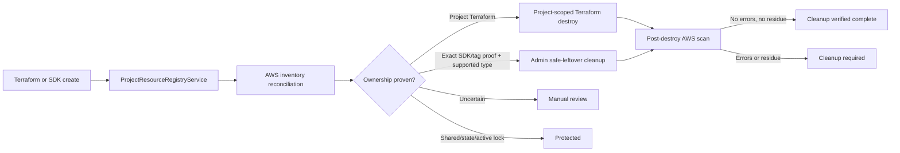
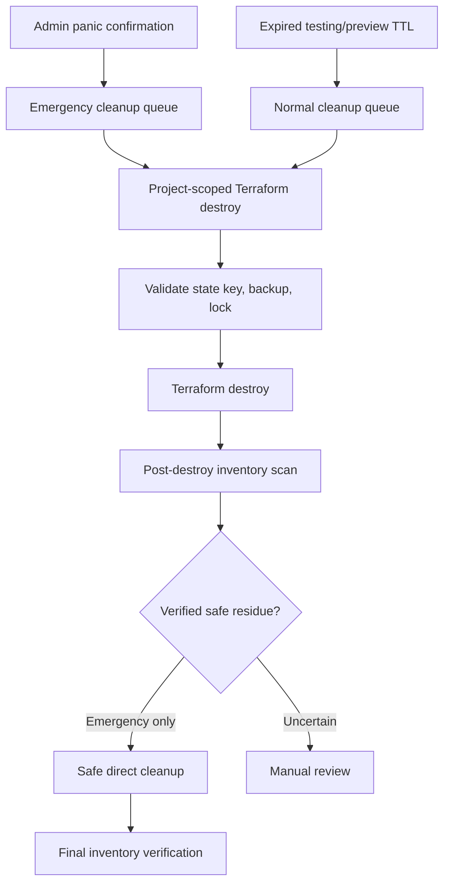

# DeployGuard cloud resource lifecycle

This document is the audit map for resources created by DeployGuard. The persisted `central_cloud_resources` registry is the authoritative cross-project view. Terraform state remains authoritative for Terraform destroy scope; the registry never broadens that scope.

## Ownership and cleanup rules

- `terraform`: registered after successful apply from exact Terraform outputs. Cleanup path is the project's Terraform state key.
- `sdk`: registered immediately after a successful DeployGuard SDK create/ensure call and reconciled by AWS inventory.
- `discovered_tag`: ownership requires `ManagedBy=DeployGuard` plus an exact project identifier.
- `naming_prefix`: useful discovery evidence, but insufficient by itself for destructive cleanup unless an exact project mapping also exists.
- `state_backend`: the shared state bucket is always protected. Project state objects and active lockfiles are protected. Only a confirmed stale project lockfile has a supported cleanup path.
- Missing or conflicting ownership evidence always becomes `manual_review` or `protected`; it never becomes automatically safe.

## Resource map

| Resource | Created by | Persisted/tracked by | Normal destroy path | Leftover cleanup | Primary risk |
|---|---|---|---|---|---|
| VPC, subnets, IGW, route tables/associations | Terraform network module | Infrastructure environment outputs, Terraform state, resource registry | Project Terraform destroy | Manual review only | Shared/unrelated network deletion |
| NAT gateway, EIP, ENI | Terraform network module / AWS dependencies | Terraform state, NAT outputs, tag inventory, registry | Project Terraform destroy | Manual review only | High ongoing cost; dependency ordering |
| ALB, listener, target group | Terraform ALB module | Terraform outputs, deployment record, registry | Project Terraform destroy | Manual review only | High ongoing cost; ambiguous naming |
| ECS cluster, service, task definition, autoscaling | Terraform ECS module | Terraform outputs, deployment record, registry, AWS reconciliation | Project Terraform destroy | Explicitly supported only for strongly verified residue | Running workload interruption |
| ECS tasks | ECS service runtime | AWS reconciliation and registry | Service scale-down/Terraform destroy | Admin-only stop for strongly verified orphan | Running workload interruption |
| ECR repository | DeployGuard ECR SDK service | Pipeline run plus immediate registry record | Project residue cleanup after destroy | Admin-only repository delete | Image loss; repository sharing |
| ECR images and lifecycle policy | ECR push/lifecycle SDK operations | Child inventory records under repository | Deleted with repository or lifecycle policy | Not independently auto-deleted | Artifact retention/storage cost |
| CloudWatch log groups/streams | Terraform ECS/EventBridge modules and runtime | Terraform outputs, prefix/tag inventory, registry | Project Terraform destroy | Exact project log group deletion | Loss of diagnostic history |
| Secrets Manager secrets | Terraform ECS module | Terraform state, exact project prefix/tags, registry | Project Terraform destroy | Admin-only scheduled deletion | Secret loss; never expose values |
| IAM roles and policies | Terraform ECS/EFS/EventBridge modules | Terraform state, tags/naming discovery, registry | Project Terraform destroy | Manual review only | Privilege and shared-role risk |
| Cloud Map namespace/service | Terraform Cloud Map module | Terraform outputs, Terraform state, registry | Project Terraform destroy | Manual review only | Dependency on ECS services/VPC |
| EFS file system, access points, mount targets | Terraform EFS module | Terraform outputs, storage record, registry, AWS reconciliation | Project Terraform destroy | Manual review only | Data loss and ongoing storage cost |
| KMS key/alias | Terraform EFS module | Terraform output/state and registry | Project Terraform destroy | Manual review only | Data recovery impact |
| Backup vault, plan, selection | Terraform EFS module | Terraform outputs, backup/storage records, registry | Project Terraform destroy | Manual review only | Recovery-point loss |
| EventBridge rule, targets, connection, destination | Terraform EventBridge module | Terraform outputs/state, tag inventory, registry | Project Terraform destroy | Manual review only | Integration disruption |
| S3 Terraform state object/version | State management service | Project Terraform state table and registry | Retained for audit/recovery | Never ordinary cleanup | Loss of destroy/recovery authority |
| S3 native `.tflock` | Terraform/state service | Lock table, S3 inspection, registry | Released by Terraform | Only confirmed stale project lockfile | Concurrent state corruption |
| Shared `deployguard-state-bucket` | Platform bootstrap/manual setup | Configuration and protected registry entry | Never project destroy | Never | Cross-project state loss |

## Lifecycle flow

Inventory scan failures are persisted in `cloud_inventory_scans`. A zero-resource result is only considered verified when the relevant scan completed without service errors.

## Resource Command Center

The admin Resource Command Center groups inventory by project and cleanup path. Terraform-managed dependencies are presented as one stack rather than independent delete targets. ECR images and lifecycle policies are children of their repository. Cost risk prioritizes NAT gateways, load balancers, ECS workloads, EIPs, EFS, and large log groups; it is not a fabricated cost estimate.

Cleanup queues have distinct responsibilities:

- `deploymentQueue` runs application deployment work.
- `deployguard-infrastructure-lifecycle` is the normal project cleanup queue. Project destroys are idempotent, state-key scoped, lock protected, and run with concurrency 1.
- `deployguard-emergency-cleanup` coordinates admin-confirmed non-production cleanup at higher priority and concurrency. It queues project Terraform destroys first and only then handles directly supported tagged residue.

## Emergency non-production cleanup

Panic cleanup requires an administrator, recent authentication, a server-issued one-time challenge, and the exact phrase `DESTROY ALL DEPLOYGUARD TEST RESOURCES`. Eligibility requires a persisted `testing` or `preview` environment, `ManagedBy=DeployGuard` evidence, a resource `Environment` tag of `testing`, `preview`, or `dev`, project ownership, and no shared/protected classification.

The action persists an `emergency_cleanup_operations` record with per-project progress. Production environments are rejected in both the selector and the internal automated-destroy method. The shared state bucket, state objects/versions/backups, active locks, and shared IAM/platform resources are never direct targets.

## Testing and preview TTL

Infrastructure environments persist `environmentType`, `ttlExpiresAt`, `autoDestroyEnabled`, and `cleanupStatus`. Developers and administrators can schedule 1, 4, 12, or 24 hours, or provide a validated custom future expiry through the API. The worker scheduler scans only expired `testing` and `preview` rows and enqueues the normal state-scoped cleanup path. Production cannot enable auto-destroy. Failed TTL queue attempts remain `retry_pending` and are audited.

