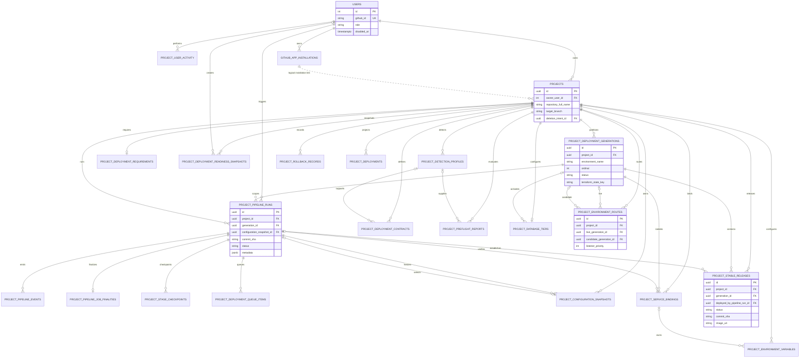
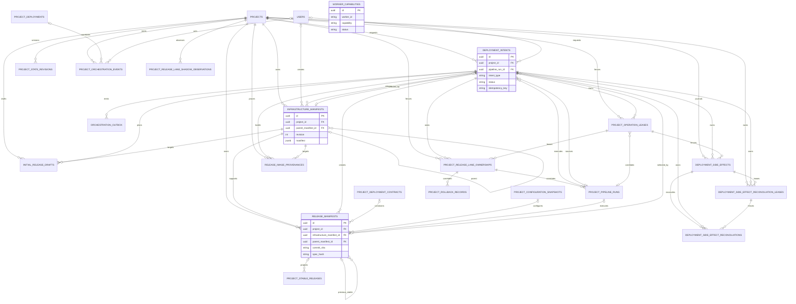
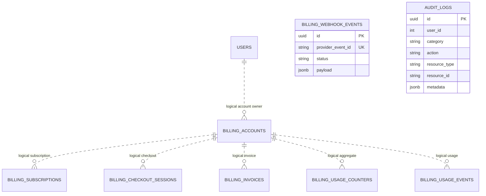
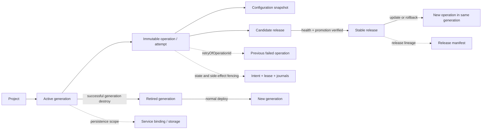

# DeployGuard Extended Entity-Relationship Diagram

This document represents the current migrated PostgreSQL model. It covers 84 application tables and the 182 enforced foreign-key relationships present in the local schema. The diagrams are split by domain so the model remains readable.

Legend:

- `||` exactly one
- `o|` zero or one
- `o{` zero or many
- `|{` one or many
- Solid relationships represent database foreign keys.
- Relationships labelled `logical` describe identifier-based associations without a database foreign key.

## 1. Core project and deployment-generation lifecycle

## 2. Immutable orchestration, manifests, and side-effect fencing

## 3. Infrastructure, Terraform state, persistence, and cleanup

```mermaid
erDiagram
    PROJECTS ||--o{ PROJECT_INFRASTRUCTURE_ENVIRONMENTS : environments
    PROJECT_PIPELINE_RUNS o|--o{ PROJECT_INFRASTRUCTURE_ENVIRONMENTS : applies
    INFRASTRUCTURE_MANIFESTS o|--o{ PROJECT_INFRASTRUCTURE_ENVIRONMENTS : desired
    INFRASTRUCTURE_MANIFESTS o|--o{ PROJECT_INFRASTRUCTURE_ENVIRONMENTS : applied

    PROJECTS ||--o{ PROJECT_INFRASTRUCTURE_EVENTS : emits
    PROJECT_INFRASTRUCTURE_ENVIRONMENTS o|--o{ PROJECT_INFRASTRUCTURE_EVENTS : concerns
    PROJECT_PIPELINE_RUNS o|--o{ PROJECT_INFRASTRUCTURE_EVENTS : correlates
    USERS o|--o{ PROJECT_INFRASTRUCTURE_EVENTS : acts

    PROJECTS ||--o{ PROJECT_TERRAFORM_STATES : stores
    PROJECT_INFRASTRUCTURE_ENVIRONMENTS o|--o{ PROJECT_TERRAFORM_STATES : materializes
    PROJECTS ||--o{ PROJECT_TERRAFORM_LOCKS : locks
    PROJECT_PIPELINE_RUNS o|--o{ PROJECT_TERRAFORM_LOCKS : owns
    PROJECTS ||--o{ PROJECT_STATE_VALIDATION_RESULTS : validates
    PROJECT_INFRASTRUCTURE_ENVIRONMENTS o|--o{ PROJECT_STATE_VALIDATION_RESULTS : checks
    PROJECTS ||--o{ PROJECT_STATE_RECOVERY_REQUESTS : recovers
    PROJECTS ||--o| PROJECT_CLOUD_STATES : projects

    PROJECTS ||--o{ PROJECT_PERSISTENT_STORAGE : owns
    PROJECT_INFRASTRUCTURE_ENVIRONMENTS o|--o{ PROJECT_PERSISTENT_STORAGE : hosts
    PROJECT_PIPELINE_RUNS o|--o{ PROJECT_PERSISTENT_STORAGE : provisions
    PROJECT_PERSISTENT_STORAGE ||--o{ PROJECT_BACKUP_RECORDS : backs_up
    PROJECTS ||--o{ PROJECT_BACKUP_RECORDS : owns
    PROJECTS ||--o{ PROJECT_STORAGE_EVENTS : emits
    PROJECT_PERSISTENT_STORAGE o|--o{ PROJECT_STORAGE_EVENTS : concerns
    USERS o|--o{ PROJECT_STORAGE_EVENTS : acts
    PROJECTS ||--o{ PROJECT_STORAGE_RESTORE_REQUESTS : requests
    PROJECT_PERSISTENT_STORAGE ||--o{ PROJECT_STORAGE_RESTORE_REQUESTS : restores
    USERS o|--o{ PROJECT_STORAGE_RESTORE_REQUESTS : requests
    USERS o|--o{ PROJECT_STORAGE_RESTORE_REQUESTS : approves

    PROJECTS ||--o{ PROJECT_SERVICE_DISCOVERY_RECORDS : discovers
    PROJECT_INFRASTRUCTURE_ENVIRONMENTS ||--o{ PROJECT_SERVICE_DISCOVERY_RECORDS : contains
    PROJECTS ||--o{ CENTRAL_CLOUD_RESOURCES : registers
    PROJECTS ||--o{ CLOUD_INVENTORY_SCANS : scans
    PROJECTS ||--o{ PROJECT_LEGACY_RESOURCE_QUARANTINES : quarantines

    PROJECTS ||--o{ INFRASTRUCTURE_DESTROY_CHALLENGES : challenges
    PROJECTS ||--o{ INFRASTRUCTURE_DESTROY_OPERATIONS : destroys
    DEPLOYMENT_INTENTS o|--o{ INFRASTRUCTURE_DESTROY_OPERATIONS : requests
    INFRASTRUCTURE_MANIFESTS o|--o{ INFRASTRUCTURE_DESTROY_OPERATIONS : targets
    INFRASTRUCTURE_DESTROY_OPERATIONS o|--o{ DEPLOYMENT_INTENTS : selected_by
    INFRASTRUCTURE_DESTROY_OPERATIONS o|--o{ PROJECT_OPERATION_LEASES : fences
    CLOUD_CLEANUP_OPERATIONS {
      uuid id PK
      string scope
      string status
      jsonb evidence
    }
    EMERGENCY_CLEANUP_OPERATIONS {
      uuid id PK
      string scope
      string status
      jsonb evidence
    }
    CENTRAL_CLEANUP_CHALLENGES {
      uuid id PK
      string challenge_type
      timestamptz expires_at
    }
    PROJECTS ||--o{ TERRAFORM_EXPORT_ARTIFACTS : exports
```

## 4. Security, cost, observability, notifications, and AI evidence

```mermaid
erDiagram
    PROJECTS ||--o{ PROJECT_SECURITY_FINDINGS : owns
    PROJECT_PIPELINE_RUNS o|--o{ PROJECT_SECURITY_FINDINGS : correlates

    PROJECTS ||--o| PROJECT_COST_SETTINGS : configures
    USERS o|--o{ PROJECT_COST_SETTINGS : updates
    PROJECTS ||--o{ PROJECT_COST_ESTIMATES : estimates
    PROJECT_DEPLOYMENT_GENERATIONS ||--o{ PROJECT_COST_ESTIMATES : scopes
    PROJECT_PIPELINE_RUNS o|--o{ PROJECT_COST_ESTIMATES : correlates
    USERS o|--o{ PROJECT_COST_ESTIMATES : creates
    USERS o|--o{ PROJECT_COST_ESTIMATES : approves
    USERS o|--o{ PROJECT_COST_ESTIMATES : rejects
    PROJECT_COST_ESTIMATES ||--o{ PROJECT_COST_RESOURCE_BREAKDOWNS : contains
    PROJECTS ||--o{ PROJECT_COST_RESOURCE_BREAKDOWNS : owns
    PROJECT_PIPELINE_RUNS o|--o{ PROJECT_COST_RESOURCE_BREAKDOWNS : correlates

    PROJECTS ||--o| NOTIFICATION_PREFERENCES : configures
    PROJECTS ||--o{ NOTIFICATION_SUBSCRIPTIONS : subscribes
    PROJECTS ||--o{ NOTIFICATION_DELIVERIES : delivers

    PROJECTS ||--o{ AI_ANALYSIS_SESSIONS : troubleshoots
    AI_ANALYSIS_SESSIONS ||--o{ AI_ANALYSIS_MESSAGES : contains
    AI_ANALYSIS_SESSIONS ||--o{ AI_ANALYSIS_RESULTS : produces

    PROJECTS ||--o{ PROJECT_LOG_STREAM_SESSIONS : streams
    PROJECT_PIPELINE_RUNS o|--o{ PROJECT_LOG_STREAM_SESSIONS : correlates
    PROJECT_DEPLOYMENTS o|--o{ PROJECT_LOG_STREAM_SESSIONS : observes
    USERS o|--o{ PROJECT_LOG_STREAM_SESSIONS : opens

    PROJECTS ||--o{ PROJECT_OBSERVABILITY_EVENTS : emits
    PROJECT_PIPELINE_RUNS o|--o{ PROJECT_OBSERVABILITY_EVENTS : correlates
    PROJECT_DEPLOYMENTS o|--o{ PROJECT_OBSERVABILITY_EVENTS : observes
    USERS o|--o{ PROJECT_OBSERVABILITY_EVENTS : acts

    PROJECTS ||--o{ PROJECT_PIPELINE_METRIC_SUMMARIES : summarizes
    PROJECT_PIPELINE_RUNS ||--o{ PROJECT_PIPELINE_METRIC_SUMMARIES : measures
    PROJECTS ||--o{ PROJECT_RUNTIME_METRIC_SNAPSHOTS : samples
    PROJECT_PIPELINE_RUNS o|--o{ PROJECT_RUNTIME_METRIC_SNAPSHOTS : correlates
    PROJECT_DEPLOYMENTS o|--o{ PROJECT_RUNTIME_METRIC_SNAPSHOTS : measures
    PROJECTS ||--o{ PROJECT_STAGE_METRICS : measures
    PROJECT_PIPELINE_RUNS o|--o{ PROJECT_STAGE_METRICS : correlates
    PROJECT_DEPLOYMENTS o|--o{ PROJECT_STAGE_METRICS : measures
    PROJECTS ||--o{ PROJECT_SPOT_INTERRUPTION_EVENTS : records
```

## 5. Identity-adjacent billing and audit data

These tables currently use identifier columns for several logical associations without enforcing all of them as PostgreSQL foreign keys. They are shown separately to distinguish that fact from the enforced project lifecycle graph.

## 6. Authoritative lifecycle interpretation

Key boundaries:

- `project_id + environment_name + generation_id` isolates generation-owned infrastructure and persistence evidence.
- A Deploy, Retry, or Rollback creates a new immutable operation; it does not rewrite prior operations.
- Stable release authority changes only after verified candidate promotion.
- Destroy retires a generation only after verified cleanup. A subsequent Deploy creates a new generation.
- Project extinction relies on the project-rooted `ON DELETE CASCADE` graph, while provider resources and external artifacts require separately verified cleanup before the project row is removed.
