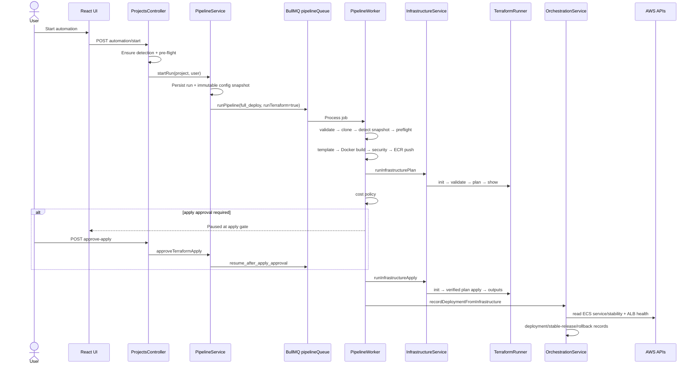

# DeployGuard Current Orchestration Map

## Scope and evidence standard

This is a Session 1, read-only description of the repository at
`a59bb18d3bbbf5c251df999afceea29c5dde882e`. Graphify was used only to locate
candidate paths. Every conclusion below was verified against the cited production
source. No runtime, schema, queue, Terraform, AWS, database, or frontend change was
made.

## Executive map

DeployGuard currently has two user-visible ways to request a normal deployment,
but both converge on the same combined `full_deploy` worker path:

1. Project automation:
   `POST /api/projects/:projectId/automation/start`
   (`backend/src/projects/projects.controller.ts:234`) calls
   `PipelineService.startRun()` (`backend/src/projects/pipeline/pipeline.service.ts:66`).
2. Infrastructure deploy:
   `POST /api/projects/:projectId/deploy`
   (`backend/src/infrastructure/infrastructure.controller.ts:20`) calls
   `InfrastructureService.deploy()` (`backend/src/infrastructure/infrastructure.service.ts:148`).
   The orchestration deploy route delegates to this same service
   (`backend/src/orchestration/orchestration.controller.ts:11`,
   `backend/src/orchestration/orchestration.service.ts:76`).

Both create `full_deploy` jobs. The normal pipeline hard-codes
`runTerraform: true` (`backend/src/projects/pipeline/pipeline.service.ts:131`), and
the worker runs Terraform plan, cost, Terraform apply, and then ECS orchestration
for every full deployment (`backend/src/projects/pipeline/pipeline-worker.service.ts:351`,
`:369`). This is the exact reason ordinary application releases currently run
Terraform.

## Entry-point inventory

| Intent | Frontend | Backend entry | Current run/job result | Duplicate/idempotency behavior |
|---|---|---|---|---|
| Create project | `frontend/src/pages/NewProject.jsx` | `POST /api/projects` (`projects.controller.ts:169`) | Project record only; setup automation is a separate request | Repository duplication is checked by project service; not a deployment idempotency key |
| Start automation | `startProjectAutomation` (`frontend/src/api/projectApi.js:76`) | `projects.controller.ts:234` | `full_deploy` | Controller consults current state and `startRun` checks active run, but check/create/enqueue is not one transaction |
| Start pipeline | `startPipelineRun` (`projectApi.js:203`; no production page consumer found) | `projects.controller.ts:337` | `full_deploy` | Same `startRun` check; queue add has no deterministic `jobId` |
| Retry pipeline | `retryPipelineRun` (`projectApi.js:233`) | `projects.controller.ts:401` | Calls automation start and creates a new full run | No retry key; active-run guard only |
| Resume recovery | `ResumeDeploymentButton.jsx:3` | `projects.controller.ts:219` | `stage_selective_resume`, or full fallback | PostgreSQL advisory session lock + equivalent-active-recovery check; selective queue job uses `recovery-${run.id}` |
| Approve apply | `approveTerraformApply` (`projectApi.js:83`) | `projects.controller.ts:415` | `resume_after_apply_approval` | Conditional status update plus deterministic `apply-approval-${run.id}` job ID (`pipeline.service.ts:381`) |
| Direct deploy | `ProjectDeployPanel.jsx:81` | `infrastructure.controller.ts:20` | Separate `full_deploy` infrastructure run | No active-run gate in `createInfrastructureRun`; no queue job ID |
| Direct plan | API helper exists | `infrastructure.controller.ts:25` | `infrastructure_plan` | Creates a new run; no uniqueness key |
| Direct apply | API helper exists | `infrastructure.controller.ts:30` | `infrastructure_apply` | Creates a new run; apply claim later protects plan/config consistency |
| Orchestration deploy | `deployOrchestration` (`projectApi.js:453`) | `orchestration.controller.ts:11` | Delegates to direct deploy | Same duplicate risk as direct deploy |
| Rollback | `ProjectRollback.jsx:12` | `orchestration.controller.ts:39` | ECS service update to prior stable task definition | Operation record and status checks; no general release request idempotency key |
| Cancel run | Project/Pipeline pages | `projects.controller.ts:385` | Cancels current run/job where possible | Run-scoped |
| Project archive | Settings | `projects.controller.ts:517` | Archives project record | Does not destroy cloud resources |
| Project destroy | `DestroyInfrastructurePanel.jsx` | `infrastructure-lifecycle.controller.ts:13-21` | Dedicated lifecycle queue Terraform destroy | Challenge, recent auth, state backup, `jobId=operation.id`, state lock |
| Admin cleanup | Admin cleanup page | `central-cloud-cleanup.controller.ts:15-28` | Inventory/direct safe residue cleanup or project destroy retry | Admin challenge and operation-scoped jobs |
| Repository trigger | None found | None found | No push/webhook deployment entry point | GitHub Actions is only optional external CI dispatch inside a run |

## Current full pipeline

The default worker sequence is:

1. validate inputs
2. prepare run
3. clone repository
4. stack-detection snapshot
5. deployability/pre-flight validation
6. optional external CI
7. Dockerfile/template generation
8. Docker build
9. security stage
10. ECR push
11. Terraform plan
12. cost policy
13. Terraform apply gate/apply
14. managed database readiness
15. ECS deployment record/stability
16. ALB health
17. stable release or rollback
18. terminal run status

The branch and ordering are implemented in
`backend/src/projects/pipeline/pipeline-worker.service.ts:192-471`.
`Worker` concurrency is globally `1` (`pipeline-worker.service.ts:167-185`).

The worker persists stage events in `project_pipeline_events`, run state in
`project_pipeline_runs`, stage checkpoints in `project_stage_checkpoints`, and
module-specific records in infrastructure, cost, security, state, storage, and
orchestration tables. The run snapshot is stored in
`project_configuration_snapshots`.

## Terraform paths

There is one production Terraform process adapter:
`backend/src/infrastructure/terraform-runner.service.ts`.

| Terraform operation | Production caller(s) | Notes |
|---|---|---|
| `init` | Infrastructure plan/apply; lifecycle destroy | Enforces workspace root/backend mode |
| `validate` | Infrastructure plan | Real Terraform validation |
| `plan` + `show` | `InfrastructureService.runInfrastructurePlan()` (`infrastructure.service.ts:300`) | Writes `tfplan` and integrity fingerprints |
| `apply` | `InfrastructureService.runInfrastructureApply()` (`infrastructure.service.ts:488`) | Applies the exact verified plan after claim and approval |
| `output` | Infrastructure apply | Populates infrastructure environment outputs |
| `state pull` | Infrastructure state validation (`infrastructure.service.ts:1278`) | Persists state metadata |
| `state list` | Lifecycle destroy worker (`infrastructure-lifecycle-worker.service.ts:67`) | Filters protected targets |
| `destroy` | Lifecycle destroy worker (`infrastructure-lifecycle-worker.service.ts:70`) | Project state scoped; shared bucket explicitly rejected |

`backend/src/projects/pipeline/terraform.service.ts:43` is a competing legacy
placeholder used by the non-full pipeline stage; it does not execute a real
Terraform plan and should not be mistaken for the production infrastructure
runner.

Terraform workspaces are rooted at the configured
`TERRAFORM_WORKING_BASE_DIR`, then isolated by
`<projectId>/<pipelineRunId>` (`infrastructure.service.ts:225-253`). The base
network template is copied into that run directory. Shared module templates are
copied to a project-level sibling `modules` directory, so separate projects are
isolated but concurrent runs for one project can write the same copied module
path.

Remote state is canonicalized to
`<prefix>/<projectId>/terraform.tfstate`, with S3 native
`.tflock` (`backend/src/state-management/terraform-state.service.ts:76-99`).

## ECS and release paths

The ECS adapter already provides reusable primitives:

- register task definition (`backend/src/orchestration/ecs.service.ts:83`)
- wait for service stability (`ecs.service.ts:91`)
- update service to task definition (`ecs.service.ts:184`)
- validate deployment configuration (`ecs.service.ts:224`)

Current ordinary deployment does **not** call
`registerTaskDefinition()` or `updateServiceToTaskDefinition()`. Instead,
`OrchestrationService.recordDeploymentFromInfrastructure()` reads
`ecs_task_definition_arn` from Terraform outputs
(`backend/src/orchestration/orchestration.service.ts:165-181`), then waits for
service stability and ALB health (`orchestration.service.ts:258`). The only
production caller found for `updateServiceToTaskDefinition()` is rollback
(`backend/src/orchestration/rollback.service.ts:132`).

Therefore a release-only lane is feasible but incomplete: task-definition
rendering, registration, service update, stability, health, stable-release, and
rollback primitives exist; ordinary candidate promotion, supersession,
release-level idempotency, and a durable release manifest are not wired.

## Locking and concurrency

| Scope | Current control | Finding |
|---|---|---|
| Pipeline queue | BullMQ worker concurrency `1` | Prevents parallel pipeline work in one worker deployment, but is a throughput bottleneck and not a durable per-project invariant |
| Start automation | Read active-run then create/enqueue | Race window exists because it is not a single transaction/advisory lock |
| Direct infrastructure runs | No active-run check | Can race automation and each other |
| Apply eligibility | Transaction + project configuration advisory lock + apply advisory lock | Strong pre-mutation fingerprint and newest-run claim, but transaction lock ends before the Terraform subprocess |
| Terraform operation | `project#<id>#environment#dev` persisted lock + heartbeat | Shared across plan/apply/destroy; stale-lock queue exists |
| S3 state | Native S3 lockfile | Second Terraform-level exclusion |
| Recovery | PostgreSQL advisory session lock keyed by recovery request | Stronger request coalescing; fallback can still create a full deploy |
| Destroy | Active-run/destroy checks, operation `jobId`, state lock | Safest current mutation path |
| Lock ordering | Not centrally declared | Pipeline/apply/recovery/destroy obtain different combinations; future two-lane ordering must be explicit |
| Worker compatibility | No worker schema/version registration gate found | An older worker could consume a newer payload during rolling deployment |

The persisted lock queue selects the next waiting deployment and the
infrastructure service re-enqueues with `jobId=state-lock-${queueItem.id}`
(`backend/src/infrastructure/infrastructure.service.ts:1420`). State-lock
acquisition itself uses conditional updates to avoid taking a fresh live lock
(`backend/src/state-management/state-lock.service.ts:32-110`).

## Workspaces and artifacts

| Artifact | Current isolation | Cleanup/reuse |
|---|---|---|
| Detection clone | OS temp `deploy-guard-detect-*` | Always recursively removed (`repository-workspace.service.ts:29-74`, `:119`) |
| Pipeline repository | `<PIPELINE_WORKSPACE_DIR>/<runId>/repository` | Parent run directory removed in worker `finally` (`pipeline-worker.service.ts:1020-1064`, `:468`) |
| Docker build context | Detected app root within run repository | Path-escape check; Docker image/tag retained externally |
| Terraform | `<terraform-root>/<projectId>/<runId>` | Retained for apply/destroy; path stored on environment |
| Terraform modules copy | `<terraform-root>/<projectId>/modules` | Shared by runs of one project; concurrency risk |
| Terraform plan | Run workspace `tfplan` + stored hash/fingerprints | Exact-plan checks before apply |
| State reads | OS temp `deployguard-state-read-*` | Removed in `finally` (`terraform-state.service.ts:286-305`) |
| Logs/events | PostgreSQL module event tables | No filesystem log workspace is canonical |
| Recovery artifacts | Stage checkpoint rows and image references | Fingerprint rules prevent unsafe reuse, but coverage depends on checkpoint completeness |

## State, status, time, and progress producers

`ProjectCurrentStateService` is the broadest projector
(`backend/src/projects/current-state/project-current-state.service.ts`), but it
aggregates multiple independent authorities:

- project and repository settings
- detection profile and deployment contract
- pre-flight and deployment requirements
- configuration snapshot and service binding
- pipeline run/events and BullMQ activity
- security and cost records
- infrastructure environment/events/readiness
- Terraform state/lock/validation queue snapshot
- storage and database tier
- deployment, stable release, runtime metrics
- cloud reconciliation and resource registry

Consumers do not all use only that projection. Pipeline UI calculates a fallback
percentage from stage counts, Infrastructure reads its own environment/events,
State reads the state safety endpoint, Orchestration reads orchestration status,
and cleanup pages read cloud-resource reconciliation. This explains how the same
project can acquire different status, recency, and progress interpretations.

## Recovery ownership

`RecoveryIssueService`/current state diagnoses the active issue.
`DeploymentCheckpointService` determines reusable artifacts.
`StageSelectiveResumeService` creates recovery runs
(`backend/src/projects/recovery/stage-selective-resume.service.ts:49-177`).
The worker executes selective or full fallback paths
(`pipeline-worker.service.ts:485-568`).

Selective resume is real, but classification is not yet the two-lane planner:
some issues re-enter Terraform, cleanup-only issues bypass deployment, and a
missing/unsafe checkpoint falls back to `PipelineService.startRun()`, which is
the Terraform-coupled full deployment.

## Deletion ownership

Project deletion and cloud deletion are separate:

- `DELETE /api/projects/:id` archives the project
  (`backend/src/projects/projects.controller.ts:517`).
- Terraform destroy uses the lifecycle controller/service/worker.
- Admin cleanup handles only verified, supported leftovers.
- TTL/emergency cleanup can enqueue only eligible non-production environments.

Live destroy requires recent auth, an expiring challenge, the exact phrase,
a versioned state backup reference, the project-specific state key, a project
state lock, and confirmation that the shared state bucket is not tracked
(`infrastructure-lifecycle.service.ts:54-156`,
`infrastructure-lifecycle-worker.service.ts:33-111`). Persistent database
resources are preserved unless separately confirmed
(`infrastructure-lifecycle.service.ts:291-295`).

The main gap is lifecycle cohesion: archiving a project is not a durable
delete workflow that waits for cloud cleanup before final archival.

