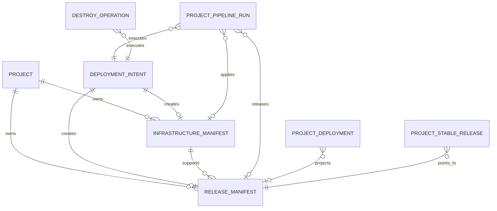

# DeployGuard Two-Lane Migration — Session 2 Frozen Contracts

## 1. Status

This document freezes the persistence and service contracts for the two-lane
migration. It is design-only. It does not add entities, migrations, APIs,
workers, queues, or runtime behavior.

Contract version: `1`

The existing `ProjectDeploymentContract` remains the repository deployability
contract. It is an input to planning; it is not renamed or replaced by either
manifest. Its current one-row-per-project shape is verified at
`backend/src/projects/project-deployment-contract.entity.ts:54-214`.

## 2. Core terminology

- **Infrastructure manifest**: immutable desired or applied cloud-foundation
  revision for one project environment.
- **Release manifest**: immutable application-release revision bound to exactly
  one infrastructure manifest.
- **Deployment intent**: idempotent user/system request and the planner's
  durable classification decision.
- **Execution run**: an attempt to execute an accepted intent. Existing
  `ProjectPipelineRun` remains the execution record.
- **Stable release**: the currently promoted, health-verified release manifest.
- **Applied infrastructure**: the current successfully applied infrastructure
  manifest.
- **Canonical state**: read-only server projection that combines intent,
  manifests, execution, state safety, reconciliation, and health.

## 3. Global rules

1. Manifests are immutable after insertion, except lifecycle status, timestamps,
   sanitized executor metadata, and failure fields.
2. A specification change always creates a new monotonically increasing
   revision.
3. Release and infrastructure revision numbers are independent.
4. A release manifest always references an exact infrastructure manifest.
5. A release worker may run only against an `applied` infrastructure manifest.
6. Terraform may run only for an accepted `infrastructure_change` or
   `deletion` intent.
7. A release-only intent must never contain a Terraform operation.
8. No manifest contains secret values, credentials, tokens, encrypted payloads,
   Terraform state contents, or raw worker logs.
9. Secret references and deterministic fingerprints may be stored; secret
   values remain in the existing encrypted configuration system.
10. Historical imports never claim verified live/applied state without matching
    persisted evidence.

## 4. InfrastructureManifest schema

Table: `infrastructure_manifests`

Entity: `InfrastructureManifest`

### 4.1 Relational columns

| Column | SQL type | Null | Contract |
|---|---|---:|---|
| `id` | uuid PK | no | Generated UUID |
| `schema_version` | integer | no | `1` |
| `project_id` | uuid FK projects | no | `ON DELETE CASCADE` |
| `environment_name` | varchar(64) | no | Existing default is `dev` |
| `revision` | bigint | no | Monotonic per project/environment |
| `parent_manifest_id` | uuid FK self | yes | Prior desired revision |
| `created_by_intent_id` | uuid FK deployment_intents | yes | Null only for legacy import before intent linkage |
| `created_by_user_id` | integer FK users | yes | Null for system import |
| `origin` | varchar(32) | no | `planner`, `legacy_backfill`, `reconciliation_import` |
| `status` | varchar(32) | no | Lifecycle below |
| `spec_hash` | char(64) | no | SHA-256 of canonical sanitized `spec` |
| `terraform_template_version` | varchar(128) | no | Version/hash of Terraform templates |
| `state_backend` | varchar(16) | no | `s3` or `local_mock` |
| `state_key` | varchar(512) | no | Project-scoped key only |
| `state_version_id` | varchar(512) | yes | Applied/observed S3 version |
| `desired_spec` | jsonb | no | Canonical infrastructure specification |
| `change_set` | jsonb | no | Planner diff from applied manifest |
| `requires_terraform` | boolean | no | Must be true only when the diff needs Terraform |
| `plan_artifact_reference` | jsonb | yes | Sanitized workspace/artifact identity |
| `plan_artifact_sha256` | char(64) | yes | Exact-plan integrity |
| `plan_input_fingerprint` | char(64) | yes | Existing pre-mutation input identity |
| `plan_configuration_fingerprint` | char(64) | yes | Configuration snapshot identity |
| `terraform_outputs` | jsonb | yes | Sanitized, non-secret outputs |
| `terraform_outputs_hash` | char(64) | yes | Canonical outputs hash |
| `resource_count` | integer | yes | State/reconciliation evidence |
| `failure_code` | varchar(128) | yes | Stable machine code |
| `failure_message` | text | yes | Sanitized |
| `planned_at` | timestamptz | yes | |
| `approved_at` | timestamptz | yes | |
| `apply_started_at` | timestamptz | yes | |
| `applied_at` | timestamptz | yes | |
| `superseded_at` | timestamptz | yes | |
| `destroyed_at` | timestamptz | yes | |
| `created_at` | timestamptz | no | DB time |
| `updated_at` | timestamptz | no | DB time |

### 4.2 Status values

Use `varchar` plus a named `CHECK`, not a PostgreSQL enum:

`desired`, `planning`, `planned`, `approval_required`, `approved`, `applying`,
`applied`, `superseded`, `failed`, `destroying`, `destroyed`,
`imported_unverified`, `manual_review`.

### 4.3 Desired spec

`desired_spec` is canonical JSON with sorted object keys and normalized arrays:

```ts
type InfrastructureSpecV1 = {
  region: string;
  terraformTemplateVersion: string;
  network: {
    topology: "managed_vpc";
    availabilityZoneCount: number;
    publicSubnets: boolean;
    privateSubnets: boolean;
    natMode: "none" | "single" | "per_az";
  };
  registry: {
    managedEcrRepository: boolean;
    immutableTags: boolean;
    lifecyclePolicyHash: string | null;
  };
  ecsFoundation: {
    clusterMode: "shared_project" | "dedicated_project";
    serviceName: string;
    launchType: "fargate";
    capacityProviders: string[];
  };
  ingress: {
    enabled: boolean;
    protocol: "HTTP" | "HTTPS";
    containerPort: number;
    targetGroupPort: number;
    healthCheckPath: string;
    healthCheckProtocol: "HTTP";
  };
  database: {
    mode: "none" | "managed" | "external";
    engine: "postgres" | "mysql" | null;
    tierRevision: string | null;
    persistence: boolean;
    externalTlsRequired: boolean | null;
  };
  storage: {
    efsRequired: boolean;
    accessPointRequired: boolean;
    encrypted: boolean;
    backupRequired: boolean;
  };
  discovery: {
    cloudMapRequired: boolean;
    namespace: string | null;
  };
  observability: {
    cloudWatchLogs: boolean;
    cloudWatchMetrics: boolean;
    prometheus: boolean;
  };
  iamPolicyRevision: string;
  tags: Record<string, string>;
};
```

Application image, commit, build command, runtime secret references, and task
definition revision do not belong in this spec. Container/target port and ALB
health path are infrastructure-owned because changing the target group currently
requires infrastructure reconciliation.

### 4.4 Change set

```ts
type InfrastructureChangeSetV1 = {
  fromManifestId: string | null;
  changedPaths: string[];
  categories: Array<
    "network" | "registry" | "ecs_foundation" | "ingress" | "database" |
    "storage" | "discovery" | "observability" | "iam" | "tags"
  >;
  destructivePaths: string[];
  requiresApproval: boolean;
  reasonCodes: string[];
};
```

### 4.5 Constraints and indexes

- Unique `(project_id, environment_name, revision)`.
- Index `(project_id, environment_name, status, created_at DESC)`.
- Partial unique current applied manifest:
  `(project_id, environment_name) WHERE status='applied'`.
- `spec_hash` must match `^[0-9a-f]{64}$`.
- `requires_terraform=false` is forbidden for status values `planning`,
  `planned`, `approval_required`, `approved`, or `applying`.
- `state_key` must match the project-scoped backend key produced by
  `TerraformStateService.buildStateKey()`; current production construction is
  verified at `backend/src/state-management/terraform-state.service.ts:76-85`.

## 5. ReleaseManifest schema

Table: `release_manifests`

Entity: `ReleaseManifest`

### 5.1 Relational columns

| Column | SQL type | Null | Contract |
|---|---|---:|---|
| `id` | uuid PK | no | |
| `schema_version` | integer | no | `1` |
| `project_id` | uuid FK projects | no | `ON DELETE CASCADE` |
| `environment_name` | varchar(64) | no | |
| `revision` | bigint | no | Monotonic per project/environment |
| `parent_manifest_id` | uuid FK self | yes | Previous desired release |
| `previous_stable_manifest_id` | uuid FK self | yes | Rollback target at creation |
| `infrastructure_manifest_id` | uuid FK infrastructure_manifests | no | Exact foundation revision |
| `created_by_intent_id` | uuid FK deployment_intents | yes | |
| `pipeline_run_id` | uuid FK project_pipeline_runs | yes | Execution attempt |
| `deployment_contract_id` | uuid FK project_deployment_contracts | yes | |
| `configuration_snapshot_id` | uuid FK project_configuration_snapshots | yes | |
| `origin` | varchar(32) | no | `planner`, `legacy_backfill`, `rollback` |
| `status` | varchar(32) | no | Lifecycle below |
| `spec_hash` | char(64) | no | Canonical release spec |
| `repository_full_name` | varchar | no | |
| `branch` | varchar | no | |
| `commit_sha` | varchar | no | Full immutable SHA; unknown only for unverified import |
| `app_root` | varchar | no | |
| `deployment_contract_hash` | char(64) | no | |
| `configuration_fingerprint` | char(64) | no | |
| `build_fingerprint` | char(64) | no | |
| `runtime_fingerprint` | char(64) | no | |
| `image_uri` | varchar | yes | Available after push/import |
| `image_digest` | varchar | yes | Required before ECS update |
| `task_definition_input_hash` | char(64) | yes | |
| `task_definition_arn` | varchar | yes | |
| `release_spec` | jsonb | no | Sanitized |
| `health_evidence` | jsonb | yes | Sanitized ALB/ECS result |
| `failure_code` | varchar(128) | yes | |
| `failure_message` | text | yes | Sanitized |
| `build_started_at` | timestamptz | yes | |
| `built_at` | timestamptz | yes | |
| `deployment_started_at` | timestamptz | yes | |
| `health_verified_at` | timestamptz | yes | |
| `promoted_at` | timestamptz | yes | |
| `superseded_at` | timestamptz | yes | |
| `rollback_started_at` | timestamptz | yes | |
| `rolled_back_at` | timestamptz | yes | |
| `created_at` | timestamptz | no | |
| `updated_at` | timestamptz | no | |

### 5.2 Status values

`desired`, `blocked_on_infrastructure`, `building`, `built`, `deploying`,
`waiting_for_stability`, `health_checking`, `healthy`, `stable`, `failed`,
`rollback_started`, `rolled_back`, `superseded`, `cancelled`,
`imported_unverified`, `manual_review`.

### 5.3 Release spec

```ts
type ReleaseSpecV1 = {
  source: {
    repositoryFullName: string;
    branch: string;
    commitSha: string;
    appRoot: string;
  };
  build: {
    dockerStrategy: "generated" | "custom";
    dockerTemplate: string | null;
    buildCommand: string | null;
    outputDirectory: string | null;
    buildArgumentNames: string[];
  };
  runtime: {
    imageUri: string | null;
    imageDigest: string | null;
    command: string | null;
    containerPort: number;
    cpu: number;
    memory: number;
    plainVariableNames: string[];
    secretReferenceNames: string[];
    serviceBindingRevisions: Array<{ id: string; revision: string }>;
  };
  health: {
    path: string;
    expectedPort: number;
    gracePeriodSeconds: number;
  };
};
```

Only names and reference identifiers appear. Build/runtime secret values must not
be included. Existing `ProjectConfigurationSnapshot` already separates plain,
build, secret references, encrypted secret payload, and sanitized manifest
(`backend/src/projects/project-configuration-snapshot.entity.ts:15-29`).

### 5.4 Constraints and indexes

- Unique `(project_id, environment_name, revision)`.
- Index `(project_id, environment_name, status, created_at DESC)`.
- Partial unique current stable:
  `(project_id, environment_name) WHERE status='stable'`.
- Stable requires non-null `image_digest`, `task_definition_arn`,
  `health_verified_at`, and `promoted_at`.
- Any deployable status requires referenced infrastructure status `applied`;
  this cross-table invariant is enforced transactionally by the planner/worker,
  not a SQL `CHECK`.
- `pipeline_run_id` is not unique: later attempts may execute the same intent,
  while a run points back to one release manifest.

## 6. Revision relationships



Rules:

1. Revision allocation occurs inside the planner transaction after a
   per-project/environment planner lock.
2. Repeating an identical desired spec reuses the existing manifest; it does not
   create a duplicate revision.
3. `release_only`: no infrastructure manifest is created; the release references
   the current applied infrastructure manifest.
4. `infrastructure_change`: create a desired infrastructure manifest. Create a
   release manifest only when application redeployment is required; it starts
   `blocked_on_infrastructure`.
5. After successful apply, the old applied infrastructure becomes
   `superseded`, the new one becomes `applied`, and the blocked release becomes
   eligible for a separate release intent/job.
6. Infrastructure apply never directly calls the release controller while
   holding infrastructure/state locks. It commits, releases locks, then writes a
   new outbox event or unblocks the existing release intent.
7. Rollback creates a new release manifest with `origin=rollback`; it never
   rewrites the previous manifest.
8. Destroy targets the currently applied infrastructure manifest and records
   its ID on the deletion intent/operation. Successful destroy changes it to
   `destroyed`; release history remains audit history.

## 7. DeploymentIntent schema

Table: `deployment_intents`

```ts
type DeploymentIntentKind =
  | "deploy" | "retry" | "resume" | "plan" | "apply"
  | "rollback" | "destroy" | "cleanup" | "legacy_import";

type DeploymentClassification =
  | "release_only" | "infrastructure_change" | "no_op"
  | "unsafe_or_unknown" | "deletion";

type DeploymentIntentStatus =
  | "received" | "planned" | "enqueued" | "running"
  | "completed" | "failed" | "cancelled" | "no_op" | "rejected";
```

Columns:

- `id uuid PK`
- `schema_version integer NOT NULL DEFAULT 1`
- `project_id uuid NOT NULL`
- `environment_name varchar(64) NOT NULL`
- `requested_by_user_id integer NULL`
- `kind varchar(32) NOT NULL`
- `classification varchar(32) NULL`
- `status varchar(32) NOT NULL`
- `client_idempotency_key varchar(255) NOT NULL`
- `canonical_idempotency_key char(64) NOT NULL`
- `request_fingerprint char(64) NOT NULL`
- `request_payload jsonb NOT NULL` — sanitized
- `decision jsonb NULL`
- `infrastructure_manifest_id uuid NULL`
- `release_manifest_id uuid NULL`
- `source_pipeline_run_id uuid NULL`
- `pipeline_run_id uuid NULL`
- `destroy_operation_id uuid NULL`
- `failure_code varchar(128) NULL`
- `failure_message text NULL`
- `received_at`, `planned_at`, `enqueued_at`, `started_at`, `completed_at`
- `created_at`, `updated_at`

Constraints:

- Unique `(project_id, environment_name, canonical_idempotency_key)`.
- Same key + same request fingerprint returns the existing intent and response.
- Same key + different fingerprint returns HTTP `409 IDEMPOTENCY_KEY_REUSED`.
- No secrets in `request_payload`; configuration values are represented by a
  configuration fingerprint and snapshot ID.
- An accepted mutating intent has exactly one classification.
- `no_op` does not create a run or queue job.
- `unsafe_or_unknown` is terminal `rejected` until the user changes inputs and
  sends a new idempotency key.

Canonical key:

```text
sha256("v1\n" + projectId + "\n" + environmentName + "\n" +
       actorIdentity + "\n" + clientIdempotencyKey)
```

Request fingerprint:

```text
sha256(canonicalJson({
  kind, requestedCommitSha, deploymentContractHash,
  configurationFingerprint, desiredInfrastructureSpecHash,
  desiredReleaseSpecHash, sourcePipelineRunId, recoveryCode
}))
```

New mutation APIs require `Idempotency-Key`. Legacy adapters may generate a UUID
per distinct browser action during transition, but such generated keys do not
protect a client that retries without preserving the key.

## 8. Classification contract

Planner output:

```ts
type PlannerDecisionV1 = {
  schemaVersion: 1;
  intentId: string;
  classification: DeploymentClassification;
  reasonCodes: string[];
  currentAppliedInfrastructureManifestId: string | null;
  desiredInfrastructureManifestId: string | null;
  currentStableReleaseManifestId: string | null;
  desiredReleaseManifestId: string | null;
  infrastructureChangedPaths: string[];
  releaseChangedPaths: string[];
  approvalRequired: boolean;
  executionLane: "none" | "release" | "infrastructure" | "deletion";
  blockedReasons: Array<{ code: string; message: string; source: string }>;
};
```

Classification:

1. Missing/stale deployment contract, unresolved required configuration,
   deleting project, unverified legacy foundation, or unresolvable ownership:
   `unsafe_or_unknown`.
2. Destroy/cleanup request: `deletion`.
3. No applied infrastructure or infrastructure spec hash differs:
   `infrastructure_change`.
4. Infrastructure hash matches, but release hash differs or current stable
   release is absent/unhealthy and the request is retry/resume: `release_only`.
5. Both hashes match a healthy stable release and no active intent supersedes it:
   `no_op`.

The planner resolves all context-dependent fields before returning. It never
returns `context_dependent`.

## 9. Transactional planner contract

Interface:

```ts
interface TransactionalDeploymentPlanner {
  plan(input: {
    actor: AuthenticatedActor;
    projectId: string;
    environmentName: string;
    kind: DeploymentIntentKind;
    idempotencyKey: string;
    requestedCommitSha?: string;
    sourcePipelineRunId?: string;
    recoveryCode?: string;
  }): Promise<{
    intent: SanitizedDeploymentIntent;
    decision: PlannerDecisionV1;
    replayed: boolean;
  }>;
}
```

Required algorithm:

1. Begin a PostgreSQL `SERIALIZABLE` transaction.
2. Acquire `pg_advisory_xact_lock(hashtext(
   "deployguard:planner:<projectId>:<environment>"))`.
3. Load project with ownership/archival/deletion fence.
4. Insert intent or retrieve the unique existing intent.
5. On replay, verify request fingerprint and return without creating anything.
6. Load deployment contract, pre-flight, effective sanitized configuration,
   service bindings, desired database/storage settings, applied infrastructure,
   stable release, and active operation leases.
7. Create canonical desired infrastructure/release specs and hashes.
8. Apply the classification rules.
9. Allocate manifest revisions with `MAX(revision)+1` while the advisory
   transaction lock is held.
10. Insert only the required immutable manifests.
11. For an executable decision, create a `ProjectPipelineRun` and configuration
    snapshot, link IDs, then insert a transactional outbox record.
12. For `no_op`, mark the intent `no_op`; do not create a run/outbox row.
13. For unsafe input, mark `rejected` with sanitized blockers.
14. Commit.
15. A separate dispatcher publishes the outbox message to BullMQ.

The planner performs no Git clone, Docker, Terraform, AWS, Redis, or network call
inside the database transaction.

## 10. Transactional outbox

Table: `orchestration_outbox`

Columns:

- `id uuid PK`
- `intent_id uuid NOT NULL`
- `aggregate_type varchar(32) NOT NULL`
- `aggregate_id uuid NOT NULL`
- `event_type varchar(64) NOT NULL`
- `worker_envelope jsonb NOT NULL`
- `payload_sha256 char(64) NOT NULL`
- `status varchar(24) NOT NULL`:
  `pending`, `publishing`, `published`, `failed`, `dead_letter`
- `attempt_count integer NOT NULL DEFAULT 0`
- `available_at timestamptz NOT NULL`
- `claimed_by varchar NULL`
- `claim_expires_at timestamptz NULL`
- `published_job_id varchar NULL`
- `last_error text NULL` — sanitized
- `created_at`, `updated_at`, `published_at`

Unique `(intent_id, event_type, payload_sha256)`.

Delivery is at-least-once. Exactly-once effects come from intent identity,
deterministic BullMQ job IDs, operation leases, fencing tokens, and conditional
manifest status transitions.

## 11. Canonical state contract

Endpoint remains `GET /api/projects/:id/current-state`; response becomes
versioned and backward-compatible during migration.

```ts
type CanonicalProjectStateV1 = {
  schemaVersion: 1;
  projectionRevision: number;
  generatedAt: string;
  etag: string;
  project: {
    id: string;
    name: string;
    environmentName: string;
    repositoryFullName: string | null;
    branch: string | null;
  };
  desired: {
    infrastructureManifestId: string | null;
    infrastructureRevision: number | null;
    releaseManifestId: string | null;
    releaseRevision: number | null;
  };
  applied: {
    infrastructureManifestId: string | null;
    infrastructureRevision: number | null;
    stableReleaseManifestId: string | null;
    stableReleaseRevision: number | null;
  };
  operation: {
    intentId: string | null;
    classification: DeploymentClassification | null;
    lane: "release" | "infrastructure" | "deletion" | null;
    runId: string | null;
    status: string;
    stage: string | null;
    active: boolean;
    stale: boolean;
    leaseExpiresAt: string | null;
  };
  infrastructure: {
    status: "not_provisioned" | "planning" | "approval_required" |
      "applying" | "provisioned" | "failed" | "destroying" |
      "destroyed" | "manual_review";
    manifestId: string | null;
    stateKey: string | null;
    resourceCount: number | null;
    lastReconciledAt: string | null;
  };
  release: {
    status: "not_released" | "building" | "deploying" | "healthy" |
      "live" | "unhealthy" | "failed" | "rolled_back" | "manual_review";
    manifestId: string | null;
    commitSha: string | null;
    imageDigest: string | null;
    taskDefinitionArn: string | null;
    liveUrl: string | null;
    healthVerifiedAt: string | null;
  };
  stateSafety: TerraformStateSafetySnapshot;
  recovery: {
    currentIssue: SanitizedRecoveryIssue | null;
    previousDeploymentIssue: SanitizedHistoricalIssue | null;
    canResume: boolean;
    resumeIntentKind: "retry" | "resume" | null;
  };
  progress: {
    percentage: number;
    completed: number;
    total: number;
    currentStage: string | null;
    stages: CanonicalStage[];
  };
  primaryAction: {
    type: string;
    label: string;
    href: string | null;
    method: "GET" | "POST" | "PATCH" | "DELETE" | null;
    enabled: boolean;
    disabledReason: string | null;
  };
  evidence: {
    sourceTimestamps: Record<string, string | null>;
    winningSources: Record<string, string>;
    cloudVerificationStatus: string;
  };
  compatibility: {
    legacyProjectionIncluded: boolean;
    minimumFrontendSchemaVersion: number;
  };
};
```

Invariants:

- `operation.active=true` requires a non-expired operation lease and a queue
  job/worker heartbeat; a DB run label alone is insufficient.
- `release.status=live` requires a stable release manifest and health evidence
  for that exact manifest.
- `infrastructure.status=provisioned` does not imply the release is live.
- Historical recovery evidence cannot override the active intent/run.
- At most one primary action is returned.
- Downstream stages remain pending behind a paused/failed dependency.
- Progress is server-owned and cannot report successful 100% for an unhealthy or
  failed candidate.
- `etag=sha256(canonicalJson(response excluding generatedAt and etag))`.
- No secret values or unredacted provider errors appear.

`project_state_revisions` provides a cross-instance monotonic invalidation
counter:

- `(project_id, environment_name)` unique
- `revision bigint`
- `invalidated_at timestamptz`
- `reason varchar`
- `source_type varchar`
- `source_id varchar`

All authoritative writes increment it in the same transaction. The projector
uses this revision for cache invalidation and response `projectionRevision`.

## 12. Frozen Session 3 boundary

Session 3 milestone 1 may implement only:

- the entities/tables/constraints defined here;
- pure canonical JSON/hash/type validators;
- worker-envelope validation and capability registration contracts;
- nullable links from legacy records;
- migration and contract tests.

It must not:

- route any production request through the new planner;
- enqueue new two-lane jobs;
- implement or activate a release controller;
- call ECS directly from a new path;
- change Terraform decisions;
- backfill production records automatically;
- change frontend behavior.

