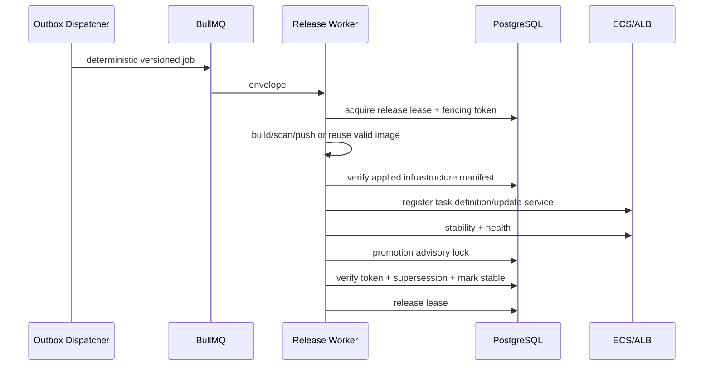

# Session 2 Lock Ordering and BullMQ Protocol

## 1. Design goal

Prevent duplicate, stale, cross-lane, and destructive operations without
holding a PostgreSQL transaction open during Git, Docker, Terraform, AWS, or
health checks.

The current system already has conditional Terraform state locks
(`backend/src/state-management/state-lock.service.ts:32-110`), S3 native
lockfiles, apply advisory locks
(`backend/src/infrastructure/infrastructure.service.ts:629-640`), and recovery
session locks. The frozen design composes them under one ordering.

## 2. OperationLease

Table: `project_operation_leases`

| Column | Type | Contract |
|---|---|---|
| `id` | uuid PK | |
| `project_id` | uuid | |
| `environment_name` | varchar(64) | |
| `lane` | varchar(24) | `release`, `infrastructure`, `deletion` |
| `scope` | varchar(32) | `execute`, `plan`, `apply`, `promote`, `destroy` |
| `intent_id` | uuid | Owner |
| `pipeline_run_id` | uuid nullable | |
| `destroy_operation_id` | uuid nullable | |
| `owner_worker_id` | varchar | |
| `fencing_token` | bigint | Monotonic per project/environment |
| `status` | varchar(24) | `acquired`, `heartbeat_active`, `released`, `expired`, `failed` |
| `acquired_at` | timestamptz | |
| `heartbeat_at` | timestamptz | |
| `expires_at` | timestamptz | |
| `released_at` | timestamptz nullable | |
| `metadata` | jsonb | Sanitized |

Partial unique `(project_id, environment_name, lane) WHERE status IN
('acquired','heartbeat_active')`.

Every side effect writes or verifies the current fencing token before its DB
transition. Expired owners cannot promote a release or mark infrastructure
applied.

## 3. Deletion fence

`projects` receives nullable:

- `deletion_fence_token bigint`
- `deletion_intent_id uuid`
- `deletion_started_at timestamptz`

The planner rejects deploy/retry/resume/plan/apply/rollback while the fence is
present. Only successful deletion completion or an authorized, proven-safe
cancel clears it.

## 4. Conflict matrix

| Requested operation | Release execute | Infrastructure plan | Infrastructure apply | Deletion |
|---|---:|---:|---:|---:|
| Release execute | conflict | allowed | conflict | conflict |
| Infrastructure plan | allowed | conflict for same desired revision | conflict | conflict |
| Infrastructure apply | conflict | conflict | conflict | conflict |
| Deletion | conflict | conflict | conflict | conflict |

Infrastructure planning may coexist with a release because it cannot mutate
cloud state and both operations use immutable revisions. Before apply, the
planner/executor revalidates that the plan still targets the intended desired
manifest and that no active release lease exists.

## 5. Global lock order

The only permitted acquisition order is:

1. **Planner transaction lock**
   `deployguard:planner:<projectId>:<environment>`
2. **Deletion fence check/set**
   project row plus deletion intent
3. **Operation lease**
   durable row with fencing token
4. **Infrastructure apply advisory transaction lock**
   `deployguard:infra-apply:<projectId>:<environment>`
5. **Persisted Terraform state lock**
   `project#<projectId>#environment#<environment>`
6. **Terraform S3 native lockfile**
   acquired internally by Terraform
7. **Release promotion advisory transaction lock**
   `deployguard:release-promote:<projectId>:<environment>`

Rules:

- Planner lock is released at transaction commit before a worker starts.
- A release worker never acquires the Terraform state lock.
- Infrastructure apply never acquires release promotion lock.
- After infrastructure apply, all infrastructure/state locks are released before
  a release outbox event becomes publishable.
- Release build may hold a release execution lease, but promotion revalidates its
  fencing token and exact infrastructure manifest under the short promotion
  transaction lock.
- Deletion sets the fence before acquiring its operation lease. It waits for or
  rejects active release/infrastructure leases; it never steals a fresh lease.
- Cleanup inventory reads require no mutation lease.
- Lock acquisition timeout produces a retryable `OPERATION_CONFLICT`, not a
  failed deployment.

No code path may acquire a lower-numbered lock while holding a higher-numbered
lock.

## 6. Lane flows

### Release-only



This flow is frozen as a protocol only. The release controller is not designed
internally or implemented in Session 2.

### Infrastructure change

Plan and apply are separate executable phases. Apply requires the approved exact
plan fingerprint. It acquires infrastructure lease, apply advisory lock, state
lock, and then Terraform's native lockfile. It commits the applied manifest,
releases every infrastructure lock, and only then permits a release outbox
message.

### Deletion

Deletion sets the fence, acquires deletion lease, validates state backup and
project key, acquires state lock/native lockfile, destroys state-tracked targets,
reconciles residue, then retains or clears the fence based on terminal proof.
The current destroy safety behavior at
`backend/src/infrastructure-lifecycle/infrastructure-lifecycle-worker.service.ts:33-111`
remains the implementation baseline.

## 7. BullMQ envelope v1

All new two-lane jobs use:

```ts
type DeployGuardWorkerEnvelopeV1 = {
  protocol: {
    name: "deployguard.worker";
    schemaVersion: 1;
    messageType:
      | "intent.release.execute"
      | "intent.infrastructure.plan"
      | "intent.infrastructure.apply"
      | "intent.deletion.execute"
      | "outbox.reconcile";
    minimumWorkerProtocol: 1;
    maximumWorkerProtocol: 1;
  };
  producer: {
    service: "deployguard-api" | "deployguard-outbox-dispatcher";
    serviceVersion: string;
    gitSha: string;
    producedAt: string;
  };
  identity: {
    intentId: string;
    projectId: string;
    environmentName: string;
    pipelineRunId: string | null;
    destroyOperationId: string | null;
    infrastructureManifestId: string | null;
    releaseManifestId: string | null;
  };
  routing: {
    lane: "release" | "infrastructure" | "deletion";
    operation: "execute" | "plan" | "apply" | "destroy";
    queue: string;
  };
  idempotency: {
    canonicalKey: string;
    payloadSha256: string;
    attempt: number;
    replayOfJobId: string | null;
  };
  execution: {
    mode: "full" | "resume";
    resumeFromStage: string | null;
    reusableCheckpointIds: string[];
    invalidatedCheckpointIds: string[];
    reasonCodes: string[];
    fencingTokenRequired: boolean;
  };
  trace: {
    correlationId: string;
    causationId: string | null;
    actorUserId: number | null;
  };
  expiresAt: string;
};
```

Deterministic BullMQ job ID:

```text
dg:v1:<lane>:<intentId>:<operation>:<attempt>
```

The envelope contains IDs, hashes, stage names, and sanitized reasons only. It
does not contain repository credentials, AWS credentials, environment values,
secret values, Terraform variables containing secrets, or OAuth tokens.

## 8. Worker capability registry

Table: `worker_capabilities`

- `worker_id varchar PK`
- `role varchar`: `legacy_pipeline`, `release`, `infrastructure`, `deletion`,
  `outbox_dispatcher`
- `minimum_protocol integer`
- `maximum_protocol integer`
- `supported_message_types jsonb`
- `service_version varchar`
- `git_sha varchar`
- `started_at`, `heartbeat_at`, `expires_at`
- `metadata jsonb` sanitized

Workers register and heartbeat. A capability is live only while
`expires_at > database_now`.

The outbox dispatcher publishes an envelope only when at least one live worker
supports its schema and message type. Otherwise the outbox row remains pending
with `WORKER_PROTOCOL_UNAVAILABLE`; the intent is not falsely failed.

## 9. Consumer validation order

Before doing work, every new worker:

1. Parses JSON with a strict schema.
2. Validates protocol name/version/message type.
3. Recomputes payload SHA-256.
4. Loads intent and compares project/environment/manifest/run IDs.
5. Rejects terminal or superseded intent as an idempotent no-op.
6. Checks deletion fence.
7. Acquires the appropriate operation lease/fencing token.
8. Conditionally transitions intent/run/manifest status.
9. Performs the stage.

Unsupported versions go to a protocol dead-letter path and emit a sanitized
audit/metric. They are not handed to the legacy worker.

## 10. Rolling compatibility

- Current `PipelineJobData` remains protocol `legacy/0`; it is not silently
  treated as v1 (`backend/src/projects/pipeline/pipeline.types.ts:15-37`).
- Legacy and v1 queues have distinct names during rollout.
- The existing pipeline worker consumes only the legacy queue.
- Session 3 registers v1 types/capabilities but does not publish v1 jobs.
- A later rollout first deploys compatible workers, observes their heartbeats,
  then enables outbox publication.
- Rollback disables publication; existing v1 jobs are drained by compatible
  workers and are never reinterpreted by the legacy worker.

