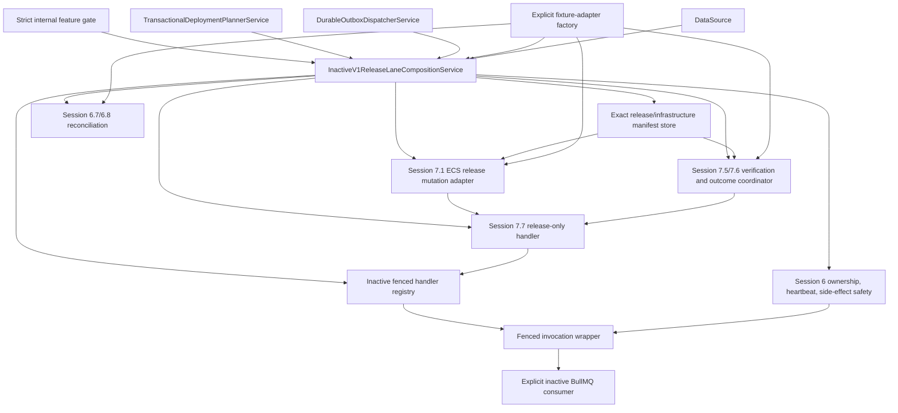

# Session 8.1 Implementation Findings

## Status

Session 8.1 is implemented and verified as a default-off, internal,
non-executing release-lane composition boundary.

The boundary does not expose an endpoint, start a consumer, dispatch an outbox
row, publish a BullMQ job, invoke the planner, construct an AWS SDK client, or
call ECS, Terraform, Docker, ECR, or the legacy pipeline.

## Dependency graph

The planner and outbox dispatcher are connected as existing internal
dependencies but are never called. The consumer is constructed only in valid
fixture-enabled mode and remains stopped.

## Gate behavior

The internal variables are:

- `TWO_LANE_RELEASE_COMPOSITION_ENABLED`
- `TWO_LANE_RELEASE_COMPOSITION_MODE`
- `TWO_LANE_RELEASE_WORKER_ID`
- `TWO_LANE_RELEASE_PROJECT_ALLOWLIST`
- `TWO_LANE_RELEASE_ENVIRONMENT_ALLOWLIST`

Only the exact string `TWO_LANE_RELEASE_COMPOSITION_ENABLED=true` enters the
enabled validation path. Missing values, `false`, booleans, case variants, and
unknown values are disabled. This is deliberate fail-closed parsing
(`inactive-v1-release-lane-composition.ts:283-318`).

An enabled configuration is ready only when:

- mode is exactly `fixture`;
- the worker ID matches the bounded worker identity format;
- at least one valid UUID appears in the project allowlist;
- at least one valid normalized environment appears in the environment
  allowlist; and
- an explicitly injected factory returns adapters with all required fixture
  policy markers.

The production Nest module registers no fixture factory. Consequently, setting
the flag without an explicit test-only factory produces `blocked`, not a
partially constructed lane.

| Input | State | Construction |
|---|---|---|
| Missing/malformed/unknown enable flag | `disabled` | No factory, handler, registry, consumer, or release composition |
| Explicit enable with invalid mode/identity/allowlists | `blocked` | No factory or release composition |
| Valid fixture config without injected factory | `blocked` | No handler, registry, consumer, or adapters |
| Valid fixture config and valid fixture factory | `ready` | Inactive graph constructed; nothing started or invoked |
| Factory throws or returns a wrong policy | `blocked` | Error is discarded; no raw detail is reported |

The sanitized status returns only state, mode, safe code, worker-configured
boolean, allowlist counts, and `consumerStarted: false`
(`inactive-v1-release-lane-composition.ts:82-94,331-347`). It contains no
worker ID, project ID, environment name, credentials, SDK errors, or payloads.

## Composition behavior

In ready fixture mode, the boundary:

1. creates the exact manifest store;
2. connects the injected fixture mutation client to the Session 7.1 mutation
   adapter;
3. connects the fixture rollout verifier to the Session 7.5/7.6 outcome
   coordinator and canonical stable projection;
4. creates the Session 7.7 policy-marked release-only handler;
5. replaces only `intent.release.execute` in the inactive registry;
6. connects capability validation, ownership, heartbeat, side-effect safety,
   fenced invocation, and the explicit consumer;
7. connects side-effect reconciliation and its coordinator; and
8. binds ECS reconciliation preparation to the exact manifest store and
   fixture-only read adapter
   (`inactive-v1-release-lane-composition.ts:193-280`).

The allowlist is canonicalized, deduplicated, sorted, and retained inside the
composition. `allows(projectId, environmentName)` fails closed for any scope
not present in both lists.

## Nest composition change

`OrchestrationContractsModule` now registers and exports the default-off
composition service (`orchestration-contracts.module.ts:43-80`).

The module no longer constructs or exports an unconditional
`InactiveV1BullMqConsumerService`. The only consumer construction is below the
validated fixture gate inside the new boundary. Existing placeholder runtime,
fencing, planner, and dispatcher services remain unchanged.

No fixture adapter provider is registered in the application composition root.

## No-execution proof

The focused test uses dependencies whose database, planner, dispatcher, ECS
mutation, ECS read, and rollout-verification methods throw immediately if
called. Both disabled and ready fixture construction complete with zero calls.

Static assertions prove the composition source has no:

- Terraform or infrastructure service dependency;
- infrastructure/deletion queue route;
- AWS `ECSClient` construction;
- BullMQ `Worker` construction;
- consumer `start`;
- outbox dispatch/publication; or
- planner invocation.

The handler registry contains the Session 7.7 handler only for
`intent.release.execute`. Infrastructure and deletion entries retain their
non-executing placeholders.

## Verification evidence

All executed commands completed with exit code 0.

| Command/suite | Result |
|---|---|
| `npm run test:inactive-v1-release-lane-composition` | Passed disabled, malformed, blocked, factory-failure, wrong-policy, and fixture-ready cases |
| Session 5 outbox pure regression | Passed |
| Session 6 runtime, ownership, invocation, consumer, heartbeat, side-effect, and reconciliation unit regressions | Passed |
| Session 7.1–7.7 focused unit regressions | Passed |
| Session 6 fenced invocation isolated PostgreSQL regression | Passed |
| Session 7 canonical outcome/projection isolated PostgreSQL regression | Passed |
| `npx tsc --noEmit --incremental false` | Passed |
| `npm run build` | Passed |
| `git diff --check` | Passed |

No Redis publication test was needed for the new boundary because it never
starts a consumer or invokes the dispatcher. No normal database or external
system was contacted.

## Files changed

- `backend/src/orchestration-contracts/release-lane/inactive-v1-release-lane-composition.ts`
- `backend/src/orchestration-contracts/orchestration-contracts.module.ts`
- `backend/scripts/verify-inactive-v1-release-lane-composition.ts`
- `backend/package.json`
- this findings document

## Remaining risks

- The ready composition is fixture-only. No production AWS adapter factory is
  registered.
- The boundary does not yet own consumer startup, dispatcher scheduling, or
  planner invocation.
- Allowlist configuration is validated and available to the boundary, but no
  execution path exists yet on which to enforce it.
- Legacy/v1 project-environment mutual exclusion is not implemented.
- Shadow planning and classification comparison are not implemented.
- No canonical status endpoint or frontend surface exposes this internal
  status.
- No real AWS permissions, quotas, throttling, or rollout behavior was tested.

## Exact next bounded task

**Session 8.2: implement the inactive legacy/v1 project-environment ownership
exclusion contract and persistence guard.**

It should define one fail-closed owner per project/environment, prevent legacy
and v1 release execution from overlapping, test acquisition/release and stale
ownership in isolated PostgreSQL, and remain default-off. It must not start the
consumer, publish jobs, invoke AWS/Terraform, expose an endpoint, or begin
shadow planning.

Session 8.2 was not started. The release lane remains inactive.
