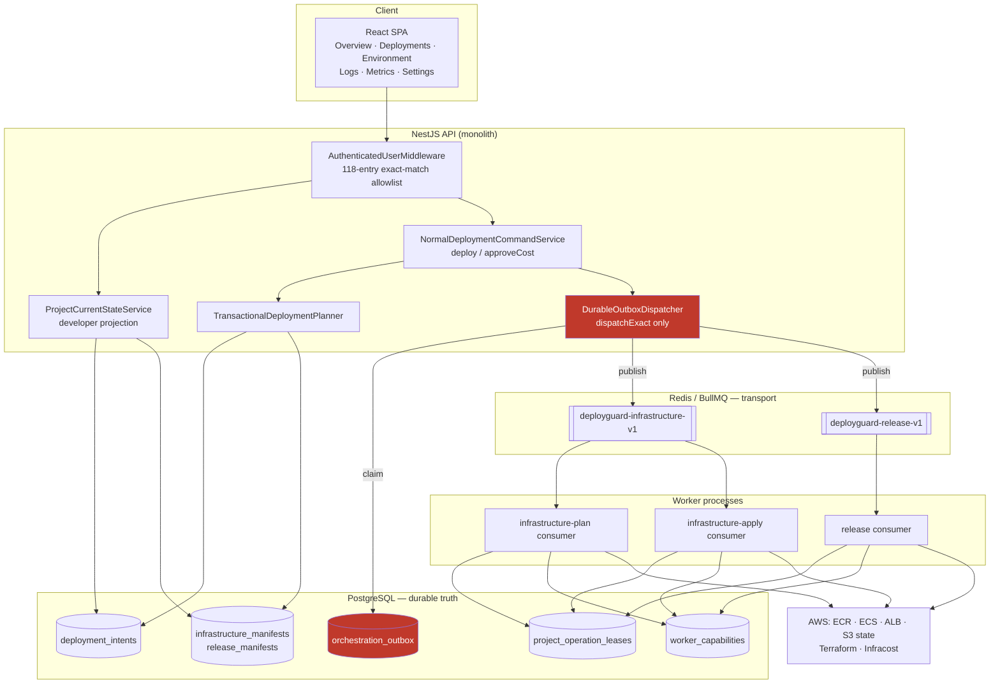
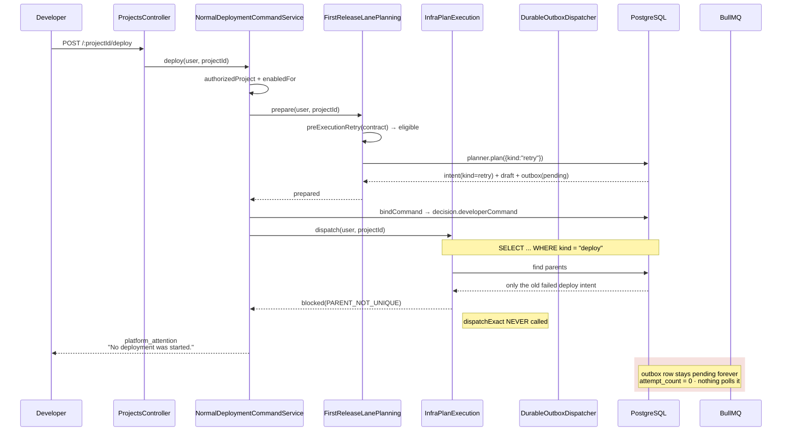
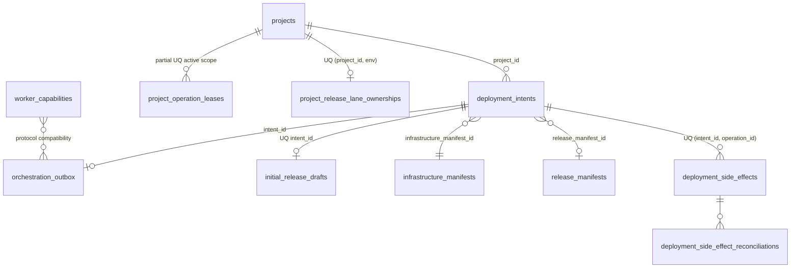

# DeployGuard Backend Architecture Review

Reviewer: independent audit (Claude)
Date: 2026-08-01
Method: read-only source, schema, and live-runtime inspection. No source, database,
Redis, Terraform, AWS, Docker or deployment-record modification. No job publication.
No Deploy command invocation. No test execution.

Evidence classes used throughout, never conflated:

| Class | Meaning |
|---|---|
| **INSPECTION** | Read from current source, schema or migrations |
| **LOCAL RUNTIME** | Read-only query against the live local PostgreSQL / Redis / Docker |
| **ISOLATED TEST** | A repository verify-script's assertions, read but not executed |
| **READ-ONLY AWS** | A non-mutating AWS API/CLI check performed by the product |
| **LIVE AWS** | Actual AWS resource mutation — **no evidence of this class exists** |

---

## 1. Executive verdict

### NOT READY — P0/P1 ARCHITECTURAL DEFECTS REMAIN

**P0: 2  ·  P1: 6  ·  P2: 11**

This verdict contradicts `FINAL_RESULT.md`, which records **GO**. The contradiction
is not interpretive. `REMAINING_WORK.md:20-22` states that the single next runtime
step is *"one operator-controlled Deploy click for the Express project."* That click
occurred at `2026-08-01 22:11:41Z`. It failed, and it failed in a way that leaves
project `7ff60e82-e166-4d3b-9ea7-78203370e59f` **permanently unable to deploy**
through any developer or operator route.

The failure is still present in the live database at the time of this review.

Two defects compound:

1. **The pre-execution retry path writes an intent its own dispatcher cannot read.**
   The planner emits `kind: "retry"`; the infrastructure-plan dispatcher filters
   `kind: "deploy"`. The retry intent is invisible to the only component that can
   publish it.
2. **The outbox has no durable drain loop.** `dispatchBatch()` and `dispatchOne()`
   have zero production callers. The outbox is drained *only* by an inline
   `dispatchExact()` inside the HTTP request. Anything that inline call misses is
   stranded forever, with no retry, no reconciliation and no operator route.

Defect 1 creates the orphan; defect 2 guarantees it is unrecoverable. Together they
falsify the central durability claim of the design and the launch-acceptance clause
of `RAILWAY_PRODUCT_CONTRACT.md:200-209`.

Separately, three of the six contractual developer surfaces are unreachable: **Logs,
Metrics and the Approve Cost action return HTTP 401 for every user**, because their
routes are absent from an exact-match authentication middleware allowlist.

**A live AWS deployment must not proceed.** The clean first-deployment path has
never completed end-to-end: the infrastructure queue holds **7 failed and 0
completed** jobs across the system's entire history.

### What is genuinely strong

The audit found real, well-built engineering. The durable contract layer —
immutable intents and manifests, deterministic BullMQ identity, canonical hashing,
partial-unique indexes for "one active lease" and "one stable release", fencing
tokens, SERIALIZABLE command binding, advisory-lock serialization, and fail-closed
`=== "true"` gating on ~80 flags — is above the standard typically seen at this
scale. The defects below are integration and wiring failures around that core, not
flaws in the core itself. That distinction matters for remediation cost: the fixes
are small and local.

---

## 2. Architecture summary

DeployGuard is a **modular monolith plus three out-of-process workers**, backed by
PostgreSQL (durable truth) and Redis/BullMQ (delivery transport only).

- **API** (`backend/src/main.ts`, NestJS 10) — 18 controllers, ~479 TypeScript
  source files, 80 entities, 60 migrations.
- **normal-v1 lane** (`backend/src/orchestration-contracts/`) — the intended
  product path. Planner → immutable intent → manifest → outbox → BullMQ → worker.
- **Legacy pipeline lane** (`backend/src/projects/pipeline/`,
  `backend/src/orchestration/`) — the predecessor. Mutating entry points are
  retired behind `GoneException`, but read paths and entities remain live.
- **Three workers**, each a `createApplicationContext` process with no HTTP server:
  release, infrastructure-plan, infrastructure-apply.

The intended invariant is sound: **PostgreSQL is the only source of truth; Redis is
a delivery channel that may be lost without losing work.** Defect P0-2 below breaks
exactly this invariant.

### Layering

| Layer | Location | Notes |
|---|---|---|
| HTTP | `*/**.controller.ts` | Role guards only; project scoping is re-derived in services |
| Product command | `projects/normal-deployment-command.service.ts` | The single canonical Deploy/Redeploy entry |
| Lane planning | `orchestration-contracts/release-lane/normal-*-planning.service.ts` | Decides eligibility, creates intents |
| Planner | `orchestration-contracts/planner/transactional-deployment-planner.service.ts` | Classification + immutable identity |
| Dispatch | `orchestration-contracts/release-lane/normal-*-execution.service.ts` | Inline `dispatchExact` |
| Outbox | `orchestration-contracts/outbox/durable-outbox-dispatcher.service.ts` | Claim, publish, complete |
| Worker runtime | `orchestration-contracts/worker-runtime/` | Ownership, leases, fencing, reconciliation |

---

## 3. System and data-flow diagrams

### 3.1 Intended system topology



Red nodes mark the defective boundary: the outbox is written durably but drained
only opportunistically.

### 3.2 Deploy click — actual control flow, with the P0 break



### 3.3 Durable state ownership



---

## 4. Document-authority map

| Document | Declared authority | Actual status | Supported by code? |
|---|---|---|---|
| `RAILWAY_PRODUCT_CONTRACT.md` | Sole authority for intended behavior | **Active, authoritative** | Intent honoured in most of the lane; violated at §"Automatic deployment", §"Developer surface", §"Multi-user contract" |
| `REMAINING_WORK.md` | Sole active implementation queue | **Active, but its central claim is false** | "No unresolved P0/P1 blocker" (`:20`) is contradicted by live state |
| `FINAL_RESULT.md` | Evidence + verdict only | **Superseded by this review** | GO verdict not reproducible |
| `CODEX_RAILWAY_TRANSFORMATION_PROGRAM.md` | Historical execution instructions | Historical | n/a |
| `FINAL_DAY_COMPLETION_TRACKER.md` (70 KB) | Historical | Historical | Explicitly demoted by contract `:17` |
| `docs/architecture/two-lane-migration/**` (62 files, ~700 KB) | Historical session evidence | Historical | Explicitly demoted by contract `:18-21` |
| `docs/ARCHITECTURE.md`, `docs/CLOUD_RESOURCE_LIFECYCLE.md`, `docs/frontend-architecture.md` | Reference | Historical (2026-07-13→21) | Partially stale |
| `docs/SETUP_REQUIRED.md` (61 KB), `MANUAL_SETUP_*` | Operational reference | Historical | Not re-verified here |
| `README.md` | Repository entry point | **Stale** | First heading is `# GitHub OAuth Authentication App`; `backend/package.json` name is `github-auth-backend` |
| 3 root PDFs | Historical | Historical | Explicitly demoted by contract `:20-21` |

**Authority conclusion.** The contract's own conflict policy (`:23-25`) resolves this
review cleanly: *"verified code/runtime/tests control current implementation."* Where
`FINAL_RESULT.md` and live runtime disagree, live runtime wins. No new source of
product truth is created by this document; findings belong in `REMAINING_WORK.md`.

---

## 5. Component responsibility map

| Component | Responsibility | Owns | Transaction | Duplicate responsibility? |
|---|---|---|---|---|
| `NormalDeploymentCommandService` <br/>`projects/normal-deployment-command.service.ts:56` | The one developer command | `decision.developerCommand` marker | SERIALIZABLE ×3 retry + advisory lock (`:252`) | No |
| `TransactionalDeploymentPlanner` <br/>`planner/transactional-deployment-planner.service.ts` | Classification, immutable identity, manifest revisions | intents, manifests, state revisions | Single txn under `deployguard:planner:{project}:{env}` (`:192`) | No |
| `NormalFirstReleaseLanePlanningService` <br/>`release-lane/normal-first-release-lane-planning.service.ts:61` | First-release eligibility | intent creation (`kind` choice, `:110`) | delegates | No |
| `NormalFirstReleaseInfrastructurePlanExecutionService` <br/>`release-lane/normal-first-release-infrastructure-plan-execution.service.ts:38` | Dispatch the plan intent | — | delegates | **Yes — re-derives "the current operation" with a different predicate than the writer. This is P0-1.** |
| `DurableOutboxDispatcherService` <br/>`outbox/durable-outbox-dispatcher.service.ts:49` | Claim → publish → complete | outbox status, fencing token | READ COMMITTED + `FOR UPDATE OF intent SKIP LOCKED` | No |
| `ProjectCurrentStateService` <br/>`projects/current-state/project-current-state.service.ts:165` | Detailed evidence assembly (1,901 lines) | — | none | **Yes — a god service; assembles evidence from ~20 subsystems** |
| `projectDeveloperCurrentState` <br/>`projects/current-state/project-developer-current-state.ts:32` | Pure sanitized projection | — | none | No — correctly pure |
| `InfrastructureReadinessService` <br/>`infrastructure/infrastructure-readiness.service.ts:57` | 15-gate readiness check | — | none | **Yes — a second, unrelated definition of "ready" (see §8)** |
| `V1UndispatchedIntentCancellationService`, `TerminalOutboxReconciliationService` | Recovery | — | — | **Dead code — registered as providers, no route, no caller (P1-3)** |

**Structural observations**

- **God service.** `project-current-state.service.ts` is 1,901 lines and reaches
  into contracts, preflight, inventory, reconciliation, lane status, cost, and
  activation. It is the highest-churn maintainability risk in the codebase (P2).
- **Weak boundary.** "Which intent is the current operation?" is answered
  independently by the planner, the planning service (`:90`), the execution service
  (`:59`), and the command service (`:287`). Each uses a different `where` clause.
  P0-1 is the direct consequence.
- **No circular module dependencies** were found between Nest modules.

---

## 6. Deployment lifecycle trace

### 6.1 Clean first deployment — **DEFECTIVE (never completed end-to-end)**

| Stage | Component | Durable effect | Status |
|---|---|---|---|
| Import / inspect | `projects.service.ts`, `detection/` | `projects`, detection profile | VERIFIED CORRECT (INSPECTION) |
| Stack detection | `detection/stack-detection.service.ts` | `frameworkVariant` | VERIFIED CORRECT |
| Preflight | `templates/preflight.service.ts` | `ProjectPreflightReport.inputFingerprint` | VERIFIED CORRECT |
| Deploy command | `normal-deployment-command.service.ts:94` | command marker | VERIFIED CORRECT |
| Plan intent | planner | intent + manifest + draft + outbox | VERIFIED CORRECT |
| **Plan dispatch** | `normal-first-release-infrastructure-plan-execution.service.ts:101` | outbox → `published` | **DEFECTIVE (P0-1, P0-2)** |
| Terraform plan | infrastructure-plan worker | manifest `planned` | **IMPLEMENTED BUT UNVERIFIED** — 0 successful plans exist |
| Cost decision | `normal-deployment-cost-policy.ts:29` | `decision.automaticContinuation` | IMPLEMENTED BUT UNVERIFIED |
| Apply | `v1-infrastructure-manifest-apply.service.ts` | manifest `applied` | IMPLEMENTED BUT UNVERIFIED |
| Release prepare → build → publish → deploy → verify | release consumer | release manifest `stable` | PARTIALLY VERIFIED — only via local fixture adapter |
| Live URL | `project-developer-current-state.ts:145` | — | VERIFIED CORRECT (gated on stable evidence only) |

**LOCAL RUNTIME evidence that this path has never completed:**

```
deployguard-infrastructure-v1: wait=0 active=0 delayed=0 failed=7 completed=0
```

Zero infrastructure jobs have ever completed successfully in this installation.

### 6.2 Source-only redeployment — **VERIFIED CORRECT (INSPECTION)**

`NormalReleaseLanePlanningService` (`normal-release-lane-planning.service.ts:60`)
requires an applied manifest **and** a stable release, then calls
`planner.plan({ requiredClassification: "release_only" })` (`:130`).
`classifyDeployment()`
(`planner/transactional-deployment-planner.pure.ts:44-56`) returns `release_only`
only when applied infrastructure exists and its spec hash is unchanged. The
release lane never constructs a Terraform workspace.

**Terraform non-invocation is proven by construction**: `TerraformRunnerService` is
provided only to the infrastructure modules, and `intent.release.execute` routes
exclusively to `deployguard-release-v1`
(`outbox/outbox-dispatcher.pure.ts:9-17`), which no infrastructure worker consumes.

### 6.3 Unchanged source — **VERIFIED CORRECT (INSPECTION)**

`classifyDeployment()` step 4 returns `no_op`. `deploy()` returns `noOp()`
(`normal-deployment-command.service.ts:112`) *before* any intent, outbox row or job
is created. No external side effect occurs.

### 6.4 Configuration change — **VERIFIED CORRECT (INSPECTION)**

`configurationFingerprint = canonicalSha256({variables, bindings, database, storage})`
(`transactional-deployment-planner.service.ts:652-655`) participates in the release
manifest reuse key, so an unchanged commit with changed configuration yields a new
release manifest and a valid new attempt. This satisfies contract `:56-57`.

### 6.5 Infrastructure change — **PARTIALLY VERIFIED**

Classification and the plan→policy→apply→release chain are implemented and
correctly gated behind three separate flags
(`normal-first-release-infrastructure-apply-execution.service.ts:71`). No execution
evidence exists (§6.1).

---

## 7. State-model assessment

### 7.1 Durable representations

| Concept | Representation | Assessment |
|---|---|---|
| Active operation | `deployment_intents.status ∈ (planned, enqueued, running)` | **PARTIALLY VERIFIED** — no DB constraint enforces uniqueness; enforced only by service-layer queries |
| Latest attempt | most-recent row by `receivedAt` | **DEFECTIVE (weak)** — see §7.3 |
| Stable release | `release_manifests` partial unique index `WHERE status='stable'` | **VERIFIED CORRECT** — genuine DB-level singleton |
| Applied infrastructure | `infrastructure_manifests` partial unique `WHERE status='applied'` | **VERIFIED CORRECT** |
| Source revision | `commitSha` + `detectionSourceCommit` equality check | VERIFIED CORRECT |
| Configuration revision | `configurationFingerprint` | VERIFIED CORRECT |
| Active lease | `project_operation_leases` partial unique on `(project, env, lane, scope) WHERE status IN ('acquired','heartbeat_active')` | **VERIFIED CORRECT** |
| Provider evidence | `existing-project-state-classifier.ts:74`, 5 classifications | VERIFIED CORRECT |

The three "one X" invariants that are backed by **partial unique indexes** — stable
release, applied manifest, active lease — are genuinely enforced by PostgreSQL. This
is good design and should be preserved.

### 7.2 The missing fourth invariant

"One active nonterminal operation" has **no equivalent DB constraint**. It is
enforced only by `activeParents.length !== 1` checks in application code. Because
those checks use *different predicates in different services* (§5), the invariant is
not actually held — which is precisely how P0-1 manifests.

**Recommendation (not implemented):** a partial unique index on
`deployment_intents (project_id, environment_name) WHERE status IN ('planned','enqueued','running')`
would make the invariant real and would have made P0-1 impossible to introduce.

### 7.3 Historical-failure contamination

The audit specifically checked whether historical failures influence current state.

| Influence | Result |
|---|---|
| Current developer action | **YES, by design and correctly** — `FIRST_RELEASE_PRE_EXECUTION_RETRY_READY` turns a blocked lane back into `ready` (`project-developer-current-state.ts:121-131`). The eligibility predicate (`normal-first-release-pre-execution-retry.ts:29-73`) is tight and correct. |
| Current error banner | No — command errors are version-scoped (`frontend/src/utils/canonicalCommandError.js`) |
| Deploy eligibility | **YES, and this is the defect** — the retry path is eligible but undispatchable |
| Stable URL | No — emitted only from verified stable evidence |
| Provider classification | No — `inventory_error` correctly excluded from `PROJECT_RESOURCE_EVIDENCE` (`existing-project-state-classifier.ts:62,100-104`) |

The two corrections `FINAL_RESULT.md` claims (inventory-error and retry-eligibility)
are **genuinely implemented and correct**. The defect is that only the *read* half of
the retry contract was built; the *dispatch* half was not.

### 7.4 Timestamp-ordered derivation

19 sites derive "latest"/"current" with `order: { createdAt|receivedAt: "DESC" }`,
including `normal-deployment-command.service.ts:287,297,310,364` and
`normal-first-release-lane-planning.service.ts:93,192,206`. Where a durable pointer
or explicit status predicate exists, these should use it. Under clock skew or
same-millisecond inserts these are non-deterministic. **P2**, but it is the same
class of weakness that produced P0-1.

---

## 8. Readiness-consistency assessment — **DEFECTIVE (P1-1)**

"Ready to deploy" has **three** unrelated meanings in this system.

| # | Definition | Location | Consumer |
|---|---|---|---|
| 1 | `normalV1Activation` + `contract.deployable` | `project-current-state.service.ts:412-431` | **The developer UI** |
| 2 | 15 gates incl. AWS creds, Terraform templates, Infracost, Trivy | `infrastructure-readiness.service.ts:57` | ADMIN-only route; **no other caller** |
| 3 | ~14 flag/evidence gates evaluated at click time | command + planning + execution services | The Deploy command |

Definition 1 — the one the developer sees — reads **exactly three inputs**. Verified
directly at `project-current-state.service.ts:412-431`: `normalV1Activation(config)`,
`contract`, `contract.deployable`. Nothing else.

### Gates that can reject a click the UI called `ready`

| Gate | Checked at | In readiness projection? |
|---|---|---|
| `TWO_LANE_NORMAL_AUTOMATIC_DEPLOY_ENABLED` | `normal-deployment-command.service.ts:386` | **No** |
| `TWO_LANE_NORMAL_INFRASTRUCTURE_PLAN_EXECUTION_ENABLED` | plan-execution `:183` | **No** |
| `TWO_LANE_NORMAL_INFRASTRUCTURE_APPLY_ENABLED` / `_EXECUTION_ENABLED` | apply-execution `:71` | **No** |
| `TWO_LANE_NORMAL_RELEASE_EXECUTION_ENABLED` | release-execution `:158` | **No** |
| Live compatible worker in `worker_capabilities` | dispatcher `:276,380` | **No** |
| Redis reachability | dispatcher `:118` | **No** |
| Expected AWS account | plan `:807`, apply `:848` | **No** |
| Terraform template directory | readiness `:145` | **No** |
| Infracost / FinOps tier block | readiness `:211` | **No** |
| Trivy security gate | readiness `:126` | **No** |
| Preflight currency, commit provenance | planning `:85-86` | **No** |
| Unique active parent intent | plan-execution `:70` | **No** |
| Later-release lineage (`stableServiceArn`, `taskDefinitionArn`) | later-planning `:112` | **No** |

**Answer to the required question:** Yes. The UI can return
`developerState=ready` / `developerAction=deploy` while the Deploy command is
guaranteed to reject. This is not theoretical — it is the exact live behaviour of
project `7ff60e82…`, which currently renders a Deploy button that can never succeed.

`FINAL_RESULT.md` treats this as resolved by *setting* the missing flag. Setting a
flag does not merge two definitions; the architectural split is untouched.

### Recommended canonical readiness contract (design only — not implemented)

One `DeploymentReadinessService` returning a discriminated union consumed by **both**
the projection and the command:

```
ready
  | configuration_required { keys }
  | approval_required { gate }
  | unsupported { reason }
  | platform_attention { safeCode }   // operator-visible detail, sanitized for developer
```

Requirements: the command calls it and rejects only on the same union; every gate in
the table above is a branch; adding a gate is a compile error at both call sites
(exhaustive `switch`). This removes the entire defect class rather than one instance.

---

## 9. Concurrency and idempotency assessment

Assessed against **database constraints**, not service-layer checks, per the review
program's instruction.

| # | Scenario | Intents | Outbox | Jobs | Verdict |
|---|---|---|---|---|---|
| 1 | One Deploy click | 1 | 1 | 1 | VERIFIED CORRECT |
| 2 | Rapid double-click | 1 | 1 | 1 | VERIFIED CORRECT — `UQ_deployment_intent_idempotency` |
| 3 | Ten simultaneous identical | 1 | 1 | 1 | VERIFIED CORRECT — SERIALIZABLE + advisory lock + unique index |
| 4 | Two browser tabs | 1 | 1 | 1 | VERIFIED CORRECT |
| 5 | **API restart after acceptance** | 1 | 1 | **0** | **DEFECTIVE (P0-2)** — inline dispatch is the only drain; work stranded |
| 6 | Worker restart before processing | 1 | 1 | 1 | VERIFIED CORRECT — BullMQ persists the job |
| 7 | Worker restart during processing | 1 | 1 | 1 | PARTIALLY VERIFIED — lease TTL 60 s + fencing |
| 8 | **Redis restart** | 1 | 1 | **0** | **DEFECTIVE (P0-2)** — `REDIS_DELIVERY_UNAVAILABLE` sets `available_at` for a retry that never comes |
| 9 | PostgreSQL rollback | 0 | 0 | 0 | VERIFIED CORRECT |
| 10 | Deploy while operation active | 1 (reused) | 1 | 1 | VERIFIED CORRECT |
| 11 | Different projects concurrently | n | n | n | VERIFIED CORRECT — advisory lock is per project+env |
| 12 | Two authorized users, same project | 1 | 1 | 1 | VERIFIED CORRECT — `bindCommand` operation-key conflict (`:265`) |
| 13 | Unauthorized user, other project | 0 | 0 | 0 | VERIFIED CORRECT — `authorizedProject` (`:222-232`) |
| 14 | **Retry after terminal failure** | 1 | 1 | **0** | **DEFECTIVE (P0-1)** — the live incident |
| 15 | Redeploy after success | 1 | 1 | 1 | PARTIALLY VERIFIED |
| 16 | Same repo in two projects | independent | independent | independent | VERIFIED CORRECT |

### Constraint inventory (INSPECTION)

Genuine DB-level protection exists and is good:

- `UQ_deployment_intent_idempotency (project_id, environment_name, canonical_idempotency_key)`
- `UQ_orchestration_outbox_payload (intent_id, event_type, payload_sha256)`
- `UQ_project_operation_lease_active_scope` (partial), `UQ_..._fencing_token`, `CHK fencing_token > 0`
- `UQ_release_manifest_current_stable` (partial), `UQ_infrastructure_manifest_current_applied` (partial)
- `UQ_deployment_side_effect_idempotency (intent_id, idempotency_key)`
- `CHK_orchestration_outbox_claim_fencing`

**Duplicate external side effects are structurally prevented.** Scenarios 1–4 and
10–13 are safe. The failures are all *under*-delivery (work lost), never
*over*-delivery (work duplicated) — the safer direction, but still P0 for a
deployment platform.

Isolation: SERIALIZABLE with bounded 3× retry on `40001`/`40P01`
(`normal-deployment-command.service.ts:369-379`); dispatcher uses READ COMMITTED
with `SKIP LOCKED`, appropriate for a claim loop.

---

## 10. Failure and recovery assessment

### 10.1 The dominant finding

Every boundary failure below shares one recovery mechanism — the outbox retry with
exponential backoff (`outbox-dispatcher.pure.ts:46-49`, base 1 s → max 60 s). That
mechanism **is never driven**, because the only method that drives it
(`dispatchOne`, via `dispatchBatch`) has no production caller. Therefore:

> Every `retryable` outcome in the dispatcher is, in production, terminal.

`failDelivery()` (`durable-outbox-dispatcher.service.ts:358`) faithfully sets
`status='failed'` and a future `available_at`. Nothing ever reads it again.

### 10.2 Boundary-by-boundary

**Repository and analysis** — VERIFIED CORRECT. GitHub unavailability, invalid
token, missing branch, unsupported stack, missing commands all resolve to
developer-owned `configuration_required` / `unsupported` with sanitized messages.
Correctly matches contract `:109-112`.

**Terraform planning** — PARTIALLY VERIFIED.
- Worker unavailable → `WORKER_PROTOCOL_UNAVAILABLE`, retry scheduled, **never retried** (P0-2).
- Account mismatch → `REMOTE_PLAN_ACCOUNT_MISMATCH` (`v1-infrastructure-manifest-plan.service.ts:694-700`) — fails closed. Correct.
- State-key collision, active lock, versioning/encryption/public-access-block failures — all fail closed with distinct codes. **This is well built.**
- Infracost unavailable → cost policy yields `platform_attention`. Correct.

**Infrastructure apply** — PARTIALLY VERIFIED.
- Reviewed-plan drift → `CANARY_APPLY_PLAN_CHANGED` (`:791-808`). Correct and important.
- Unknown external outcome → `deployment_side_effects.reconciliation_required` with a dedicated reconciliation journal and lease tables. **Architecturally correct.**
- **But** the reconciliation coordinator's entry points are the same unrouted services as §5. An unknown outcome is journalled and then not acted upon.

**Release** — PARTIALLY VERIFIED (fixture evidence only). `RELEASE_EVIDENCE_AMBIGUOUS`
is correctly mapped to `reconciling` rather than a terminal state
(`normal-v1-release-consumer-runtime.service.ts:153-174`), satisfying the contract's
"reconcile before retry" rule — for the release lane specifically.

### 10.3 Recovery surface

| Service | Registered | Routed | Called | Status |
|---|---|---|---|---|
| `TerminalOutboxReconciliationService` | `orchestration-contracts.module.ts:165` | No | No | **Dead (P1-3)** |
| `V1UndispatchedIntentCancellationService` | `:164` | No | No | **Dead (P1-3)** |
| `NormalReleaseLanePreMutationRecoveryService` | yes | No | scheduler only | Partially reachable |
| `NormalReleaseLaneConvergenceService` | yes | No | auto-convergence scheduler, gated off by default | Partially reachable |
| `POST /recovery/resume` | — | `GoneException` | — | Retired |

There is **no operator HTTP route** capable of resolving a stranded outbox row. The
only recovery for the live incident is direct database manipulation.

---

## 11. Supported-stack certification

Certification requires all of: detection → app root → install → build → start command
→ `0.0.0.0` → platform port → meaningful health check → required config → valid
container → runtime adapter → logs → health verify → stable promotion.

| Stack | Detect | Build tpl | Runtime | Health | Config | Test evidence | Status |
|---|---|---|---|---|---|---|---|
| Express | ✅ `:351` | ✅ `express-server` | ✅ ECS | ✅ `/health` probe-detected `:314` | ✅ | fixture + preflight | **NOT CERTIFIED** — never deployed (§6.1) |
| Generic Node | ✅ fallback | ✅ `generic-node` | ✅ | ⚠️ `/` | ✅ | preflight | NOT CERTIFIED |
| React (CRA) static | ✅ `:356-358` | ✅ `react-static` | ✅ | ⚠️ `/` | ✅ | preflight | NOT CERTIFIED |
| React + Vite static | ✅ `:293,356` | ✅ `vite-static` | ✅ | ⚠️ `/` | ✅ | preflight | NOT CERTIFIED |
| Next.js SSR | ✅ `:337` | ✅ `nextjs-ssr` | ✅ | ⚠️ `/` | ✅ | preflight | NOT CERTIFIED |
| Next.js static | ✅ `:338` | ✅ `nextjs-static` | ✅ | ⚠️ `/` | ✅ | preflight | NOT CERTIFIED |
| NestJS | ✅ dep | ⚠️ **reuses `nextjs-ssr`** | ✅ | ⚠️ | ✅ | none specific | NOT CERTIFIED |
| Fastify | ✅ dep | ⚠️ **reuses `express-server`** | ✅ | ⚠️ | ✅ | none specific | NOT CERTIFIED |
| Flask | ✅ `:404-406` | ✅ `flask-wsgi` | ✅ | ⚠️ | ✅ | preflight | NOT CERTIFIED |
| FastAPI | ✅ `:399-401` | ✅ `fastapi-asgi` | ✅ | ⚠️ | ✅ | preflight | NOT CERTIFIED |
| Django | ✅ `:391-393` | ✅ `django-wsgi` | ✅ | ⚠️ | ✅ | preflight | NOT CERTIFIED |
| **Streamlit** | ✅ `:409-413` | ❌ **no dedicated template** — `devops-templates.ts:259` maps to `generic-python.Dockerfile.tpl` | ✅ | `/health` `:433` | ✅ | preflight only | **DETECTION-ONLY** |
| Generic Python | ✅ fallback | ✅ `generic-python` | ✅ | ⚠️ | ✅ | preflight | NOT CERTIFIED |
| **Rails / Ruby** | ✅ `stack-detection.service.ts:446-449`; `rails-server` whitelisted `detection/template-matching.service.ts:44` | ❌ **no registry entry, no `.tpl`** | ❌ | ❌ | ❌ | none | **UNSUPPORTED — falsely whitelisted** |
| PHP, React Native | detected → unsupported | n/a | n/a | n/a | n/a | n/a | Correctly unsupported |
| **Monorepo** | ⚠️ no first-class detection; `workspaces` scored **−30** (`:277`) | — | — | — | — | — | **PARTIALLY VERIFIED** |

**10 template files serve 14 template keys.**

Notes:
- **No Dockerfile template contains a `HEALTHCHECK` instruction.** Health is enforced
  only at the ALB target group (`terraform/modules/alb/main.tf:32-36`, matcher
  `200-399`). A container that starts but serves errors is only caught at the ALB.
  Health for most stacks defaults to `/`, which a static server answers even when the
  app is broken — this is not a "meaningful health check" per the contract `:162`.
- `RAILWAY_PRODUCT_CONTRACT.md:164-175` **already states** every stack is
  *"Candidate; full normal-v1 acceptance required"* — i.e. by the contract's own
  matrix, **zero stacks are launch-certified**. This review agrees with the contract
  and disagrees with `FINAL_RESULT.md`'s GO.
- Contract row "Python / Streamlit — Detection, template, command and preflight
  fixtures pass" is inaccurate: there is no Streamlit template. **DOCUMENTATION
  CONFLICT (P1-6).**

---

## 12. Data-model assessment

**Strengths (VERIFIED CORRECT).** 80 entities / 60 migrations with genuine rigour:
partial unique indexes encoding singleton invariants; `CHK` constraints on fencing
tokens, hashes and evidence shape; a migration that **refuses to drop non-empty
history** (`1760000039000-CreateDeploymentSideEffectJournal.ts` `down()`); dedicated
FK-integrity migrations (`…054000`, `…055000`, `…056000`, `…057000`, `…058000`).
This is materially better than typical.

**Weaknesses**

| Issue | Detail | Severity |
|---|---|---|
| Missing uniqueness | No constraint for "one active nonterminal operation" (§7.2) | **P1 (contributes to P0-1)** |
| No workspace tier | No workspace/tenant table exists at all (§13) | **P1** |
| Unbounded growth | `worker_capabilities` — 15 rows, **12 expired**, oldest 2026-07-26; never reaped | P2 |
| Unbounded growth | `project_operation_leases` — 49 rows, 0 active; no retention policy | P2 |
| Weak "latest" | 19 timestamp-ordered derivations (§7.4) | P2 |
| Loosely structured state | The command marker and automatic-continuation policy live in `deployment_intents.decision` JSONB, validated only by a regex/shape check (`commandMarker()` `:390-398`) and queried by SQL JSON path (`:222`). No index, no constraint. | P2 |
| Nullable relationships | `deployment_intents.infrastructure_manifest_id` and `release_manifest_id` are both nullable, permitting intent states that services must exclude by convention | P2 |

No unsafe cascading deletes were found. Deletion is fenced
(`DELETION_FENCE_ACTIVE` blocker) and the destroy lifecycle is ADMIN-only with
`DESTROY_ENABLED=false` by default.

---

## 13. Security and tenant-isolation assessment

### 13.1 Authentication — PARTIALLY VERIFIED

Custom HMAC-SHA256 signed cookie (`auth/auth.service.ts:239`), not JWT. Cookie
`deploy_guard_session`. `passwordHash` and `github_access_token` are `select: false`.
This is sound.

**Latent backdoor (P2):** `common/middleware/authenticated-user.middleware.ts:24-27`
accepts an `x-user-id` header when `NODE_ENV !== "production"` **and**
`ALLOW_INSECURE_USER_HEADER === "true"`. Verified in the live `.env`:
`NODE_ENV=development` and `ALLOW_INSECURE_USER_HEADER` is **unset** — so the
backdoor is currently closed. One environment variable separates this deployment
from full authentication bypass.

### 13.2 The tenancy model does not match the contract — **P1-4**

`RAILWAY_PRODUCT_CONTRACT.md:193` requires: *"Every operation binds actor → workspace
→ project → environment → immutable operation."*

**There is no workspace, tenant, or organization entity in the schema.** Isolation is:

- `Project.ownerUserId` + `Project.visibility`
- `assertCanView` / `assertCanManage` (`projects.service.ts:729,748`)
- environment is the hard-coded literal `"dev"` throughout the v1 lane

"Workspace" appears only as `ProjectVisibility.WORKSPACE` (a per-project flag any
READONLY user can read) and a `workspace-summary` endpoint that means "projects
visible to me". `FINAL_RESULT.md`'s "three authenticated users/workspaces" describes
three *users*, not three isolated workspaces.

**Consequences:**
- `ADMIN` is **global and unscoped** — `listProjects` (`projects.service.ts:126`)
  returns every non-archived project in the installation to any admin.
- Every ADMIN-only controller (`finops`, `storage`, `state-management`,
  `terraform-export`, `infrastructure-lifecycle`, `ai-troubleshooting`) is therefore
  cross-tenant by construction.
- A READONLY user sees all `WORKSPACE`-visibility projects installation-wide.

This is acceptable for a single-tenant local product; it does not satisfy the stated
multi-tenant contract. Classified **UNSUPPORTED** (contract claim not implemented)
rather than a breach, since it is consistent within its own model.

### 13.3 Authorization mechanics — PARTIALLY VERIFIED

`requireRole()` (`common/rbac/require-role.guard.ts:12`) is the **only guard in the
codebase** and is **role-only** — it never inspects `:projectId`. Per-project
authorization is re-derived inside services. This works today because the audited
services do call `assertCanView`/`assertCanManage`, but the pattern is fragile: one
forgotten call is a cross-owner leak with no guard to catch it.

Object-identity checks were verified for guessed project / operation / release /
environment-variable IDs: services scope by `projectId` and return 404/403 rather
than leaking existence.

### 13.4 Unguarded route — P2 (downgraded)

`orchestration.controller.ts:80` `POST spot-event` has no `@UseGuards` and the class
has no class-level guard. However `spot-interruption.service.ts:30-39` **fails
closed**: it throws if `spotEventWebhookSecret` is unconfigured and rejects a
mismatched header. Residual issue: `secret !== config.spotEventWebhookSecret` is a
non-constant-time comparison (timing oracle). **P2, not P1.**

### 13.5 Legacy route retirement — VERIFIED CORRECT

Nine legacy mutation routes correctly return `GoneException`
`LEGACY_DEPLOYMENT_EXECUTION_RETIRED`. A route collision exists on
`POST /api/projects/:projectId/deploy` between `projects.controller.ts:348` (real)
and `infrastructure.controller.ts:21` (`Gone`); the real command wins only because
`ProjectsModule` is imported before `InfrastructureModule`
(`app.module.ts:265` vs `:267`). Correct by accident. **P2.**

---

## 14. Secret and configuration assessment

### 14.1 Secrets — VERIFIED CORRECT, with one design risk

| Control | Implementation | Status |
|---|---|---|
| Encryption at rest | AES-256-GCM, random 12-byte IV, `v1.<iv>.<tag>.<ct>` (`project-environment-crypto.service.ts:9`) | VERIFIED CORRECT |
| Column protection | `value` is `{ select: false }` (`project-environment-variable.entity.ts:39`) | VERIFIED CORRECT |
| Masking | `maskedValue: "••••••••"` always; plaintext never serialized (`projects.service.ts:227,897`) | VERIFIED CORRECT |
| Key namespace guard | `DEPLOYGUARD_*` and platform keys rejected (`:907`) | VERIFIED CORRECT |
| Log sanitization | `observability/log-sanitizer.service.ts` applied to current-state, pipeline, notifications, AWS CLI errors | VERIFIED CORRECT |

**Design risk (P2):** the env-var encryption key is derived from
`AUTH_SESSION_SECRET` (`project-environment-crypto.service.ts:29`). Rotating the
session secret — the standard response to session compromise — **permanently
destroys every stored project secret**. These two key purposes should be separated.

### 14.2 Configuration drift

| Setting | API `.env` | Plan worker | Apply worker | Note |
|---|---|---|---|---|
| `TERRAFORM_APPLY_ENABLED` | `true` | **hardcoded `"false"`** (compose `:161`) | `${…:-false}` | Correct separation |
| `INFRACOST_API_KEY` | optional | **`:?` hard-required** | absent | Required even when `INFRACOST_ENABLED=false` — P2 |
| `TWO_LANE_NORMAL_V1_OPERATING_MODE` | `shared` | `shared` | `shared` | Consistent |
| `TWO_LANE_NORMAL_AUTOMATIC_DEPLOY_ENABLED` | `true` | n/a | n/a | API-only; invisible to projection (§8) |

`.env.example` defaults are **fail-closed** (`SECURITY_GATE_MODE=bypass` and
`FINOPS_MOCK_MODE=true` are the exceptions — appropriate for local, dangerous if
promoted). ~80 `TWO_LANE_*` flags all default off and are read with strict
`=== "true"`. **This gating discipline is a genuine strength.**

One dead flag: `TWO_LANE_CANARY_PLAN_BASELINE_IMAGE` is declared in `.env.example:72`
with no reader in `src/`.

---

## 15. Terraform and AWS assessment

**Evidence separation is stated explicitly: no LIVE AWS evidence of any kind exists
in this repository or runtime.**

### Code inspection — largely VERIFIED CORRECT

This is the strongest subsystem in the audit.

- **Plan/apply separation is physical**: separate services, separate worker
  processes, separate containers; the plan container hardcodes
  `TERRAFORM_APPLY_ENABLED: "false"`.
- **State key**: `projects/{projectId}/{env}/v1/{revision}.tfstate`
  (`transactional-deployment-planner.service.ts:1495`) — per-project, per-env,
  per-revision. No collision surface.
- **Backend-mode marker** `.deployguard-backend-mode.json` refuses to proceed on
  mismatch (`terraform-runner.service.ts:42-54`).
- **Remote-state preflight** (8 checks: account identity, head-bucket, versioning
  enabled, encryption, all four public-access-block flags, state-key collision,
  active `.tflock`, exact expected key) — `v1-infrastructure-manifest-plan.service.ts:694-728`.
- **Apply verifies the reviewed plan** and throws `CANARY_APPLY_PLAN_CHANGED` on
  drift (`:791-808`).
- **Destroy fails closed** unless `scope.sharedStateBucketAbsent === true`, bounds
  targets to ≤500, regex-validates every address (`terraform-runner.service.ts:114-122`).
- **Workspace containment** via realpath escape check, rejects symlinks (`:170-190`).

**P2:** the 8-check preflight is duplicated near-verbatim between the plan and apply
services with only error codes differing. Two copies of a safety check will drift.

### Read-only AWS evidence

`sts get-caller-identity`, `s3api head-bucket / get-bucket-versioning /
get-bucket-encryption / get-public-access-block / head-object`, `iam get-role`,
`secretsmanager describe-secret` — all via the **AWS CLI**, not the SDK (there is no
`@aws-sdk/client-sts` dependency). These are readiness checks. **They are not
deployment evidence and are not represented as such here.**

### Adapters

Real SDK: ECR, ECS (read + mutation clients), ELBv2 target health, Application
Auto Scaling, CloudWatch, SNS. **ALB mutation is a stub** returning
`{ status: "terraform_managed" }` (`orchestration/alb.service.ts`) — delegation to
Terraform, correct by design but worth noting as not-implemented-here.

**Adoption of existing infrastructure** is classified (`adoptable`) but no adoption
execution path exists — classification only.

---

## 16. Worker and queue assessment

### Verified correct

- **Startup validation is strict and fail-closed.** Composition must be `ready`;
  exactly one environment (`dev`); canary ⇒ exactly 1 project, shared ⇒ exactly 0
  (`v1-bullmq-consumer.pure.ts:180-199`). Fixture mode additionally requires
  `NODE_ENV === "test"`.
- **Non-restartable disable.** A disabled/blocked worker exits 0 rather than
  crash-looping (`normal-v1-release-consumer-process.ts:10-15`).
- **Durable capability registration** with TTL 60 s, heartbeat every 15 s, and
  `expires_at > clock_timestamp()` enforcement on heartbeat
  (`v1-worker-capability.service.ts:32,89,133`).
- **Deterministic job identity**: `dg:v1:{lane}:{intentId}:{operation}:{attempt}`,
  re-derived and compared at publish time (`bullmq-outbox.publisher.ts:18-20`).
- **Frozen queue routing** asserted before dispatch; mismatch → dead-letter.
- Concurrency 1 per worker; same-project serialization via advisory locks;
  different-project parallelism preserved.

### Answer to the required question

> *Can a worker report healthy while lacking mandatory execution gates?*

**Yes — but benignly.** All three compose healthchecks invoke `… .health.js liveness`.
Liveness is process-alive, not gate-satisfied. However a gate-failing worker exits 0
and is not restarted, so it does not linger as "healthy but useless." **The real
gap is the inverse**: a *live, ready, gate-satisfied* worker sits idle while a
claimable outbox row waits — which is the live state right now (§21). Worker
readiness is correct; nothing connects it to pending work.

### Defects

| Issue | Evidence | Severity |
|---|---|---|
| No queue-drain loop | `dispatchBatch`/`dispatchOne` zero production callers | **P0-2** |
| Stalled-job recovery | BullMQ `attempts: 1`, `removeOnFail: false`; no stalled-job handler configured | P2 |
| Dead-letter handling | Rows reach `dead_letter`; nothing reads or alerts on them | P2 |
| Capability registry growth | 12 of 15 rows expired; no reaper | P2 |

**LOCAL RUNTIME queue state:**

| Queue | wait | active | delayed | failed | completed |
|---|---|---|---|---|---|
| `deployguard-infrastructure-v1` | 0 | 0 | 0 | **7** | **0** |
| `deployguard-release-v1` | 0 | 0 | 0 | 3 | 3 |
| `deployguard-deletion-v1` | 0 | 0 | 0 | 0 | 0 |

Three live capabilities are registered and unexpired (release, infrastructure-plan,
infrastructure-apply, all `dev`, all project-unbound in shared mode) — confirming
shared activation works as designed.

---

## 17. API and frontend-contract assessment

### 17.1 Canonical projection — VERIFIED CORRECT

Overview (`ProjectDetails.jsx`) and Deployments (`ProjectPipeline.jsx`) consume
exactly `GET /api/projects/:id` + `GET /api/projects/:id/current-state`, and both
render the same `CanonicalDeploymentView`. No developer page reads raw operation
tables, pipeline history, inventory, Terraform, worker state, queue state, or
lifecycle codes. Detailed evidence and existing-state classification are separate
ADMIN-only routes. **This satisfies contract `:100-105`.**

### 17.2 Command-error ownership — VERIFIED CORRECT

`commandErrorForCanonicalFetch(failure, canonicalFetchVersion)`
(`frontend/src/utils/canonicalCommandError.js`) returns `""` unless the failure's
stamped version matches the current fetch version; a `useEffect` evicts stale
failures. The parent owns the counter and increments it after a successful fetch.
The fix described in `FINAL_RESULT.md` is real and correctly implemented.

### 17.3 Three developer surfaces are unreachable — **P1-2**

The authentication middleware is bound with `RequestMethod.ALL` → Express
`app.all(path, handler)`, which is **exact-match routing, not prefix mounting**.

This was proven empirically against the installed Express: a handler registered at
`/api/projects/:projectId` does **not** run for `/api/projects/x/current-state`.
Therefore every route absent from the 118-entry allowlist receives
`req.user === undefined` and `requireRole` returns 401 to **every** caller.

Verified missing from the allowlist:

| Route | Consumer | Impact |
|---|---|---|
| `api/projects/:projectId/deploy/approve-cost` | `approveNormalV1Cost` | **Approve Cost can never succeed** |
| `api/projects/:projectId/observability/application-logs` | **Logs page** | Page broken once a stable release exists |
| `api/projects/:projectId/observability/application-metrics` | **Metrics page** | Page broken once a stable release exists |
| `api/projects/:projectId/current-state/existing-state` | operator | 401 |
| `api/projects/:projectId/activity/view` | `recordProjectView` | 401 |
| `api/projects/:projectId/database-tier` | settings | 401 |
| `api/admin/cloud-cleanup/emergency/*` | operator | 401 (`:action` matches one segment) |

The sibling routes `observability/summary`, `/pipeline-metrics`, `/runtime-metrics`,
`/logs`, `/logs/stream`, `/health` **are** enumerated — the two developer-facing ones
are exactly the ones missed.

This is latent rather than currently visible because `ProjectLogs.jsx` and
`ProjectMetrics.jsx` only call these endpoints when `state.stableRelease` is truthy.
It becomes visible the moment any project goes live.

This directly contradicts `FINAL_RESULT.md`: *"Developer pages expose the six
contractual surfaces."* Two of the six are non-functional.

---

## 18. Test-quality assessment

### Inventory

**No standard test framework exists.** No Jest/Vitest/Mocha, no `*.test.ts`, no
`*.spec.ts`, no coverage, no CI configuration. Tests are ~155 hand-rolled
`node:assert` scripts: 146 backend `verify-*.ts` + 9 frontend `.mjs`, exposed as
~140 individual npm scripts with **no aggregate runner**.

| Class | Count | Examples |
|---|---|---|
| Pure unit / temp-dir | ~60 | `verify-stack-detection.ts`, `verify-docker-templates.ts` |
| Mocked adapters | ~10 | `verify-disabled-v1-ecs-mutation-client.ts` (fake `send()`) |
| Isolated PostgreSQL | ~25 | `verify-transactional-deployment-planner-postgres.ts` |
| Redis/BullMQ only | ~20 | `verify-durable-outbox-dispatcher.ts` |
| PostgreSQL + Redis | ~7 | `verify-inactive-v1-bullmq-consumer-postgres-redis.ts` (44 KB) |
| Worker-process integration | ~3 | `verify-normal-v1-local-fixture-worker-postgres-redis.ts` |
| Docker-Compose supervision | **3** | `verify-normal-v1-release-consumer-supervision.ts` |
| Browser acceptance (CDP) | **2** | `verify-normal-v1-supervised-runtime-postgres-redis.ts` (50 KB) |
| Evidence-artifact | ~4 | `verify-final-fyp-local-demo.ts` |
| Read-only AWS | 0 | — |
| **Live AWS mutation** | **0** | — |

### Critical flags

1. **Tests exercise a method production never calls.**
   `verify-durable-outbox-dispatcher-postgres-redis.ts` calls `dispatchOne()` at
   least eight times (`:315,338,351,365,411,463,474,532`), thoroughly proving stale-claim
   recovery, incompatible-worker blocking, retry and concurrency. **Production never
   calls `dispatchOne()`.** The suite validates a drain loop that does not exist —
   which is precisely why P0-2 survived to production. This is the single most
   important test-architecture finding.

2. **Self-referential evidence tests.** `verify-final-fyp-local-demo.ts` reads
   `docs/architecture/.../fyp-local-demo/latest.{json,md,sha256}` and asserts
   `result === "passed"` and a checksum match. It validates a **committed artifact**,
   not a live run. It will pass forever regardless of system state. Presenting it as
   acceptance evidence is misleading.

3. **Frontend "tests" are regex over source text.** All 9 `.mjs` scripts
   `readFileSync` JSX and assert with regular expressions. No React render, no jsdom,
   no browser. They cannot detect the broken Logs/Metrics routes (P1-2).

4. **Mocked ECS presented alongside real execution.** `verify-disabled-v1-ecs-*`
   inject fake `send()` implementations. Legitimate as unit tests; must not be cited
   as deployment proof.

5. **Non-portable fixture.** `/usr/bin/google-chrome` is hardcoded in the browser
   acceptance test; mitigated only by `NORMAL_V1_SKIP_BROWSER=true`.

6. **Compose fixture safety was fixed** (unique project/containers/ports/volumes/
   network) per `FINAL_RESULT.md`, and the current scripts reflect that. Credit where
   due — that correction is real.

### Coverage-gap matrix

| Architectural claim | Supporting test | Gap |
|---|---|---|
| Duplicate clicks → one operation | `verify-normal-deployment-command-postgres.ts` | Covered |
| Deterministic job identity | `verify-worker-envelope-v1.ts` | Covered |
| Ownership / fencing / leases | `verify-inactive-v1-fenced-invocation-postgres.ts` | Covered |
| Stable/latest separation | `verify-normal-release-lane-status.ts` | Covered |
| Unchanged source `NO_OP` | `verify-transactional-deployment-planner-postgres.ts` | Covered |
| **Outbox drains after inline dispatch misses** | — | **NONE — P0-2** |
| **Retry-kind intent reaches its dispatcher** | `verify-normal-first-release-pre-execution-retry.ts` tests *eligibility only* | **NONE — P0-1** |
| **Readiness projection agrees with command gates** | — | **NONE — P1-1** |
| **Auth middleware covers every mounted route** | — | **NONE — P1-2** |
| Terraform apply against real AWS | — | NONE — external validation required |
| Any stack deployed end-to-end | — | NONE |

The three P0/P1 defects sit in the four largest coverage holes. The suite tests
components thoroughly and **wiring between components not at all**.

---

## 19. Scalability and maintainability assessment

| Scale | Assessment |
|---|---|
| **10 projects** | Comfortable |
| **100 projects** | Workable. Concurrency 1 per worker becomes the bottleneck; Terraform plans are minutes-long and serialize per project only, so cross-project parallelism is limited by 3 worker processes, not by design. |
| **1,000 projects** | Not viable without change: no queue partitioning; `worker_capabilities` and `project_operation_leases` grow unbounded; the 1,901-line current-state service performs many queries per page load with no caching. |

- **Advisory-lock contention**: keys are `{projectId}:{env}`-scoped — correct, no
  global bottleneck.
- **Horizontal API scaling**: mostly safe (state is in PostgreSQL), **except** that
  outbox dispatch is inline in the request. Adding API replicas multiplies the
  stranding surface rather than reducing it.
- **Singleton assumptions**: the auto-convergence scheduler
  (`normal-release-lane-auto-convergence.scheduler.ts`) is an in-process interval
  with no distributed lock. Two API replicas would run two schedulers.
- **Host-local filesystem**: Terraform workspaces live on a shared Docker volume
  between the plan and apply consumers — a correct handoff, but it binds those two
  containers to one host.

### Should this be split into microservices?

**No.** The modular monolith plus three workers is the right shape: transactional
integrity across intents, manifests and outbox rows is the system's core value, and
splitting would replace local transactions with distributed ones — the exact class of
problem the outbox exists to solve.

Evidence that *would* justify extracting a component:
1. Terraform plan/apply durations forcing worker scaling independent of the API
   (already partly true — the workers are already separate processes, which is
   sufficient).
2. A second runtime provider (GCP/Azure) requiring a distinct adapter lifecycle.
3. Sustained queue depth > 100 on `deployguard-infrastructure-v1` with all workers
   busy — currently 0.

None of these are met. **Fix the wiring; do not re-architect.**

---

## 20. Documentation contradictions

| # | Claim | Source | Reality | Class |
|---|---|---|---|---|
| 1 | "No unresolved P0/P1 blocker" | `REMAINING_WORK.md:20` | 2 P0, 6 P1 | **DOCUMENTATION CONFLICT** |
| 2 | "GO … ready for controlled testing" | `FINAL_RESULT.md:8-10` | Deploy is broken for the named project | **DOCUMENTATION CONFLICT** |
| 3 | "durable normal-v1 planner preserves … exact deterministic outbox/BullMQ identity" | `FINAL_RESULT.md` | Identity is correct; **delivery is not durable** | **DOCUMENTATION CONFLICT** |
| 4 | "real … BullMQ duplicate identity and worker-restart delivery" verified | `FINAL_RESULT.md` | Verified only via `dispatchOne()`, which production never calls | **UNSUPPORTED** |
| 5 | "Developer pages expose the six contractual surfaces" | `FINAL_RESULT.md` | Logs and Metrics 401 | **DOCUMENTATION CONFLICT** |
| 6 | "A future click creates a new deterministic retry intent/outbox" | `FINAL_RESULT.md` | It does — and the intent is then undispatchable | **DOCUMENTATION CONFLICT** |
| 7 | "the project remains at one historical intent/outbox … zero release manifests" | `REMAINING_WORK.md:44-46` | Now 2 intents, 2 outbox rows, 2 drafts | Superseded by the click |
| 8 | "Python / Streamlit — template … fixtures pass" | `RAILWAY_PRODUCT_CONTRACT.md:171` | No Streamlit template exists | **DOCUMENTATION CONFLICT** |
| 9 | "three authenticated users/workspaces" | `FINAL_RESULT.md` | No workspace entity exists | **UNSUPPORTED** |
| 10 | Contract: all stacks "Candidate; full acceptance required" | `RAILWAY_PRODUCT_CONTRACT.md:164-175` | Agrees with this review; **contradicts the GO verdict** | Internal conflict |
| 11 | `# GitHub OAuth Authentication App` | `README.md:1` | Stale project identity | P2 |

Contradictions 1–6 all trace to one root: **`FINAL_RESULT.md` was written from
component-level test evidence, and no test covers the wiring between components.**

---

## 21. Current Express-incident root-cause assessment

Project `7ff60e82-e166-4d3b-9ea7-78203370e59f` · `render-examples/express-hello-world` · `main`

### 21.1 Independent verification of the six known issues

| # | Reported issue | Independent finding |
|---|---|---|
| 1 | Inventory transport error treated as resource evidence | **VERIFIED FIXED.** `existing-project-state-classifier.ts:62` allowlists only `active_resources`, `cleanup_required`, `manual_review_required`, `protected_only`; `:100-104` carries an explicit comment excluding transport failures. Correct. |
| 2 | `REMOTE_CANARY_PLAN_NOT_ALLOWED` contaminating eligibility | **VERIFIED FIXED.** `normal-first-release-pre-execution-retry.ts:29-73` requires the exact signature: one failed plan intent + manifest, one draft, one outbox with `attemptCount === 1`, exactly one side effect, all artifacts null. Tight and correct. |
| 3 | Frontend command-error lifecycle | **VERIFIED FIXED.** Fetch-version scoping (§17.2). |
| 4 | Missing `TWO_LANE_NORMAL_AUTOMATIC_DEPLOY_ENABLED` | **VERIFIED SET** (`=true` in `.env`) — but the underlying readiness/command split is untouched (§8). |
| 5 | Shared planning relying on remote-canary admission | **VERIFIED FIXED.** `sharedRemotePlanAllowed()` (`v1-infrastructure-manifest-plan.service.ts:801-812`) is separate from `remoteCanaryAllowed()`. |
| 6 | Release Compose service missing first-release gates | **VERIFIED FIXED.** All three gates present in `docker-compose.yml`, default `false`. |

**All six reported issues are genuinely fixed.** The fixes are competent.

### 21.2 The new defect the fixes exposed — ROOT CAUSE

Fix #2 made the project retry-eligible. Clicking Deploy then took this path:

`NormalFirstReleaseLanePlanningService.prepare` →
`preExecutionRetry(contract)` returns the failed intent →
`planner.plan({ kind: retry ? "retry" : "deploy" })`
— **`normal-first-release-lane-planning.service.ts:110`**

The dispatcher that must publish that intent selects parents with:

```ts
kind: "deploy",
```
— **`normal-first-release-infrastructure-plan-execution.service.ts:63`**

**The writer emits `kind: "retry"`. The reader accepts only `kind: "deploy"`.**

Consequences, traced through `dispatch()`:
1. `parents` finds only the old `49109a5e` (`kind=deploy`, `status=failed`).
2. `activeParents` (status ∈ planned/enqueued/running) = **empty**.
3. `activeParents.length !== 1` → `blocked("NORMAL_FIRST_RELEASE_INFRASTRUCTURE_PLAN_PARENT_NOT_UNIQUE")` (`:71-72`).
4. **`dispatchExact` is never called** — hence `attempt_count = 0`, `last_error` empty, `claim_fencing_token = 0`.
5. `deploy()` → `attention()` → the developer sees *"The platform cannot continue this deployment automatically. No deployment was started."*

That message is false. A deployment **was** started durably.

### 21.3 LOCAL RUNTIME evidence

```
intent   510676d2-e0df-4317-a62c-d8a20cb131e3
         kind=retry  status=planned  created 2026-08-01 22:11:41.440Z
         decision.developerCommand.requestedAt = 22:11:41.471Z   (command marker bound)
outbox   dca632b9-144c-4863-9e2a-4e9861a8232a
         event_type=intent.infrastructure.plan
         status=pending  attempt_count=0  claim_fencing_token=0  available_at due
worker   normal-v1:smart-retail:dev:infrastructure-plan
         role=infrastructure  supports intent.infrastructure.plan  LIVE (unexpired)
```

**The `claimExact` predicate still matches this row at the time of writing** — re-run
read-only, it returns the candidate. The row is claimable *this instant*. A single
`dispatchOne()` would publish it. Nothing will ever call it.

### 21.4 Why the project is permanently wedged

On any future click, `prepare()` finds `existing` via
`normal-first-release-lane-planning.service.ts:90-92` — a query with **no `kind`
filter** — matches intent `510676d2` (`planned`, `infrastructure_change`, draft
commit and contract hash both matching) and returns `prepared(existing, true)`.
Control reaches `planExecution.dispatch()`, which again finds no `kind: "deploy"`
active parent, and again returns `PARENT_NOT_UNIQUE`.

**Every future Deploy click returns `platform_attention` forever.** There is no
operator HTTP route to clear it (§10.3). Only direct database manipulation can.

### 21.5 Isolated defect or systemic weakness?

**Systemic.** Three independent expressions of one root cause: *"which record is the
current operation?" is re-derived independently at each call site, with no shared
definition and no database constraint.*

- P0-1 — writer/reader `kind` disagreement
- P1-1 — readiness projection vs command gates disagreement
- §7.4 — 19 timestamp-ordered "latest" derivations

The same weakness produced the six previously-fixed issues. Each was fixed at its own
call site; none introduced a shared definition. **This defect class will keep
recurring until the definitions are unified** (§8, §7.2).

A second systemic weakness compounds it: **half-implemented contracts**. The retry
feature's read side (eligibility, projection, frontend) was built and tested; its
write side (dispatch) was not, and nothing tested the seam.

### 21.6 Do Smart Retail and Project-Tst prove the current path works?

**No.** Four independent reasons:

1. **Different code path.** Both were created through the now-retired legacy pipeline
   or operator one-shot scripts (`TWO_LANE_FIRST_RELEASE_ONE_SHOT_ENABLED`,
   `prepare-first-release-one-shot.ts`), not through
   `NormalDeploymentCommandService.deploy()`.
2. **Different activation mode.** Their worker capabilities
   (`normal-v1:infra-smart-retail-*`, `project-tst-*`) are **canary**, exact-project
   bound. The current path is **shared**, project-unbound. Different admission logic
   (`sharedRemotePlanAllowed` vs `remoteCanaryAllowed`).
3. **Never exercised the retry path.** Neither had a pre-execution failure, so
   neither ever produced a `kind: "retry"` intent.
4. **Counter-evidence.** `deployguard-infrastructure-v1` shows **0 completed** jobs.
   Whatever produced their infrastructure did not do so through this queue.

Their stable releases are genuine historical artifacts. They are **not** evidence
that a clean first deployment works today.

---

## 22. Prioritized findings

### P0

---

**P0-1 · Pre-execution retry intents are undispatchable — project permanently wedged**

- **Classification:** DEFECTIVE · **Evidence:** INSPECTION + LOCAL RUNTIME (proven)
- **Component:** normal-v1 first-release infrastructure-plan dispatch
- **Files:**
  - Writer: `backend/src/orchestration-contracts/release-lane/normal-first-release-lane-planning.service.ts:110`
  - Reader: `backend/src/orchestration-contracts/release-lane/normal-first-release-infrastructure-plan-execution.service.ts:59-70`
  - Wedge query: `normal-first-release-lane-planning.service.ts:90-92`
- **Entities:** `deployment_intents`, `orchestration_outbox`, `initial_release_drafts`
- **Flags:** `TWO_LANE_NORMAL_FIRST_RELEASE_PLANNING_ENABLED`, `TWO_LANE_NORMAL_INFRASTRUCTURE_PLAN_EXECUTION_ENABLED`
- **Why it matters:** the platform cannot perform a clean supported deployment for
  any project that hits a pre-Terraform failure, and it reports "no deployment was
  started" while durably creating an orphan. Violates
  `RAILWAY_PRODUCT_CONTRACT.md:139-145`.
- **Live evidence:** intent `510676d2…`, outbox `dca632b9…` (§21.3)

---

**P0-2 · The outbox has no durable drain loop — delivery is not durable**

- **Classification:** DEFECTIVE · **Evidence:** INSPECTION + LOCAL RUNTIME (proven)
- **Component:** `DurableOutboxDispatcherService`
- **Files:** `backend/src/orchestration-contracts/outbox/durable-outbox-dispatcher.service.ts:136`
  (`dispatchBatch`), `:77` (`dispatchOne`) — **zero production callers**. Only three
  inline `dispatchExact` sites exist.
- **Entities:** `orchestration_outbox` (`status`, `attempt_count`, `available_at`)
- **Why it matters:** the transactional-outbox pattern's entire purpose is surviving
  a crash between commit and publish. Without a drain loop, an API restart, a Redis
  blip, a lock skip, or any early return strands work permanently. Every `retryable`
  result in the dispatcher is effectively terminal. This falsifies
  `FINAL_RESULT.md`'s durable-lifecycle claim.
- **Live evidence:** two stranded `pending` rows — `dca632b9…` (2026-08-01) and
  `a006a343…` on project `fc0d5f53…` (**2026-07-26, six days**), both
  `attempt_count = 0`.

---

### P1

**P1-1 · Readiness projection and Deploy command are structurally split.** DEFECTIVE.
`project-current-state.service.ts:412-431` reads 3 inputs; ≥13 gates are evaluated
only after the click (§8). `developerState=ready` can be guaranteed to fail — and
currently is.

**P1-2 · Logs, Metrics and Approve Cost are unreachable (HTTP 401).** DEFECTIVE.
Auth middleware binds via `app.all()` (exact match, proven empirically); seven routes
are missing from the 118-entry allowlist in `app.module.ts:282+` (§17.3). Two of the
six contractual developer surfaces are non-functional.

**P1-3 · No operator recovery route for stranded or uncertain operations.**
DEFECTIVE. `TerminalOutboxReconciliationService` and
`V1UndispatchedIntentCancellationService` are registered
(`orchestration-contracts.module.ts:164-165`) with no controller and no caller.
Violates contract `:114-118` ("enter bounded operator review otherwise").

**P1-4 · No workspace/tenant entity despite a workspace-scoped contract.**
UNSUPPORTED. Contract `:193` requires actor→workspace→project→environment binding;
no such table exists. `ADMIN` is global; `listProjects` returns all projects
installation-wide (§13.2).

**P1-5 · Clean first-deployment path has never completed.** IMPLEMENTED BUT
UNVERIFIED. `deployguard-infrastructure-v1`: 7 failed, 0 completed. No stack is
launch-certified; Smart Retail / Project-Tst do not substitute (§21.6).

**P1-6 · Streamlit shown as supported with no template; Rails falsely whitelisted.**
DOCUMENTATION CONFLICT / DEFECTIVE. `devops-templates.ts:259` maps `streamlit-server`
to `generic-python.Dockerfile.tpl`; contract `:171` claims a template passes.
`rails-server` is whitelisted at `detection/template-matching.service.ts:44` with no
registry entry or `.tpl` file, while `stack-detection.service.ts:446-449` synthesizes
a Rails start command — so a Ruby repository is detected, given a start command, and
then cannot be built.

### P2

1. `worker_capabilities` unbounded — 12 of 15 rows expired, no reaper.
2. `project_operation_leases` unbounded — 49 rows, 0 active, no retention.
3. 19 timestamp-ordered "latest" derivations where durable identity exists.
4. `AUTH_SESSION_SECRET` doubles as the env-var encryption key — rotation destroys all secrets.
5. `ALLOW_INSECURE_USER_HEADER` backdoor latent (`NODE_ENV=development`; flag currently unset).
6. Non-constant-time secret comparison — `spot-interruption.service.ts:37`.
7. Route collision on `POST /:projectId/deploy` resolved only by module import order.
8. 8-check remote-state preflight duplicated verbatim between plan and apply services.
9. `INFRACOST_API_KEY` hard-required (`:?`) in the plan consumer even when Infracost is disabled.
10. `project-current-state.service.ts` is a 1,901-line god service.
11. No test framework, no aggregate runner, no CI; `/usr/bin/google-chrome` hardcoded; `README.md` still titled `# GitHub OAuth Authentication App`; junk files at repo root (`<empty>`, `ecsFoundation-`, `ecs_cluster_arn,`, `serviceName,`); single-commit git history.

---

## 23. Recommended remediation sequence

**Package 1 — Restore deliverability (fixes both P0). Smallest possible change.**

1. In `normal-first-release-infrastructure-plan-execution.service.ts:63`, accept the
   kinds the planner actually emits — `In(["deploy", "retry"])` — or better, drop the
   `kind` filter and select on `classification` + `status`, which is the real
   invariant.
2. Add a drain loop that calls `dispatchBatch()` on an interval, guarded by a
   PostgreSQL advisory lock so only one API replica runs it.
3. Add a partial unique index on
   `deployment_intents (project_id, environment_name) WHERE status IN ('planned','enqueued','running')`
   so the "one active operation" invariant is enforced by the database, not by four
   divergent queries.
4. Regression tests for the seam: (a) a `kind: "retry"` intent reaches BullMQ;
   (b) an outbox row left `pending` by a skipped inline dispatch is published by the
   drain loop within one interval.

*Do not clear the two stranded rows until the drain loop exists — once it does, they
will be delivered automatically, which is itself the proof the fix works.*

**Package 2 — Restore the developer surface (P1-2).** Add the seven missing allowlist
entries. Then eliminate the class: replace the 118-path enumeration with a global
middleware plus an explicit public-route exclusion list, and add a startup assertion
that every mounted route is covered.

**Package 3 — Unify readiness (P1-1).** Introduce the single
`DeploymentReadinessService` of §8, consumed by both the projection and the command.
Make adding a gate a compile error at both call sites.

**Package 4 — Operator recovery (P1-3).** Expose the two dead recovery services on
ADMIN-authorized routes with audit logging.

**Package 5 — Truthfulness (P1-5, P1-6, §20).** Correct the Streamlit contract row;
remove `rails-server` from the template whitelist; rewrite `FINAL_RESULT.md`'s verdict
against reproducible evidence.

**Package 6 — P2 hygiene.** Capability/lease reapers, key separation, constant-time
comparison, preflight deduplication, README.

**Package 7 — Then, and only then, live AWS validation (§24).**

---

## 24. Controlled live-AWS validation plan

**Precondition: Packages 1–4 complete, and one clean first deployment has completed
end-to-end locally through `NormalDeploymentCommandService.deploy()` — not through a
one-shot script, not through a fixture adapter.**

| Phase | Action | Gate to proceed |
|---|---|---|
| 0 | Dedicated AWS account; `TWO_LANE_EXPECTED_AWS_ACCOUNT_ID` pinned; billing alarm; budget cap | Account isolated from all other workloads |
| 1 | Read-only: `sts get-caller-identity`, state-bucket versioning/encryption/public-access-block, ECR describe | All 8 preflight checks pass; no mutation performed |
| 2 | `terraform plan` only, `TERRAFORM_APPLY_ENABLED=false`, on one throwaway Express project | Plan produces create-only topology; Infracost returns a real figure; `REMOTE_PLAN_STATE_KEY_COLLISION` absent |
| 3 | Operator-approved single `apply` with `TERRAFORM_APPLY_REQUIRES_APPROVAL=true` | Reviewed-plan hash matches; `CANARY_APPLY_PLAN_CHANGED` not raised; resource count equals plan |
| 4 | One first release: build → ECR push → ECS deploy → ALB health → stable promotion | Live URL served from verified stable evidence only |
| 5 | Failure injection: kill the API mid-dispatch; kill Redis; kill the worker mid-apply | **Every case recovers automatically** — this is the direct regression test for P0-2 |
| 6 | Source-only redeploy | Terraform not invoked; new image; stable promoted |
| 7 | `terraform destroy` teardown | Zero residual resources; zero leaked leases/owners/claims |

Abort conditions: any unknown external outcome that does not reconcile; any duplicate
external side effect; any stranded outbox row; any cost above the pre-agreed cap.

Every phase records its evidence class. Phase 1 is **READ-ONLY AWS** and must never
be described as deployment proof.

---

## 25. Final verdict

### NOT READY — P0/P1 ARCHITECTURAL DEFECTS REMAIN

**By evidence class:**

| Class | Finding |
|---|---|
| **Code inspection** | The durable contract layer — immutable identity, deterministic job IDs, partial-unique invariants, fencing, fail-closed gating, Terraform safety preflight — is well designed and largely correct. Two wiring defects (P0-1, P0-2) and one authorization-coverage defect (P1-2) are proven from source. |
| **Local execution** | The clean first-deployment path has **never** completed: `deployguard-infrastructure-v1` = 7 failed / 0 completed. Two outbox rows are stranded, one for six days. Project `7ff60e82…` is permanently wedged. |
| **Isolated tests** | ~155 scripts cover components thoroughly and the seams between them not at all. The outbox suite validates `dispatchOne()`, which production never calls. |
| **Read-only AWS** | Account, bucket, versioning, encryption, public-access-block and lock checks are implemented and correct. **These are readiness checks, not deployment evidence.** |
| **Live AWS deployment** | **No evidence of any kind exists.** None is claimed. |

**Should a live AWS deployment proceed? No.** Deploying to real infrastructure a
system that cannot reliably deliver a queued operation, cannot recover a stranded
one, and has never completed a single infrastructure plan would create real,
billable, orphaned cloud resources with no reconciliation path.

**Assessment of the prior GO verdict.** `FINAL_RESULT.md` is not dishonest — its
component-level evidence is real, and the six fixes it describes are genuinely and
competently implemented. It is wrong because it was assembled from tests that never
crossed a component boundary, and it declared closure at the exact moment the one
remaining runtime step was still unexecuted. That step has now run, and it failed.

**The distance to READY is small.** These are integration defects around a sound
core, not architectural rot. Package 1 is roughly a one-line predicate change, a
scheduled drain loop, one index and two tests. The correct response is to fix the
wiring and re-run acceptance — not to re-architect.

---

## Non-mutation attestation

All findings were obtained by read-only inspection. No source file, database row,
Redis key, Terraform state, AWS resource, Docker image or deployment record was
modified. No job was published. No Deploy command was invoked. No test was executed.

Baseline durable counts recorded at audit start:

```
intents 22 · outbox 18 (pending 2) · infra_manifests 9 · release_manifests 9
leases 49 (active 0) · ownerships 4 · side_effects 39 · worker_caps 15
projects 19 · users 7 · initial_release_drafts 6
queues: release 0/0/0 · infrastructure 0/0/0 · deletion 0/0/0 (wait/active/delayed)
```

**Re-verified at audit end: all thirteen counts and all nine queue depths are
identical to the baseline (`diff` clean).** The stranded outbox row
`dca632b9-144c-4863-9e2a-4e9861a8232a` remains `status=pending`,
`attempt_count=0`, `claim_fencing_token=0` — deliberately left in place as live
evidence and as the regression fixture for Package 1.

`git status` confirms the only path this audit added is `docs/audits/`.
`git diff --check` passes. No test was run; no `verify-*` script was executed.
