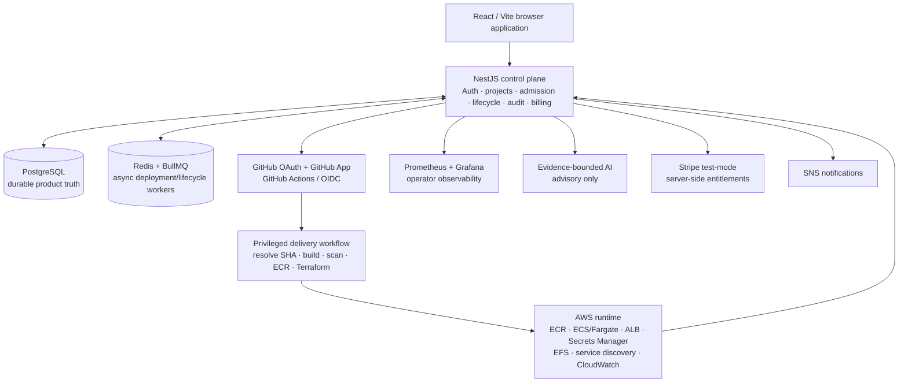
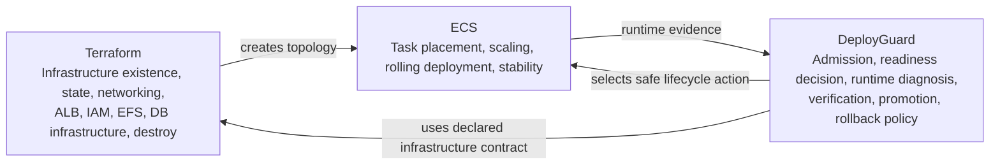
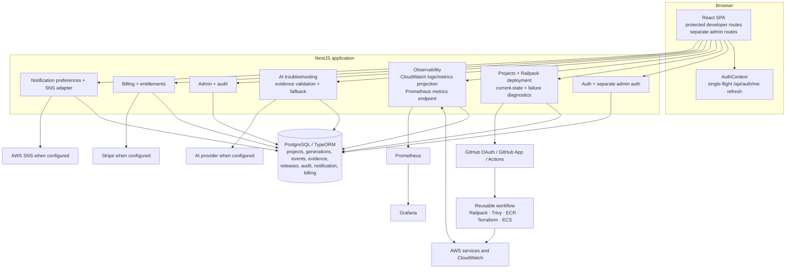
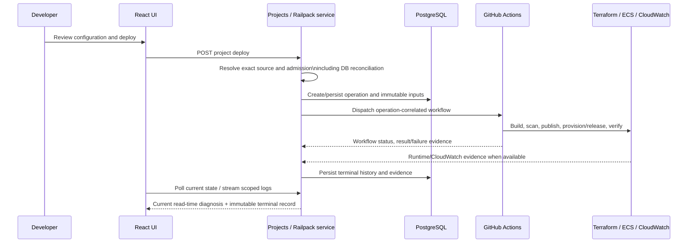

# DeployGuard FYP Modules vs. Current System

**Snapshot:** `test2` at `a571c14e9afc45bedf22ec1e4d22e136e8e3005e`

**FYP baseline:** [DeployGuard FYP-II Final Presentation Data](../DeployGuard_FYP2_Presentation_Data.md)
**Purpose:** a source-based comparison of the FYP's intended product modules with the code currently wired into the product. It is a gap map, not a new implementation plan.

## How to read this document

| Label | Meaning |
|---|---|
| **Implemented in source** | The route/module/service is wired into the current application source. This does not by itself prove a live AWS run. |
| **Partially implemented** | Important code exists, but a stated FYP boundary is not wired, not exposed, or is deliberately conservative. |
| **Intentional divergence** | The current product deliberately differs from the FYP presentation. It should not be restored accidentally. |
| **UNVERIFIED** | The source cannot prove the stated runtime behavior. Fresh local or AWS execution is required. |

The FYP presentation itself correctly separates structural verification from fresh live-cloud proof. This comparison follows the same rule: no AWS behavior below is treated as proven merely because Terraform, workflow, or API code exists.

## Executive reading

DeployGuard is substantially broader than a dashboard: the current source contains the React product, NestJS control plane, PostgreSQL records, GitHub App/OAuth integration, Railpack workflow dispatch, Terraform/ECS contracts, CloudWatch-facing observation, AI troubleshooting, notifications, billing, and administration.

The main differences from the FYP description are:

1. **Redis/BullMQ is described as an active asynchronous execution plane, but is not wired into the running product composition.** `bullmq` is installed and historical queue records exist, yet [backend/src/app.module.ts](../backend/src/app.module.ts) imports no queue module and [compose.yaml](../compose.yaml) defines no Redis service. Current deployment dispatch persists records and invokes GitHub Actions; it should not be described as an active Redis/BullMQ worker pipeline without additional wiring and proof.
2. **The FYP target ownership model is ahead of the currently certified runtime boundary.** The source has cautious direct-ECS eligibility checks, but first deploy/topology changes still use the Terraform bootstrap path when direct-ECS proof is unavailable. Several AWS cases remain explicitly UNVERIFIED.
3. **Central administrator cloud cleanup is intentionally no longer a frontend feature.** The admin cleanup page, navigation, route, and browser API client were removed. A legacy backend controller/module remains in the repository but is not imported by the root application module. Project-scoped, confirmed destroy remains part of the supported lifecycle.
4. **The recent authentication, RBAC, refresh, settings, notification, and troubleshooting changes are bounded product fixes, not a replacement of the deployment architecture.** In particular, the user session refresh is now single-flight in [AuthContext.jsx](../frontend/src/context/AuthContext.jsx), while OAuth, cookie policy, and backend session handling remain in their existing paths.

## Architecture 1 — FYP intended product architecture

This is the architecture described by FYP slides 5, 9–16, and 23–28. Dashed items are requirements that need execution evidence, not assumptions.

### Intended ownership boundary

The non-negotiable design principle is that Terraform should not silently reverse a release or scale decision made by the release controller, while the release controller should not become a second Terraform destroy engine.

## Architecture 2 — Current source-wired architecture

This diagram describes what is connected in the current root module and local product composition, rather than every historical or standalone source file.

**Deliberate omission from the current diagram:** Redis/BullMQ. The dependency exists, but no Redis container, `BullModule`, queue registration, or worker is wired into [compose.yaml](../compose.yaml) and [backend/src/app.module.ts](../backend/src/app.module.ts). It belongs in the FYP target diagram, not in a claim about the presently composed local application.

## Architecture 3 — Current deployment truth flow

The last line is important: terminal fields remain audit history; newer evidence may improve the **read-time** diagnosis only when correlation to the same failed operation can be proven. It must not rewrite the original terminal record.

## Module-by-module comparison

| FYP module / promise | What it was supposed to do | Current code status | Required difference or safe next step |
|---|---|---|---|
| **1. Web application and route model** | Present public, authentication, developer, project, billing, and admin experiences; keep operation state authoritative after refresh. | **Implemented in source.** [AppRoutes.jsx](../frontend/src/routes/AppRoutes.jsx) exposes protected project routes, developer-only `/deploy`, and a separate admin route tree. Project views include overview, pipeline, infrastructure, monitoring, settings, troubleshooting, and billing. | Keep route protection and server-authoritative state. The current UI should not be represented as deciding deployment success locally. |
| **2. Authentication and RBAC** | Support user identity, GitHub OAuth, repository access through GitHub App tokens, and a separate admin boundary; distinguish developer, read-only, and admin roles. | **Implemented in source.** [auth.controller.ts](../backend/src/auth/auth.controller.ts) handles OAuth state/callback and HTTP-only user sessions; [admin-auth.controller.ts](../backend/src/auth/admin-auth.controller.ts) uses a separate admin session. Frontend route guards enforce developer/admin access. | Recent `AuthContext` work prevents overlapping initial `/api/auth/me` refreshes and ignores stale completions. OAuth flow, RBAC policy, cookies, and backend sessions were not redesigned. Full GitHub-provider reliability remains **UNVERIFIED** without repeated real-provider testing. |
| **3. GitHub onboarding and source ingestion** | Let a user connect an App installation, choose repository/branch/service directories, resolve an exact revision, and reject ambiguous build contracts before cloud work. | **Implemented in source.** [projects.controller.ts](../backend/src/projects/projects.controller.ts), [repository-source.service.ts](../backend/src/projects/repository-source.service.ts), and build/port resolvers provide these boundaries. | Requires a valid GitHub App installation for full browser proof. An unavailable installation is an external prerequisite, not a product pass. |
| **4. Service configuration and secrets** | Keep environment values service-scoped, identify one build/start/port contract per service, attach an optional managed DB, and avoid exposing plaintext secrets. | **Implemented in source.** Project entities and [projects.module.ts](../backend/src/projects/projects.module.ts) wire config revisions, build targets, encrypted environment handling, runtime secret materialization, and managed-database admission. | The remaining work is certification of actual cloud injection and database cases, not a change to service-scoped ownership. |
| **5. Build, scan, immutable delivery** | Build the exact selected source, validate it, scan with Trivy, publish immutable ECR images, then retain source/image/config identity. | **Implemented in source / workflow contract.** [railpack-deployment.service.ts](../backend/src/projects/railpack-deployment.service.ts) seals immutable inputs and dispatches [deployguard-reusable.yml](../.github/workflows/deployguard-reusable.yml). | A workflow contract proves intended behavior, not that every repository/AWS configuration has run successfully. Keep external action/workflow pins and execute fresh AWS certification per SHA. |
| **6. Terraform, ECS, and lifecycle ownership** | Terraform owns infrastructure/state/destroy; DeployGuard owns admission, runtime decision, promotion, and rollback policy; ECS performs runtime primitives. Support deploy, release-only redeploy, exact rollback, reset-fresh, and verified destroy. | **Partially implemented.** The Railpack service has deploy/retry/reset/rollback/destroy entry points and conservative direct-ECS eligibility. First deploy/topology changes deliberately fall back to Terraform bootstrap when live topology proof is absent. | Do not claim the full target ownership split as freshly AWS-certified. The required work is bounded live certification of first deploy, direct release-only redeploy, exact rollback, topology reapply, and repeat destroy—not a new logging architecture. |
| **7. Managed databases and service-specific readiness** | Support PostgreSQL/MySQL/MongoDB contracts; admit only reconciled DB state; gate only the attached service; preserve healthy data during reset-fresh. | **Implemented in source; AWS proof incomplete.** `ManagedDatabaseReconciliationService`, `DatabaseTierService`, and the runtime Terraform contract exist. Admission states are represented in the project path. | The FYP itself lists MySQL dynamic task-network grants, MongoDB, DB-failure isolation/recovery, and related topology cases as requiring fresh AWS proof. Keep them **UNVERIFIED** until executed on the exact revision. |
| **8. Durable data, identities, and audit** | Persist Project → Service → Build Target/Runtime Config Revision → Generation → Stable Release plus events, evidence, and audited actions. | **Implemented in source.** [app.module.ts](../backend/src/app.module.ts) registers the TypeORM entities and imports audit/project modules; generation and stable-release entities are present. | PostgreSQL is the durable product record. Do not substitute browser state, raw GitHub status, or a queue record for this source of truth. |
| **9. Redis/BullMQ async workers** | Use Redis/BullMQ queues for deployment, lifecycle, and emergency-cleanup work with retry/backoff while PostgreSQL stays authoritative. | **Not currently wired into the composed product.** `bullmq` is installed and historical queue-related records remain, but no Redis service exists in [compose.yaml](../compose.yaml), and no `BullModule`/worker registration is imported by [app.module.ts](../backend/src/app.module.ts). | This is a genuine FYP-to-code architecture gap. Either wire and test the queue/worker plane, or revise the FYP documentation to state that current long-running execution uses GitHub Actions plus persisted reconciliation rather than active BullMQ workers. Do not describe it as live today. |
| **10. Current state, pipeline, and release presentation** | Show current attempt separately from stable release; expose valid recovery actions only; remain correct through refresh/reconnect. | **Implemented in source.** [ProjectPipeline.jsx](../frontend/src/pages/ProjectPipeline.jsx), project current-state services, and the Railpack reconciliation path expose persisted operation state. | Maintain the distinction between an attempted generation and a verified stable release. Browser refresh must only re-read backend truth. |
| **11. CloudWatch, Prometheus, Grafana, and logs** | Show cloud runtime metrics/logs, stream sanitized logs, and provide control-plane metrics/dashboards. | **Implemented in source / configuration.** [observability.module.ts](../backend/src/observability/observability.module.ts) wires CloudWatch and Prometheus-facing services; [compose.yaml](../compose.yaml) starts Prometheus and Grafana. | CloudWatch data needs a valid AWS runtime and credentials. Do not add OpenTelemetry/OpenObserve merely to close this comparison; those are outside the current intended architecture. |
| **12. Evidence-grounded AI troubleshooting** | Send bounded/redacted evidence to an AI provider; validate cited evidence/schema; keep AI advisory; use deterministic fallback when provider output is invalid or unavailable. | **Implemented in source.** [ai-troubleshooting.service.ts](../backend/src/ai-troubleshooting/ai-troubleshooting.service.ts) and evidence preprocessing enforce bounded evidence; the current changes reject zero valid references, invented root-cause codes, and AI `SAFE_NOW` where deterministic ownership is `UNVERIFIED`. | Continue to require operation correlation and valid evidence references for both live AI and fallback output. AI must never overwrite terminal ownership/retry authority or trigger deployment actions. |
| **13. Failure diagnosis and recovery** | Persist stage, deterministic code, owner, service scope, cause, evidence, and safe retry guidance; never guess when evidence is ambiguous. | **Implemented in source, with recent targeted hardening.** [failure-diagnostic.service.ts](../backend/src/projects/failure-diagnostics/failure-diagnostic.service.ts) provides current/read-time diagnosis, while terminal pipeline fields remain audit history. | Classification may improve at read time only from provably operation-correlated later evidence. If correlation is uncertain, result remains `UNVERIFIED`; do not mutate the persisted terminal diagnosis. |
| **14. Notifications** | Store preferences/subscriptions/delivery outcomes and publish operational notifications through SNS when configured. | **Implemented in source; provider delivery UNVERIFIED.** [notifications.module.ts](../backend/src/notifications/notifications.module.ts) wires a dispatcher, preference records, and SNS adapter; settings UI exposes project notification configuration. | Keep the adapter/configuration optional and state provider delivery only when live credentials/configuration prove it. |
| **15. FinOps and billing** | Estimate infrastructure cost for admission; separately manage test-mode subscription, entitlements, checkout, invoices, and signed billing events. | **Implemented in source / configuration.** [billing.module.ts](../backend/src/billing/billing.module.ts) contains billing/entitlement services and [finops](../backend/src/finops) contains cost-related services. | Stripe remains test-mode/conditional. Cost estimates are decision support, not a claim of exact AWS billing. Live provider/webhook proof is separate. |
| **16. Administration and audit** | Give administrators fleet readiness, users/roles, projects, and sanitized audit data behind a separate login. | **Implemented in source.** [AdminUsers.jsx](../frontend/src/pages/AdminUsers.jsx) provides overview/users/projects/audit tabs and [admin.controller.ts](../backend/src/admin/admin.controller.ts) supplies the API. | Retain the separate admin session and role checks. Do not merge ordinary developer access into platform-wide administration. |
| **17. Central cloud cleanup** | The FYP originally included emergency central cleanup in the administrator scope. | **Intentional divergence.** The frontend cleanup page, route, navigation item, and client calls were removed. A legacy backend cleanup controller/module remains on disk but the root [app.module.ts](../backend/src/app.module.ts) does not import that module. Project-scoped destroy is still supported through the normal lifecycle. | Do **not** re-add the frontend cleanup surface. If full removal is desired, make a separate, audited decision to retire the unreachable backend module after confirming no supported caller depends on it. This comparison does not authorize that deletion. |
| **18. Portable local product setup** | Run PostgreSQL, migrations, backend, frontend, Prometheus, and Grafana with health/dependency ordering and persistent volumes. | **Implemented in source.** [compose.yaml](../compose.yaml) defines these services, health checks, and named volumes. | This composition does not include Redis, reinforcing the queue/worker gap above. Local container health is not AWS lifecycle certification. |

## What is already different by design (do not accidentally undo it)

1. **No central cloud-cleanup UI.** The user asked for it removed. Keep project-scoped destroy; do not restore `/admin/cleanup` or an admin navigation tab.
2. **AI is advisory only.** It cannot decide a retry, promote a release, change failure ownership, or invent evidence.
3. **`UNVERIFIED` is a correct outcome.** It is safer than guessing a repository, platform, or provider owner.
4. **Terminal failure fields are immutable history.** Read-time diagnostics may become more informative only through safely correlated evidence.
5. **OAuth and RBAC boundaries remain separate.** The session-refresh race fix changes frontend request coordination, not OAuth, cookie policy, or role authority.
6. **Project-scoped destroy remains.** Removing central cleanup did not remove the ordinary deployment lifecycle destroy path.

## Certification boundary: what cannot be claimed yet

The following statements need fresh execution evidence on the exact commit before they are called live passes:

- MySQL dynamic task-network grant reconciliation;
- MongoDB runtime path;
- database-failure isolation and recovery;
- topology reapply preserving an active release/task definition;
- repeat-destroy idempotency;
- any GitHub/AWS/SNS/Stripe provider behavior not exercised with valid external configuration;
- the intermittent GitHub OAuth symptom beyond the locally verified single-flight frontend refresh behavior.

The current product should therefore describe these as **UNVERIFIED**, **external prerequisite**, or **structural contract present**, as appropriate—not as completed live-cloud certification.

## Smallest priority order if full FYP alignment is desired

This is a comparison-driven order, not a request to redesign the system:

1. Decide whether Redis/BullMQ is a genuine release requirement. If yes, add the smallest queue/worker wiring with durable idempotent reconciliation and tests; if no, correct the FYP architecture/documentation so it no longer claims an active queue plane.
2. Run exact-SHA AWS certification for the explicitly unverified database/lifecycle scenarios before changing the Terraform/ECS authority model further.
3. Keep AI/failure-evidence enforcement isolated and continue adding regression tests around only proven evidence correlation.
4. Leave central cleanup removed from the frontend. Retire its dormant backend code only as a separate, scoped cleanup task if the product decision is permanent.

## Evidence used for this comparison

- FYP intent: [DeployGuard_FYP2_Presentation_Data.md](../DeployGuard_FYP2_Presentation_Data.md), especially slides 3–7, 9–29.
- Product intent and current known limits: [PRODUCT.md](../PRODUCT.md).
- Application composition: [backend/src/app.module.ts](../backend/src/app.module.ts) and [compose.yaml](../compose.yaml).
- Frontend surface and guards: [frontend/src/routes/AppRoutes.jsx](../frontend/src/routes/AppRoutes.jsx) and [frontend/src/context/AuthContext.jsx](../frontend/src/context/AuthContext.jsx).
- Deployment, state, and failure authority: [backend/src/projects/projects.module.ts](../backend/src/projects/projects.module.ts), [backend/src/projects/railpack-deployment.service.ts](../backend/src/projects/railpack-deployment.service.ts), and [backend/src/projects/failure-diagnostics/failure-diagnostic.service.ts](../backend/src/projects/failure-diagnostics/failure-diagnostic.service.ts).
- Observation, notifications, and billing modules: [backend/src/observability/observability.module.ts](../backend/src/observability/observability.module.ts), [backend/src/notifications/notifications.module.ts](../backend/src/notifications/notifications.module.ts), and [backend/src/billing/billing.module.ts](../backend/src/billing/billing.module.ts).
